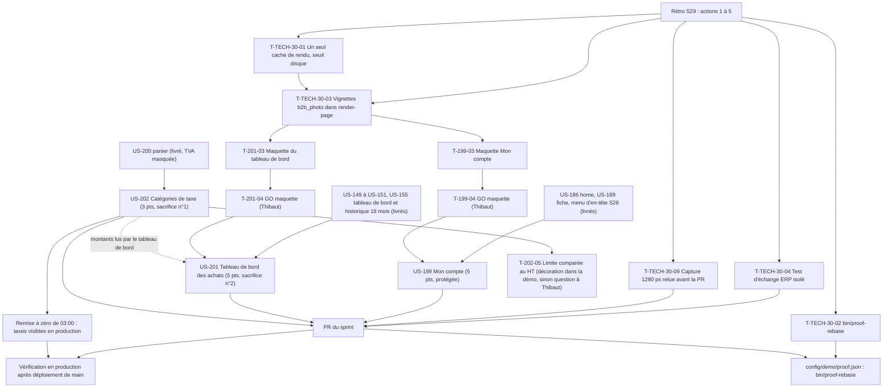

# Dépendances : Sprint 030 (compte, tableau de bord et TVA)

> Périmètre décidé par Thibaut le 2026-10-25 (13 points engagés). Les dépendances ci-dessous portent sur les stories ; le détail des tâches est dans chaque fichier `tasks/US-XXX-tasks.md`. Sources : [sprint-goal.md](./sprint-goal.md), [tasks/README.md](./tasks/README.md).

## Lecture

| Dépendance | Nature | Conséquence |
|------------|--------|-------------|
| T-TECH-30-01 et 03 avant T-199-03 et T-201-03 | Actions 1 et 2 de la rétro du sprint 29 | Un seul cache de rendu et des vignettes réelles avant la première capture de maquette |
| T-199-04 avant T-199-05 | Porte de Thibaut | **Aucun Twig du compte avant le GO de la maquette** ; tâches de code 📅 |
| T-201-04 avant T-201-05 | Porte de Thibaut | **Aucun Twig du tableau de bord avant le GO de la maquette** ; tâches de code 📅 |
| T-202-01 avant T-202-05 | Décision de Thibaut (HT) et constat du planning | Le plugin compare le total TTC : décoration dans la démo, sinon question à Thibaut avant tout code |
| US-202 avant les captures finales d'US-201 | Montants partagés | Le tableau de bord lit les montants des commandes : US-202 mergée d'abord, ou décision « HT » notée au registre |
| T-TECH-30-02 avant la première PR | Action 1 | `bin/proof-rebase` ; PR fusionnées en série |
| T-TECH-30-04 avant la première suite complète | Action 5 | La suite complète passe après un chargement de fixtures local |
| Remise à zéro de 03:00 avant T-202-08 | Règle 16 (la base survit aux déploiements) | Les taxes ne sont visibles en production qu'après la remise à zéro suivante ; contrôle le lendemain du déploiement |

## Chemin critique

La file la plus longue est celle d'US-199, puis celle d'US-201 : T-TECH-30-01 (1,25 h) → T-TECH-30-03 (0,75 h) → T-199-03 (2 h) → T-199-04 (Thibaut) → T-199-05 (1 h) → T-199-06 (3 h) → T-199-07 (0,5 h) → T-199-08 (0,75 h) → T-199-09 (0,5 h) → T-TECH-30-09 (0,5 h) → merge → T-199-10 (0,5 h) → T-199-11 (0,5 h). Environ 11 h de Claude et une attente de Thibaut. Les deux maquettes sont faites l'une après l'autre par l'orchestrateur (4 h) ; pendant ce temps, w202 livre US-202 (sans maquette) et w199, w201 font cadrage et état « avant ».
