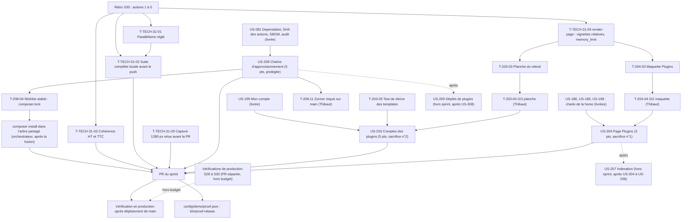

# Dépendances : Sprint 031 (chaîne d'approvisionnement, comptes des plugins et page Plugins)

> Périmètre décidé par Thibaut le 2026-10-27 (13 points engagés). Les dépendances ci-dessous portent sur les stories ; le détail des tâches est dans chaque fichier `tasks/US-XXX-tasks.md`. Sources : [sprint-goal.md](./sprint-goal.md), [tasks/README.md](./tasks/README.md).

## Lecture

| Dépendance | Nature | Conséquence |
|------------|--------|-------------|
| T-TECH-31-04 avant T-203-03 et T-204-03 | Action 4 de la rétro du sprint 30 | Vignettes réelles (URL relatives comprises) avant la première capture ou maquette |
| T-TECH-31-01 avant le lancement des workers | Action 1 | Parallélisme réglé : au plus 2 workers qui lancent des tests au-delà de 2 Go de swap ou sous 7 Go de disque |
| T-203-04 avant T-203-09 et T-203-10 | Porte de Thibaut | **Aucun Twig du relevé avant le GO de la planche** ; le reste d'US-203 (devis, assistants IA, consentement) n'attend pas |
| T-204-04 avant T-204-05 | Porte de Thibaut | **Aucun Twig de la page « Plugins » avant le GO de la maquette** ; tâches 📅 |
| T-203-05 avant T-203-07 | Garde | Le test de dérive est posé avant les surcharges |
| US-208 avant l'intégration des autres stories | Fichiers communs | `composer.lock` et workflows : intégrés d'abord ; `composer install` dans l'arbre partagé **seulement après la fusion** |
| T-208-06 avant T-208-11 | Porte de Thibaut | Le job zizmor est requis sur `main` une fois vert |
| T-TECH-31-02 avant le push de la PR | Action 2 | Suite complète locale, ou attente explicite dite dans la PR |
| US-208 avant US-209 ; US-204 à US-206 avant US-207 | Décision de Thibaut du 2026-10-27 | Hors sprint |
| Vérifications de production S28 à S30 | Registre du 2026-10-27 | Parallèles, PR séparée, hors budget |

## Chemin critique

La file la plus longue est celle d'US-203 : T-TECH-31-04 (0,75 h) → T-203-03 (1,25 h) → T-203-04 (Thibaut) → T-203-09 (0,25 h) → T-203-10 (1,25 h) → T-203-12 (0,75 h) → T-203-13 (0,5 h) → T-TECH-31-09 (0,5 h) → merge → T-203-14 (0,5 h) → T-203-15 (0,25 h), soit environ 6 h de Claude et une attente de Thibaut ; elle est parallèle aux surcharges des devis et des assistants IA (T-203-05 à T-203-08, environ 4 h). La file d'US-204 suit : T-204-03 (1,25 h) → GO → T-204-05 à T-204-09 (3,75 h). US-208 (9,25 h de Claude, sans porte hormis T-208-11) est le travail le plus long en heures et avance dès le planning.
