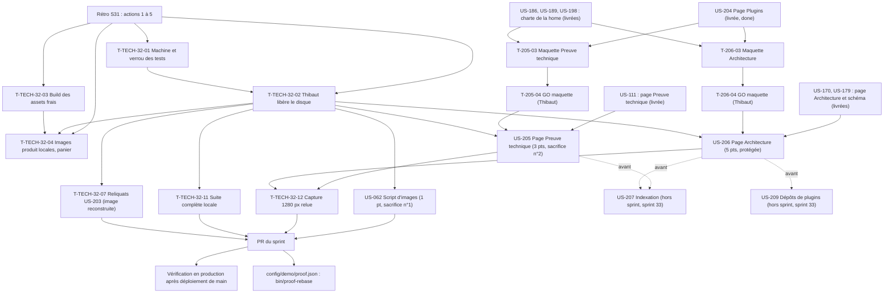

# Dépendances : Sprint 032 (preuve technique, architecture et script d'images)

> Périmètre décidé par Thibaut le 2026-10-28 (9 points engagés). Les dépendances ci-dessous portent sur les stories ; le détail des tâches est dans chaque fichier `tasks/US-XXX-tasks.md`. Sources : [sprint-goal.md](./sprint-goal.md), [tasks/README.md](./tasks/README.md).

## Lecture

| Dépendance | Nature | Conséquence |
|------------|--------|-------------|
| T-TECH-32-01 et T-TECH-32-02 avant les tests des workers | Action 1 de la rétro du sprint 31 | `bin/check-disk` annonce les runs autorisés ; le disque est libéré par Thibaut ; **aucun test ni rendu local sous 5 Go** : les tâches de test et de rendu d'US-205, US-206 et US-062 sont 📅 « disque » |
| T-TECH-32-03 avant la première capture | Action 2 | `public/build` frais avant toute capture ou rendu ; aucune compilation du SCSS à part |
| T-TECH-32-04 après T-TECH-32-02 et 03 | Action 3 | Images produit locales avant la capture du panier ; négociable |
| T-205-04 avant T-205-05 à T-205-11 | Porte de Thibaut | **Aucun Twig de la page « Preuve technique » avant le GO de la maquette** ; tâches 📅 |
| T-206-04 avant T-206-05 à T-206-12 | Porte de Thibaut | **Aucun Twig de la page « Architecture » avant le GO de la maquette** ; tâches 📅 |
| T-205-05 avant T-205-06 ; T-206-05 avant T-206-06 | Test rouge d'abord | Commit de tests rouges seul, cité dans la PR |
| T-206-06 avant T-206-07 | Coquille puis sections | Le sommaire d'ancres et le schéma d'abord, les quatre autres sections ensuite |
| T-TECH-32-07 après T-TECH-32-02 | Reliquat du sprint 31 | Image reconstruite : demande de la place ; US-203 passe en done ensuite |
| T-TECH-32-11 avant le push de la PR | Action 1 (DoD) | Suite complète locale, ou attente explicite dite dans la PR |
| T-TECH-32-12 avant la PR | Règle 23 | Capture à 1280 px relue (rendu local, ou production si le disque l'interdit) |
| US-205 et US-206 avant US-207 ; US-206 avant US-209 | Décision de Thibaut du 2026-10-28 | Hors sprint (sprint 33) |

## Chemin critique

La file la plus longue est celle d'US-206 : T-206-01 (0,75 h) → T-206-03 (2 h, orchestrateur) → T-206-04 (Thibaut) → T-206-05 (1 h) → T-206-06 (2,25 h) → T-206-07 (1,75 h) → T-206-08 (0,5 h) → T-206-09 (0,75 h, disque) → T-206-10 (0,5 h, disque) → T-TECH-32-12 (0,5 h) → merge → T-206-11 (0,5 h) → T-206-12 (0,25 h), soit environ 11 h de Claude et une attente de Thibaut. La file d'US-205 suit : T-205-03 (1,25 h) → GO → T-205-05 à T-205-09 (3,75 h) → merge → T-205-10 et T-205-11 (0,75 h). US-062 (2 h, sans porte) avance dès le planning. Le disque est la contrainte commune : T-205-08, T-206-09, les captures et la suite complète ne démarrent pas sous 5 Go.
