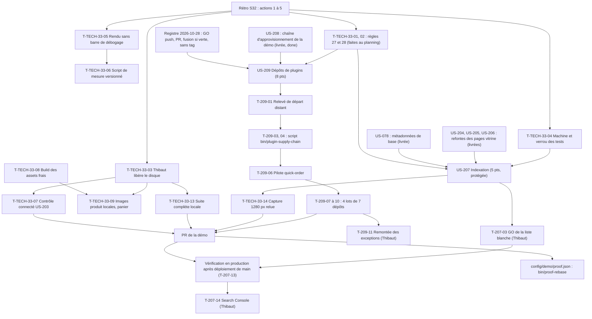

# Dépendances : Sprint 033 (indexation des pages vitrine et dépôts de plugins)

> Périmètre décidé par Thibaut le 2026-10-28 (13 points engagés). Les dépendances ci-dessous portent sur les stories ; le détail des tâches est dans chaque fichier `tasks/US-XXX-tasks.md`. Sources : [sprint-goal.md](./sprint-goal.md), [tasks/README.md](./tasks/README.md).

## Lecture

| Dépendance | Nature | Conséquence |
|------------|--------|-------------|
| T-TECH-33-01 et 02 avant tout test rouge | Actions 1 et 2 de la rétro du sprint 32 | Règle 27 (l'échec observé est cité dans le commit des tests rouges) et règle 28 (table des invariants de test au cadrage) appliquées dès le premier cadrage ; faites au planning |
| T-TECH-33-03 et 04 avant les tests des workers | Action 3 | `bin/check-disk` annonce les runs autorisés ; le disque est libéré par Thibaut ; **aucun test ni rendu local sous 5 Go** : les tâches de test et de rendu d'US-207 (T-207-02, 11, 12) sont 📅 « disque » ; le rouge n'est « prouvé » qu'avec une exécution |
| T-TECH-33-05 avant T-TECH-33-06 et avant la première capture | Action 4 | Rendu sans barre de débogage, puis script de mesure versionné ; aucune retouche manuelle |
| T-TECH-33-08 avant la première capture ; avant T-TECH-33-09 | Reliquat de T-TECH-32-03 | `public/build` frais avant toute capture ou rendu ; aucune compilation du SCSS à part |
| T-TECH-33-09 après T-TECH-33-03 et 08 | Reliquat de T-TECH-32-04 | Images produit locales avant la capture du panier ; négociable |
| T-207-01 avant T-207-04 | Règle 28 | Table des invariants confirmée et confrontée au périmètre avant le premier test rouge |
| T-207-04 avant T-207-05 à 08 | Test rouge d'abord (règle 27) | Commit de tests rouges seul, avec les échecs observés, cité dans la PR |
| T-207-05 avant T-207-06, 07, 09 | Liste blanche d'abord | Une seule liste, lue par `NoIndexSubscriber`, `RobotsController` et le sitemap ; les tests existants sont adaptés ensuite, une ligne de registre avant chaque modification |
| T-207-03 (GO de Thibaut) avant d'**activer** l'indexation en production | Porte de Thibaut | Le code et les tests s'écrivent avant, réglage désactivé par défaut ; GO noté au registre avant l'activation (T-207-13) |
| T-207-13 avant T-207-14 | Décision du 2026-10-28 | Thibaut déclare le sitemap après le déploiement ; Claude fournit l'URL et les étapes |
| US-208 avant US-209 | Dépendance de la fiche | Les scripts `bin/check-pinned-refs` et `bin/check-lock-diff` et le gabarit de workflow sont repris, jamais copiés |
| T-209-01 avant T-209-02 | Relevé de départ distant | Le relevé (branches par défaut distantes, pas copies locales) fixe l'état de départ et les versions de Composer des CI |
| T-209-03 avant T-209-04 | Tranche (a) avant (b) | Le sacrifice n°1 (tranche (b)) peut être appliqué sans défaire la tranche (a) |
| T-209-06 (pilote) avant T-209-07 à 10 | Validation du script | Sa CI verte valide le script, la version de Composer qui lit `config.policy` et les SHA avant les lots |
| T-209-07 à 10 en série | Procédure par lot | Un lot à la fois : règle 29 (`git fetch`, branche), `apply`, `check`, PR, CI, fusion si verte ; les exceptions vont à T-209-11 |
| T-209-11 avant toute action sur un dépôt en exception | Registre | Décision de Thibaut notée avant d'agir ; la PR reste ouverte |
| T-TECH-33-13 avant le push de la PR de la démo | Action 3 (DoD) | Suite complète locale, ou attente explicite dite dans la PR |
| T-TECH-33-14 avant la PR | Règle 23 | Capture à 1280 px relue (rendu local, ou production si le disque l'interdit) |

## Chemin critique

La file la plus longue est celle d'US-209, mais elle ne demande presque pas de disque : T-209-01 (1,5 h) → T-209-02 (1,5 h) → T-209-03 (2,5 h) → T-209-04 (2 h) → T-209-06 (1,5 h, pilote) → T-209-07 à 10 (4 h, quatre lots en série) → T-209-12 (1 h) → T-209-13 (0,75 h) → T-209-15 (0,5 h), soit environ 15,25 h de Claude, plus l'attente des CI des 29 dépôts. La file d'US-207 suit : T-207-01 (0,75 h) → T-207-04 (1,25 h) → T-207-05 (1,25 h) → T-207-06 et 07 (2 h) → T-207-08 (0,75 h) → T-207-09 (0,5 h) → T-207-10 (0,75 h) → T-207-11 (0,75 h, disque) → T-TECH-33-14 → merge → T-207-13 (0,75 h, production) → T-207-14 (Thibaut) → T-207-15, soit environ 9,5 h de Claude et deux attentes de Thibaut (GO de la liste blanche, Search Console). Le disque est la contrainte commune des tests : T-207-11, les captures et la suite complète ne démarrent pas sous 5 Go.
