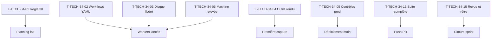

# Tâches transverses : Sprint 034

## Récapitulatif

| Tâches | Estimation | Réalisée |
|--------|------------|----------|
| Actions de rétro T-TECH-34-01 à 05, reliquats T-TECH-33 | 1 h | _à remplir_ |

## Dépendances

## Tâches

| ID | Type | Tâche | Estimation | Réalisé | Statut |
|----|------|-------|------------|---------|--------|
| T-TECH-34-01 | DOC | **Règle 30** de la consigne de worker (action 1 de la rétro S33) : toute règle d'exécution d'un GO est transmise au worker concerné avant ou en même temps que son inscription au registre ; un GO donné à l'orchestrateur ne se délègue au worker que par une phrase explicite ; écrite au planning | 0 h | | ✅ |
| T-TECH-34-02 | OPS | **Workflows YAML validés** (action 2 de la rétro S33) : ajouter à la checklist et au script une validation par analyseur YAML de tout workflow modifié, et la vérification qu'au moins un job a tourné avant la fusion ; testé sur un workflow volontairement invalide | 0,25 h | | 🔲 |
| T-TECH-34-03 | OPS | **Disque et rouge prouvé** (action 3 de la rétro S33) : 📅 Thibaut libère le disque (cible 10 Go libres, commande en chemins absolus précédée d'un `du -sh`) ; `bin/check-disk` annonce le nombre de runs autorisés et `bin/run-tests` met en file d'attente derrière le verrou ; reprise de T-TECH-33-03 et T-TECH-33-04 | 0,25 h | | 📅 |
| T-TECH-34-04 | OPS | **Outils de rendu et de build** (action 4 de la rétro S33) : reprendre T-TECH-33-05, T-TECH-33-06 et T-TECH-33-08 : rendu sans barre de débogage, script de mesure à 320 et 375 px versionné, avertissement de `public/build` périmé | 0,25 h | | 🔲 |
| T-TECH-34-05 | OPS | **Contrôles de production et reliquats** (action 5 de la rétro S33) : vérifications de production d'US-207 **faites le 2026-10-28** (PR #131, `DEMO_INDEXING=1` posé par Thibaut, Search Console déclarée) ; reste la reprise de T-TECH-33-07 (contrôle connecté d'US-203) et T-TECH-33-09 (capture du panier) si le disque le permet | 0 h | | 📅 |
| T-TECH-34-06 | OPS | **Disque et machine** : relevés (`df -h .`, mémoire libre, swap) avant le premier lot ; aucun test sous 5 Go, aucune suite complète sous 6 Go, au plus deux workers qui testent en même temps (règle 24) | 0 h | | 🔲 |
| T-TECH-34-10 | REV | Tenue du registre des décisions et des GO, règles 26, 28 et 30 appliquées | 0 h | | 🔲 |
| T-TECH-34-12 | OPS | ECS, PHPStan max (dépôt entier) et Rector rejoués avant chaque push ; CI verte avant le merge | 0 h | | 🔲 |
| T-TECH-34-13 | TEST | **Suite complète locale avant le push de la PR de sprint**, ou attente explicite dite dans la PR (règle, reprise de T-TECH-33-13) | 0,25 h | | 📅 |
| T-TECH-34-15 | DOC | Revue et rétrospective du sprint 34, puis clôture | 0 h | | 🔲 |

**Total** : 1 h (dont 0,5 h de Thibaut)

## Actions de Thibaut

- T-TECH-34-03 : Libérer le disque (cible 10 Go libres, commande en chemins absolus précédée d'un `du -sh` fournie par l'orchestrateur) avant le lancement des workers.
- T-TECH-34-05 : Poser le réglage `DEMO_INDEXING=1` en production après le déploiement de `main`.

## Rapport de fin (gabarit)

### Actions de rétro du sprint 33

- [ ] Action 1 (T-TECH-34-01) : Règle 30 écrite au planning.
- [ ] Action 2 (T-TECH-34-02) : Workflows YAML validés par analyseur, vérification job exécuté.
- [ ] Action 3 (T-TECH-34-03) : Disque libéré par Thibaut, scripts de tests en file d'attente.
- [ ] Action 4 (T-TECH-34-04) : Rendu sans barre de débogage, script de mesure, avertissement de build périmé.
- [ ] Action 5 (T-TECH-34-05) : Contrôles de production d'US-207 après déploiement, reliquats T-TECH-33-07 et -09.

### Preuves de qualité

PHPStan, ECS, Rector, lints : **commandes et dernières lignes de sortie** ou « non exécuté » avec raison (spike sans code).

### Points d'attention

- Règle 30 appliquée : 0 action à fort effet exécutée par un acteur autre que celui du registre.
- Workflows validés : 0 PR de workflow fusionnée sans job exécuté.
- Disque et rouge prouvé : au moins 10 Go libres au lancement, 0 commit de tests rouges sans échec cité.
