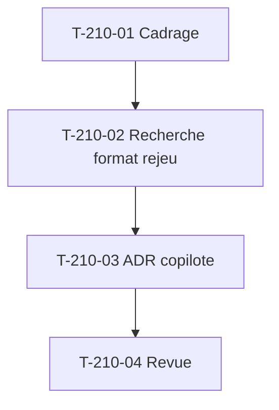

# Tâches : US-210 — Spike copilote d'achat

## Récapitulatif

| Story | Points | Worker | Estimation | Réalisée |
|-------|--------|--------|------------|----------|
| [US-210](../../backlog/user-stories/US-210.md) | 3 | w210 | 6,5 h | 6 h |

## Dépendances

## Tâches

| ID | Type | Tâche | Estimation | Réalisé | Statut |
|----|------|-------|------------|---------|--------|
| T-210-01 | DOC | Cadrage : timebox 6 h, accès à la documentation b2b-mcp, tier-pricing, purchase-approval, Sylius Plus | 0,5 h | 0,5 h | ✅ |
| T-210-02 | DOC | Recherche : format de rejeu (fichier versionné, clé de correspondance, comportement sans réponse enregistrée), adaptateur LLM (interface minimale, adaptateur rejoué, adaptateur réel), outils exposés (inventaire b2b-mcp réutilisables, interdits), recoupement Sylius Plus ; timebox 6 h | 5,5 h | 5 h | ✅ |
| T-210-03 | DOC | ADR `docs/adr/0018-copilote-format-rejeu-adaptateur.md` : format de rejeu, port et adaptateurs, outils autorisés et interdits, conclusion Sylius Plus, note privée de sécurité hors dépôt | 0,25 h | 0,5 h | ✅ |
| T-210-04 | REV | Revue (aucun détail sensible dans l'ADR public, ton neutre) et relecture par Thibaut ; estimation d'US-211 à US-216 confirmée ou révisée | 0,25 h | | 🔲 |

**Total** : 6,5 h

## Scénarios Gherkin → Tests ou preuves

| Scénario | Type | Test ou preuve |
|----------|------|----------------|
| Spike mené à terme (nominal) | nominal | T-210-03 : ADR `0018-*` relu par Thibaut, tranche les 4 points (format, adaptateurs, outils, Sylius Plus) |
| Aucune réponse enregistrée (alternatif) | alternatif | T-210-03 : ADR documente le comportement de repli (message « scénario non enregistré », jamais d'appel LLM) |
| Recoupement avéré avec Sylius Plus (alternatif) | alternatif | T-210-03 : ADR consigne la conclusion, décision portée à Thibaut, plugin public mais non promu |
| Timebox dépassé (erreur) | erreur | T-210-02 : timebox 6 h stricte, arrêt avec points ouverts à arbitrer si le plafond est atteint |
| Détail sensible dans l'ADR public (erreur) | erreur | T-210-04 : revue dédiée, ADR factuel et neutre, détails dans la note privée |

## Rapport de fin (gabarit)

### Scénarios validés

- [ ] 1 nominal, 2 alternatifs, 2 erreurs (US-210 : 1+2+2)

### Livrables

- [ ] `docs/adr/0018-copilote-format-rejeu-adaptateur.md` relu par Thibaut
- [ ] Note privée de sécurité hors dépôt public (chemin communiqué à Thibaut)
- [ ] Estimations d'US-211 à US-216 confirmées ou révisées

### Preuves de qualité

PHPStan, ECS, Rector, lints : **aucune commande** (spike sans code).

### Points d'attention

- Timebox 6 h stricte, arrêt avec points ouverts si dépassé.
- Aucun détail de sécurité (garde-fous, seuils, liste des outils interdits) dans l'ADR public.
- Ton neutre, pas de comparaison avec Sylius Plus.
