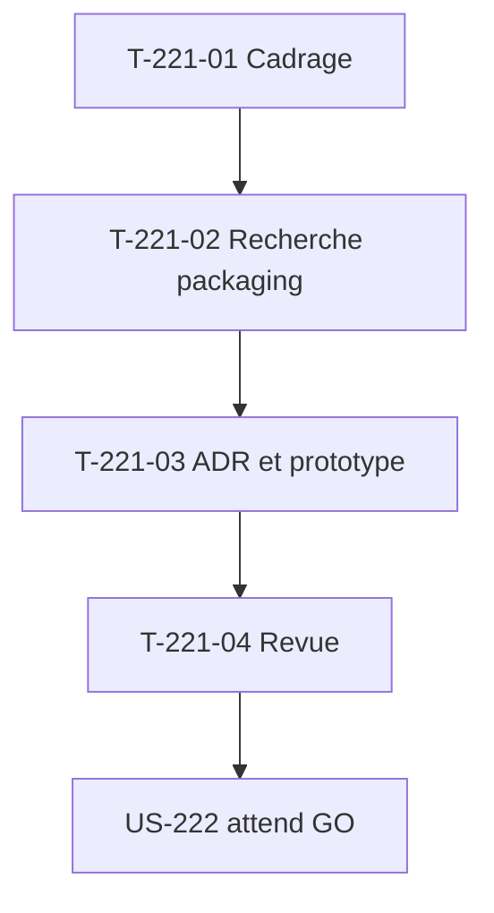

# Tâches : US-221 — Spike packaging d'un thème Sylius 2

## Récapitulatif

| Story | Points | Worker | Estimation | Réalisée |
|-------|--------|--------|------------|----------|
| [US-221](../../backlog/user-stories/US-221.md) | 3 | w221 | 6,5 h | _à remplir_ |

## Dépendances

## Tâches

| ID | Type | Tâche | Estimation | Réalisé | Statut |
|----|------|-------|------------|---------|--------|
| T-221-01 | DOC | Cadrage : timebox 6 h, projet vierge Sylius 2.3, accès à la documentation Sylius 2, Flex, maquettes G2StRQigRKD6SqNRoyHpkW | 0,5 h | 0,5 h | ✅ |
| T-221-02 | OPS | Recherche : bundle de thème Sylius 2 vs paquet de gabarits, Twig hooks et surcharges, assets (Asset Mapper ou Encore, Stimulus), recette Flex, compatibilité Sylius 2.2/2.3, recoupement Sylius Plus ; timebox 6 h | 5,5 h | 4,5 h | ✅ |
| T-221-03 | DOC | ADR `docs/adr/0019-packaging-theme-sylius2.md` : approche retenue, prototype minimal (une page) installé dans un projet vierge, ordre de priorité des surcharges, conclusion Sylius Plus ; **GO de Thibaut avant US-222** | 0,25 h | 1 h | ✅ |
| T-221-04 | REV | Revue (ton neutre, aucun détail sensible) et relecture par Thibaut ; estimation d'US-222 à US-228 confirmée ou révisée | 0,25 h | | 📅 |

**Total** : 6,5 h

## Scénarios Gherkin → Tests ou preuves

| Scénario | Type | Test ou preuve |
|----------|------|----------------|
| Prototype installé (nominal) | nominal | T-221-02 : prototype installé dans un projet Sylius 2.3 vierge, une page affiche le style du thème sans autre manipulation |
| Sylius 2.2 (alternatif) | alternatif | T-221-02 : prototype testé sur Sylius 2.2, fonctionne ou écart consigné dans l'ADR |
| Assets (alternatif) | alternatif | T-221-03 : ADR décrit la méthode retenue (Asset Mapper ou Encore) avec ses commandes |
| Surcharge qui entre en conflit (erreur) | erreur | T-221-03 : ordre de priorité documenté et testé sur un projet qui surcharge déjà un gabarit du thème |
| Timebox dépassé (erreur) | erreur | T-221-02 : timebox 6 h stricte, arrêt avec points ouverts à arbitrer si le plafond est atteint |

## Rapport de fin (gabarit)

### Scénarios validés

- [ ] 1 nominal, 2 alternatifs, 2 erreurs (US-221 : 1+2+2)

### Livrables

- [ ] `docs/adr/0019-packaging-theme-sylius2.md` relu par Thibaut
- [ ] Prototype minimal conservé ou jeté selon l'ADR
- [ ] Estimations d'US-222 à US-228 confirmées ou révisées
- [ ] **GO de Thibaut sur l'ADR avant de lancer US-222**

### Preuves de qualité

PHPStan, ECS, Rector, lints : **aucune commande** (spike sans code dans la démo, prototype jetable).

### Points d'attention

- Timebox 6 h stricte, arrêt avec points ouverts si dépassé.
- **US-222 ne démarre qu'après le GO de Thibaut sur cet ADR** (décision du 2026-10-28).
- Ton neutre, pas de comparaison avec Sylius Plus.
