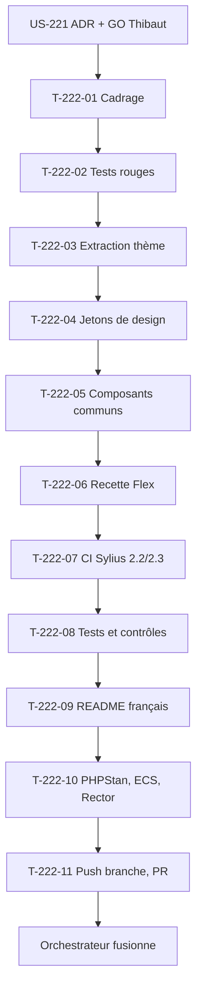

# Tâches : US-222 — Thème Industrie & Négoce tranche 1

## Récapitulatif

| Story | Points | Worker | Estimation | Réalisée |
|-------|--------|--------|------------|----------|
| [US-222](../../backlog/user-stories/US-222.md) | 5 | w222 | 12 h | _à remplir_ |

## Dépendances

**Note** : L'orchestrateur crée le dépôt public `tmonier/sylius-industry-trade-theme` sur GO de Thibaut ; le worker pousse sa branche et ouvre la PR ; l'orchestrateur fusionne CI verte. Aucun tag ni release (règle 30).

## Tâches

| ID | Type | Tâche | Estimation | Réalisé | Statut |
|----|------|-------|------------|---------|--------|
| T-222-01 | DOC | Cadrage et **table des invariants de test** (règle 28) : thème de la démo (EPIC-03, refontes), maquettes G2StRQigRKD6SqNRoyHpkW, approche d'US-221, tests existants touchés (aucun normalement, extraction sans modifier la démo) | 1 h | | 🔲 |
| T-222-02 | TEST | Tests rouges, **rouge prouvé (règle 27)**, commités seuls : paquet installable, jetons rendus, composants communs, contrastes AAA, Sylius 2.2 et 2.3 | 1,5 h | | 🔲 |
| T-222-03 | BE | Extraction du thème de la démo vers le paquet : structure selon l'ADR d'US-221, `composer.json`, dépendances minimales | 1,5 h | | 🔲 |
| T-222-04 | FE-WEB | Jetons de design (couleurs, typographie, espacements, contrastes AAA) : variables CSS ou Sass, surchargeables | 1,5 h | | 🔲 |
| T-222-05 | FE-WEB | Composants communs (en-tête, pied de page, boutons, tableaux, champs, messages) et gabarit de base : Twig, hooks enregistrés | 2 h | | 🔲 |
| T-222-06 | OPS | Recette Flex : fichiers copiés, configuration, ordre de priorité des surcharges | 1 h | | 🔲 |
| T-222-07 | OPS | CI Sylius 2.2/2.3 : matrice, rendu de smoke test, workflows durcis (actions par SHA, `permissions`, `persist-credentials: false`, zizmor, `composer audit`, Dependabot) | 1,5 h | | 🔲 |
| T-222-08 | TEST | Tests et contrôles : projet vierge Sylius 2.3, installation du paquet, une page affiche le style ; surcharge en conflit testée ; contrastes validés ; ordre de priorité vérifié | 1 h | | 🔲 |
| T-222-09 | DOC | README en français : installation, usage, lien vers la démo, lien vers le profil de l'auteur, ton neutre | 0,5 h | | 🔲 |
| T-222-10 | REV | PHPStan max (dépôt entier), ECS, Rector, lints, rejoués avant le push | 0,25 h | | 🔲 |
| T-222-11 | OPS | Push branche `feature/theme-tranche-1`, PR sur le dépôt du thème ; **orchestrateur fusionne CI verte** ; **aucun tag ni release** (règle 30, GO de Thibaut) | 0,25 h | | 🔲 |
| T-222-12 | DOC | Mise à jour de `project-management/backlog/user-stories/US-222.md` (statut `done`) | 0 h | | 🔲 |
| T-222-13 | OPS | Préparation de la commande de soumission Packagist pour Thibaut (URL, étapes) | 0 h | | 🔲 |
| T-222-14 | REV | Revue (aucun détail sensible dans le dépôt public, ton neutre, pas de comparaison avec Sylius Plus) et table « scénario → test ou preuve » | 0 h | | 🔲 |

**Total** : 12 h

## Table des invariants de test (règle 28)

Remplie au cadrage (T-222-01), confirmée avant le premier commit de code.

| Test existant | Fige quoi | La story change quoi | Traitement | Ligne de registre |
|---------------|-----------|----------------------|------------|-------------------|
| _Aucun test de la démo touché normalement_ | - | US-222 extrait le thème vers un paquet, la démo reste inchangée | - | - |
| Tests du dépôt du thème (créés par US-222) | Installation du paquet, rendu des composants, contrastes AAA | Création des tests | Nouveaux tests | - |

**Note** : Si un test de la démo est touché pendant l'extraction, le worker le signale et attend une ligne de registre avant de modifier le test.

## Scénarios Gherkin → Tests ou preuves

| Scénario | Type | Test ou preuve |
|----------|------|----------------|
| Installation (nominal) | nominal | T-222-08 : projet Sylius 2.3 vierge, `composer require`, recette Flex, une page affiche le style du thème |
| Jetons surchargés (alternatif) | alternatif | T-222-08 : projet qui redéfinit la couleur d'accent, surcharge le jeton, tous les composants suivent |
| Contrastes (alternatif) | alternatif | T-222-08 : audit de contraste sur les jetons par défaut, toutes les paires texte/fond atteignent AAA |
| Sylius 2.2 (erreur évitée) | erreur | T-222-07 : CI matrice Sylius 2.2 et 2.3, rendu identique prouvé |
| Recette Flex ré-appliquée (erreur) | erreur | T-222-08 : projet où la recette a déjà été appliquée, rejouée, aucun fichier écrasé sans avertissement |

## Rapport de fin (gabarit)

### Scénarios validés

- [ ] 1 nominal, 2 alternatifs, 2 erreurs (US-222 : 1+2+2)

### Livrables

- [ ] Dépôt `tmonier/sylius-industry-trade-theme` créé et durci (workflows, Dependabot)
- [ ] Paquet Composer avec jetons de design et composants communs
- [ ] Recette Flex installable
- [ ] CI Sylius 2.2/2.3 verte (rendu de smoke test)
- [ ] README en français (installation, usage, lien démo, profil auteur)
- [ ] Branche `feature/theme-tranche-1` poussée, PR ouverte
- [ ] **PR fusionnée par l'orchestrateur, CI verte**
- [ ] **Aucun tag ni release** (GO de Thibaut)
- [ ] Commande de soumission Packagist préparée pour Thibaut

### Preuves de qualité

PHPStan (dépôt entier) : commande et dernière ligne de sortie ou « non exécuté » avec raison.
ECS (`src tests`) : idem.
Rector : idem.
Lint Twig : idem.
Lint YAML : idem.
Tests : **rouge prouvé (règle 27)**, échec observé de chaque test cité dans le message du commit ; suite verte après implémentation.

### Points d'attention

- **Orchestrateur crée le dépôt et fusionne** ; worker pousse branche et ouvre PR, ne crée aucun dépôt et ne fusionne pas (règle 30).
- **Aucun tag ni release sans GO de Thibaut**.
- Thème extrait de la démo, démo inchangée (tests existants non touchés).
- Ton neutre, pas de comparaison avec Sylius Plus.
- Aucun détail sensible dans le dépôt public.
