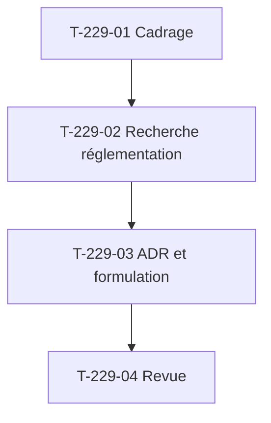

# Tâches : US-229 — Spike passeport numérique produit

## Récapitulatif

| Story | Points | Worker | Estimation | Réalisée |
|-------|--------|--------|------------|----------|
| [US-229](../../backlog/user-stories/US-229.md) | 3 | w229 | 6,5 h | _à remplir_ |

## Dépendances

## Tâches

| ID | Type | Tâche | Estimation | Réalisé | Statut |
|----|------|-------|------------|---------|--------|
| T-229-01 | DOC | Cadrage : timebox 6 h, accès au règlement (UE) 2024/1781, calendriers officiels, documentation Sylius Plus | 0,5 h | | 🔲 |
| T-229-02 | DOC | Recherche : texte du règlement (UE) 2024/1781 (écoconception, passeport numérique), calendrier batteries 2027, actes délégués par catégorie de produits, identifiants GS1 Digital Link, recoupement Sylius Plus ; sources citées avec dates de consultation ; timebox 6 h | 5,5 h | | 🔲 |
| T-229-03 | DOC | ADR `docs/adr/0020-passeport-numerique-produit-espr.md` : ce qui est fixé, ce qui ne l'est pas, formulation prudente (« base ouverte et versionnée », jamais « conforme » ni « certifié »), identifiants GS1, conclusion Sylius Plus | 0,25 h | | 🔲 |
| T-229-04 | REV | Revue (formulation prudente validée avant tout texte public, ton neutre, aucun détail sensible) et relecture par Thibaut ; estimation d'US-230 à US-235 confirmée ou révisée | 0,25 h | | 🔲 |

**Total** : 6,5 h

## Scénarios Gherkin → Tests ou preuves

| Scénario | Type | Test ou preuve |
|----------|------|----------------|
| Synthèse sourcée (nominal) | nominal | T-229-03 : ADR cite le règlement, l'état des actes délégués et la date de consultation de chaque source |
| Formulation prudente (alternatif) | alternatif | T-229-03 : ADR propose un texte de README sans « conforme » ni « certifié », renvoie au texte officiel |
| Recoupement avec Sylius Plus (alternatif) | alternatif | T-229-03 : ADR consigne la conclusion, décision portée à Thibaut, plugin public mais non promu si recoupement |
| Source ambiguë (erreur) | erreur | T-229-02 : information non confirmée marquée « non confirmée », exclue des textes publics |
| Timebox dépassé (erreur) | erreur | T-229-02 : timebox 6 h stricte, arrêt avec points ouverts à arbitrer si le plafond est atteint |

## Rapport de fin (gabarit)

### Scénarios validés

- [ ] 1 nominal, 2 alternatifs, 2 erreurs (US-229 : 1+2+2)

### Livrables

- [ ] `docs/adr/0020-passeport-numerique-produit-espr.md` relu par Thibaut
- [ ] Formulation prudente validée avant tout texte public
- [ ] Estimations d'US-230 à US-235 confirmées ou révisées

### Preuves de qualité

PHPStan, ECS, Rector, lints : **aucune commande** (spike sans code).

### Points d'attention

- Timebox 6 h stricte, arrêt avec points ouverts si dépassé.
- Formulation prudente : jamais « conforme » ni « certifié » (test de contenu en US-235, non ce sprint).
- Sources officielles citées avec dates de consultation.
- Ton neutre, pas de comparaison avec Sylius Plus.
