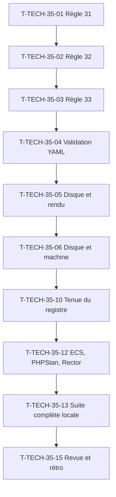

# Tâches techniques : Sprint 035 (actions de la rétro du sprint 34)

## Récapitulatif

| Sprint | Worker | Estimation | Réalisée |
|--------|--------|------------|----------|
| Sprint 35 | Orchestrateur (sauf T-TECH-35-05, actions de Thibaut) | 1 h (dont 0,5 h de Thibaut) | _à remplir_ |

## Dépendances

## Tâches

| ID | Type | Tâche | Estimation | Réalisé | Statut |
|----|------|-------|------------|---------|--------|
| T-TECH-35-01 | DOC | **Règle 31** de la consigne : vérifier les faits techniques d'un ADR ou d'une documentation avant présentation à Thibaut (versions de paquets contre Packagist, contraintes PHP/Sylius, dates réglementaires) ; aucun ADR avec une erreur factuelle (fait au planning) | 0 h | | ✅ |
| T-TECH-35-02 | DOC | **Règle 32** de la consigne : interdire de retirer ou d'affaiblir un test pour obtenir du vert ; si un test échoue, corriger le code ou le test, pas supprimer le test (fait au planning) | 0 h | | ✅ |
| T-TECH-35-03 | DOC | **Règle 33** de la consigne : nouveau paquet commence par le test d'installation ou de rendu avant le contenu ; squelette de CI copié d'un plugin existant ; test rouge prouvé cité (fait au planning) | 0 h | | ✅ |
| T-TECH-35-04 | OPS | Validation YAML de `sprint-status.yaml` : script `bin/check-sprint-status` exécuté et testé vert sur le fichier réel, testé rouge sur deux fichiers invalides (bloc de sprint sous `backlog`, `current_sprint` absent) ; à lancer après chaque écriture du fichier (fait au planning) | 0 h | | ✅ |
| T-TECH-35-05 | OPS | 📅 Disque et rendu : Thibaut libère le disque (cible 10 Go libres, commande en chemins absolus précédée d'un `du -sh` fournie par l'orchestrateur) ; reliquats T-TECH-34-02, -03, -04 (workflows validés, `bin/check-disk` annonce runs, verrou file d'attente, outils de rendu) | 0,5 h | | 🔲 |
| T-TECH-35-06 | OPS | Disque et machine : relevés avant le premier lot (df, mémoire libre, swap), aucun test sous 5 Go, au plus deux workers en test | 0 h | | 🔲 |
| T-TECH-35-10 | REV | Tenue du registre et des GO, règles 26, 28, 30, 31 appliquées | 0 h | | 🔲 |
| T-TECH-35-12 | OPS | ECS, PHPStan max, Rector rejoués avant chaque push PR sprint ; CI verte avant merge | 0 h | | 🔲 |
| T-TECH-35-13 | TEST | Suite complète locale avant push PR sprint, ou attente explicite dite dans PR (règle, T-TECH-33-13) | 0,25 h | | 🔲 |
| T-TECH-35-15 | DOC | Revue et rétrospective du sprint 35, puis clôture | 0,25 h | | 🔲 |

**Total** : 1 h (dont 0,5 h calendaire de Thibaut)

## Actions de la rétro du sprint 34

| # | Action | Résultat au sprint 35 |
|---|--------|------------------------|
| 1 | Règle 31 : vérifier les faits techniques avant présentation (T-TECH-35-01) | ✅ Écrite au planning dans la consigne de worker |
| 2 | Règle 32 : interdire de retirer ou d'affaiblir un test (T-TECH-35-02) | ✅ Écrite au planning dans la consigne de worker |
| 3 | Règle 33 : nouveau paquet commence par le test d'installation (T-TECH-35-03) | ✅ Écrite au planning dans la consigne de worker |
| 4 | Validation YAML de `sprint-status.yaml` (T-TECH-35-04) | ✅ Faite au planning : `bin/check-sprint-status` testé vert et rouge |
| 5 | Disque, rendu et reliquats (T-TECH-35-05) | 🔲 Thibaut libère le disque avant lancement ; reliquats T-TECH-34-02, -03, -04 |

## Reliquats hérités du sprint 34

| Reliquat | Description | Statut au sprint 35 |
|----------|-------------|----------------------|
| T-TECH-34-02 | Workflows YAML validés par analyseur, vérification job exécuté | 🔲 Reporté à T-TECH-35-05 |
| T-TECH-34-03 | Disque libéré (10 Go cibles), `bin/check-disk` annonce runs, verrou en file d'attente | 🔲 Reporté à T-TECH-35-05 (Thibaut libère, scripts écrits) |
| T-TECH-34-04 | Outils de rendu et de build (rendu sans barre, script mesure, avertissement build périmé) | 🔲 Reporté à T-TECH-35-05 |

## Rapport de fin (gabarit)

### Actions validées

- [x] Règle 31 écrite au planning (T-TECH-35-01)
- [x] Règle 32 écrite au planning (T-TECH-35-02)
- [x] Règle 33 écrite au planning (T-TECH-35-03)
- [x] Script `bin/check-sprint-status` testé (T-TECH-35-04)
- [ ] Disque libéré par Thibaut (T-TECH-35-05)
- [ ] Reliquats T-TECH-34-02, -03, -04 traités ou reportés (T-TECH-35-05)

### Indicateurs

| Indicateur | Cible | Sprint 35 | Sprint 34 |
|------------|-------|-----------|-----------|
| Points livrés | 16 | _à remplir_ | 9 |
| Stories avec rouge prouvé | 4 | _à remplir_ | 0 (règle 27 non tenue pour US-222) |
| ADR ou doc avec erreur factuelle | 0 | _à remplir_ | 3 (corrigés avant présentation) |
| Test retiré pour obtenir du vert | 0 | _à remplir_ | 1 (US-222, rétabli) |
| Planning invalide (YAML) | 0 | _à remplir_ | 1 (bloc sprint-34 sous backlog) |
| Espace libre minimal | 5 Go | _à remplir_ | 4 Go (tout le sprint) |
