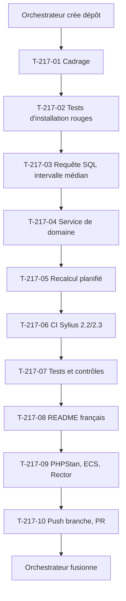

# Tâches : US-217 — Commerce prédictif : squelette du plugin et intervalle médian de réassort par référence

## Récapitulatif

| Story | Points | Worker | Estimation | Réalisée |
|-------|--------|--------|------------|----------|
| [US-217](../../backlog/user-stories/US-217.md) | 5 | w217 | 11,5 h | _à remplir_ |

## Dépendances

**Note** : L'orchestrateur crée le dépôt public `thibmonier/sylius-b2b-predictive-analytics-plugin` sur GO de Thibaut (registre du 2026-10-28) ; le worker pousse sa branche `feature/predictive-mvp` et ouvre la PR ; l'orchestrateur fusionne CI verte. Aucun tag ni release (règle 30).

## Tâches

| ID | Type | Tâche | Estimation | Réalisé | Statut |
|----|------|-------|------------|---------|--------|
| T-217-01 | DOC | Cadrage et **table des invariants de test** (règle 28) : nouveau dépôt, aucun test existant ; dépendances company-insights ; approche statistique (médiane) | 0,5 h | | 🔲 |
| T-217-02 | TEST | Tests d'installation rouges, **rouge prouvé (règle 27 et 33)**, commités seuls : squelette de CI copié de quick-order, paquet installable dans un projet Sylius vierge (local `path` puis `vcs`), tests unitaires du calcul d'intervalle | 1 h | | 🔲 |
| T-217-03 | DB | Requête SQL de calcul de l'intervalle médian par entreprise et référence : commandes complétées (même définition que company-insights), au moins 3 commandes, médiane des intervalles entre commandes successives, date de dernière commande et date attendue | 2 h | | 🔲 |
| T-217-04 | BE | Service de domaine `PredictiveReorderCalculator` : interface, implémentation SQL, Value Object `ReorderPrediction` (intervalle, date dernière, date attendue, explication, raison si aucune prédiction) | 2 h | | 🔲 |
| T-217-05 | OPS | Recalcul planifié : commande Symfony `app:predictive:recalculate`, enregistrement dans `messenger.yaml`, déclenchement quotidien (même horaire que company-insights) | 1 h | | 🔲 |
| T-217-06 | OPS | CI Sylius 2.2/2.3 : matrice PHP 8.3 et 8.5, workflows durcis (actions par SHA, `permissions`, `persist-credentials: false`, zizmor, `composer audit`, Dependabot) | 1,5 h | | 🔲 |
| T-217-07 | TEST | Tests et contrôles : projet vierge Sylius 2.3, installation du paquet, calcul d'intervalle avec 3, 5 et 7 commandes, médiane non faussée par valeur extrême, cloisonnement par entreprise, historique insuffisant (< 3 commandes), commandes annulées exclues | 2 h | | 🔲 |
| T-217-08 | DOC | README en français : installation, usage, lien vers la démo, lien vers le profil de l'auteur (linkedin.com/in/thibautmonier/), ton neutre | 0,5 h | | 🔲 |
| T-217-09 | REV | PHPStan max (dépôt entier), ECS, Rector, lints, rejoués avant le push | 0,5 h | | 🔲 |
| T-217-10 | OPS | Push branche `feature/predictive-mvp`, PR sur le dépôt du plugin ; **orchestrateur fusionne CI verte** ; **aucun tag ni release** (règle 30, GO de Thibaut) | 0,25 h | | 🔲 |
| T-217-11 | REV | Revue (aucun détail sensible dans le dépôt public, ton neutre, pas de comparaison avec Sylius Plus) et table « scénario → test ou preuve » | 0,25 h | | 🔲 |

**Total** : 11,5 h

## Table des invariants de test (règle 28)

Remplie au cadrage (T-217-01), confirmée avant le premier commit de code.

| Test existant | Fige quoi | La story change quoi | Traitement | Ligne de registre |
|---------------|-----------|----------------------|------------|-------------------|
| _Aucun test existant_ | - | US-217 crée un nouveau dépôt de plugin | - | - |

**Note** : Nouveau dépôt, aucun test existant.

## Scénarios Gherkin → Tests ou preuves

| Scénario | Type | Test ou preuve |
|----------|------|----------------|
| Intervalle calculé (nominal) | nominal | T-217-07 : 5 commandes tous les 28 jours, intervalle médian de 28 jours, date attendue = dernière + 28 jours |
| Intervalles irréguliers (alternatif) | alternatif | T-217-07 : intervalles de 20, 21, 60 et 22 jours, médiane (21,5 jours) non faussée par la valeur extrême |
| Référence à une seule entreprise (alternatif) | alternatif | T-217-07 : deux entreprises, chacune a ses propres intervalles, aucun mélange |
| Moins de 3 commandes (erreur) | erreur | T-217-07 : référence commandée 2 fois, aucune prédiction, raison « historique insuffisant » conservée |
| Commandes annulées (erreur évitée) | erreur | T-217-07 : commande annulée exclue du calcul, mêmes règles de commandes comptées que company-insights |

## Rapport de fin (gabarit)

### Scénarios validés

- [ ] 1 nominal, 2 alternatifs, 2 erreurs (US-217 : 1+2+2)

### Livrables

- [ ] Dépôt `thibmonier/sylius-b2b-predictive-analytics-plugin` créé et durci (workflows, Dependabot)
- [ ] Paquet Composer avec calcul d'intervalle médian par entreprise et référence
- [ ] Service de domaine `PredictiveReorderCalculator` avec Value Object `ReorderPrediction`
- [ ] Recalcul planifié quotidien
- [ ] CI Sylius 2.2/2.3 verte (PHP 8.3 et 8.5)
- [ ] README en français (installation, usage, lien démo, profil auteur)
- [ ] Branche `feature/predictive-mvp` poussée, PR ouverte
- [ ] **PR fusionnée par l'orchestrateur, CI verte**
- [ ] **Aucun tag ni release** (GO de Thibaut)

### Preuves de qualité

PHPStan (dépôt entier) : commande et dernière ligne de sortie ou « non exécuté » avec raison.
ECS (`src tests`) : idem.
Rector : idem.
Lint YAML : idem.
Tests : **rouge prouvé (règle 27 et 33)**, échec observé de chaque test cité dans le message du commit ; suite verte après implémentation.

### Points d'attention

- **Orchestrateur crée le dépôt et fusionne** ; worker pousse branche et ouvre PR, ne crée aucun dépôt et ne fusionne pas (règle 30).
- **Règle 33** : test d'installation en premier commit, rouge prouvé cité (squelette CI copié de quick-order).
- **Règle 32** : interdire de retirer ou d'affaiblir un test pour obtenir du vert.
