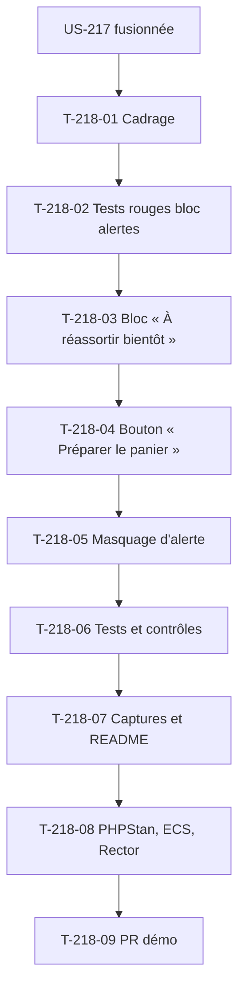

# Tâches : US-218 — Commerce prédictif : alerte de réassort dans « Mon compte » et panier pré-rempli

## Récapitulatif

| Story | Points | Worker | Estimation | Réalisée |
|-------|--------|--------|------------|----------|
| [US-218](../../backlog/user-stories/US-218.md) | 5 | w218 | 10,5 h | _à remplir_ |

## Dépendances

**Note** : Cette story modifie le dépôt du plugin prédictif (partie front et entité de masquage) et la démo (intégration du bloc dans l'espace client).

## Tâches

| ID | Type | Tâche | Estimation | Réalisé | Statut |
|----|------|-------|------------|---------|--------|
| T-218-01 | DOC | Cadrage et **table des invariants de test** (règle 28) : page « Mon compte » existante, lien de réassort (reorder) existant, tests de la démo touchés | 0,5 h | | 🔲 |
| T-218-02 | TEST | Tests rouges, **rouge prouvé (règle 27)**, commités seuls : bloc affiché si alerte dans les 7 jours, explication présente, bouton « Préparer le panier » affiché, alerte masquable, cloisonnement par entreprise | 1 h | | 🔲 |
| T-218-03 | FE-WEB | Bloc « À réassortir bientôt » dans « Mon compte » : requête des prédictions avec date attendue dans les 7 jours, affichage de la référence, de l'explication (« vous en commandez tous les 28 jours, dernière commande il y a 25 jours ») et du bouton | 2 h | | 🔲 |
| T-218-04 | BE | Bouton « Préparer le panier » : utilise le lien de réassort (reorder) existant, quantité habituelle (médiane des quantités commandées), panier pré-rempli, redirection vers le panier | 2 h | | 🔲 |
| T-218-05 | BE | Masquage d'alerte : entité `DismissedPrediction` (référence, entreprise, utilisateur, type de masquage « Pas maintenant » ou « Ne plus proposer »), filtrage des alertes affichées | 1,5 h | | 🔲 |
| T-218-06 | TEST | Tests et contrôles : alerte affichée si échéance dans 7 jours, panier pré-rempli avec quantité habituelle, alerte masquée (« Ne plus proposer ») n'apparaît plus, aucune échéance = bloc absent, référence retirée du catalogue n'est pas proposée, cloisonnement par entreprise | 2 h | | 🔲 |
| T-218-07 | DOC | Captures (page « Mon compte » avec alertes, panier pré-rempli) et mise à jour README du plugin (section « Alertes ») | 0,5 h | | 🔲 |
| T-218-08 | REV | PHPStan max (dépôt entier du plugin et de la démo), ECS, Rector, lints, rejoués avant le push | 0,5 h | | 🔲 |
| T-218-09 | OPS | PR sur le dépôt du plugin (branche `feature/predictive-alerts`) et PR sur la démo (branche du sprint) ; **orchestrateur fusionne CI verte** ; aucun tag ni release | 0,25 h | | 🔲 |
| T-218-10 | REV | Revue (aucun détail sensible, ton neutre, pas de comparaison avec Sylius Plus) et table « scénario → test ou preuve » | 0,25 h | | 🔲 |

**Total** : 10,5 h

## Table des invariants de test (règle 28)

Remplie au cadrage (T-218-01), confirmée avant le premier commit de code.

| Test existant | Fige quoi | La story change quoi | Traitement | Ligne de registre |
|---------------|-----------|----------------------|------------|-------------------|
| Tests de la page « Mon compte » | Affichage actuel (onglets, sections) | Ajout d'un bloc « À réassortir bientôt » avant les sections existantes | Nouveaux tests séparés, aucun test existant modifié | - |
| Fixtures de la démo | Entreprises, comptes, historique de 12 mois | Aucun changement ce sprint (fixtures de rythmes d'achat en US-219) | Inchangées | - |

**Note** : Si un test de la démo casse pendant l'ajout du bloc, le worker le signale et attend une ligne de registre avant de modifier le test.

## Scénarios Gherkin → Tests ou preuves

| Scénario | Type | Test ou preuve |
|----------|------|----------------|
| Alerte affichée (nominal) | nominal | T-218-06 : référence attendue dans 3 jours, bloc affiché avec explication et bouton « Préparer le panier » |
| Panier pré-rempli (alternatif) | alternatif | T-218-06 : clic sur « Préparer le panier », panier contient la référence avec quantité habituelle (médiane), redirection vers le panier |
| Alerte masquée (alternatif) | alternatif | T-218-06 : « Ne plus proposer », référence n'est plus proposée pour ce compte |
| Aucune échéance (erreur) | erreur | T-218-06 : aucune référence proche de l'échéance, bloc absent sans espace vide |
| Référence retirée du catalogue (erreur) | erreur | T-218-06 : référence qui n'est plus vendable, alerte n'est pas proposée |
| Cloisonnement (erreur) | erreur | T-218-06 : Acme et BuildCo, Claire voit seulement les prédictions d'Acme |

## Rapport de fin (gabarit)

### Scénarios validés

- [ ] 1 nominal, 2 alternatifs, 2 erreurs (US-218 : 1+2+3)

### Livrables

- [ ] Bloc « À réassortir bientôt » dans « Mon compte »
- [ ] Bouton « Préparer le panier » utilisant le lien de réassort
- [ ] Masquage d'alerte (« Pas maintenant », « Ne plus proposer »)
- [ ] Cloisonnement par entreprise vérifié
- [ ] Captures (page « Mon compte » avec alertes, panier pré-rempli)
- [ ] README du plugin mis à jour (section « Alertes »)
- [ ] PR du plugin et PR de la démo ouvertes
- [ ] **PR fusionnées par l'orchestrateur, CI verte**
- [ ] **Aucun tag ni release** (GO de Thibaut)

### Preuves de qualité

PHPStan (dépôt entier du plugin et de la démo) : commande et dernière ligne de sortie ou « non exécuté » avec raison.
ECS (`src tests`) : idem.
Rector : idem.
Lint Twig : idem.
Lint YAML : idem.
Tests : **rouge prouvé (règle 27)**, échec observé de chaque test cité dans le message du commit ; suite verte après implémentation.

### Points d'attention

- **Dépendance US-217** : le plugin doit être fusionné avant de commencer US-218.
- **Règle 32** : interdire de retirer ou d'affaiblir un test pour obtenir du vert.
- **Table des invariants** : aucun test existant modifié sans ligne de registre.
