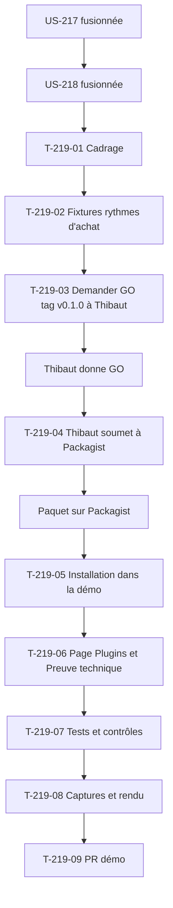

# Tâches : US-219 — Commerce prédictif : fixtures de rythmes d'achat réalistes et intégration à la démo

## Récapitulatif

| Story | Points | Worker | Estimation | Réalisée |
|-------|--------|--------|------------|----------|
| [US-219](../../backlog/user-stories/US-219.md) | 3 | w219 | 8,5 h | _à remplir_ |

## Dépendances

**Note** : Le worker demande le GO du tag v0.1.0 à Thibaut quand le plugin est fusionné (T-219-03) ; Thibaut soumet le paquet à Packagist (T-219-04) ; la démo installe `^0.1`, pas de `dev-main`.

## Tâches

| ID | Type | Tâche | Estimation | Réalisé | Statut |
|----|------|-------|------------|---------|--------|
| T-219-01 | DOC | Cadrage et **table des invariants de test** (règle 28) : fixtures existantes (historique de 12 mois US-155), pages « Plugins » et « Preuve technique » existantes, tests de la démo touchés | 0,5 h | | 🔲 |
| T-219-02 | DB | Fixtures de rythmes d'achat réalistes : historiques sur 12 mois avec rythmes distincts (gants tous les 14 jours, lunettes tous les 60 jours, visserie irrégulière 15-25 jours), une alerte garantie pour Claire à l'ouverture (dernière commande il y a 25 jours sur un produit à rythme de 28 jours), dates relatives à « aujourd'hui », test de vraisemblance (intervalles entre 7 et 120 jours) | 2,5 h | | 🔲 |
| T-219-03 | OPS | 📅 **Demander le GO du tag v0.1.0 à Thibaut** quand le plugin est fusionné (registre du 2026-10-28) | 0 h | | 🔲 |
| T-219-04 | OPS | 📅 **Thibaut soumet le paquet à Packagist** (action calendaire, 0,5 h) | 0,5 h | | 🔲 |
| T-219-05 | OPS | Installation du plugin dans la démo : `composer require tmonier/sylius-b2b-predictive-analytics-plugin:^0.1`, recette Flex si existante, configuration, recalcul planifié dans `messenger.yaml` | 1,5 h | | 🔲 |
| T-219-06 | DOC | Page « Plugins » et « Preuve technique » : ajout du plugin prédictif, fiche (nom, description, lien GitHub, mention de règles explicables), capture du bloc « À réassortir bientôt », lien vers le profil de l'auteur | 1 h | | 🔲 |
| T-219-07 | TEST | Tests et contrôles : alerte garantie pour Claire à l'ouverture, au moins 2 alertes visibles avec explications, dates relatives cohérentes après remise à zéro, aucune alerte factice si historique trop court, données réalistes (test de vraisemblance des intervalles) | 1,5 h | | 🔲 |
| T-219-08 | DOC | Captures (page « Mon compte » de Claire avec alertes, panier pré-rempli) et rendu réel vérifié en FR et EN | 0,5 h | | 🔲 |
| T-219-09 | OPS | PR sur la démo (branche du sprint) ; **orchestrateur fusionne CI verte** | 0,25 h | | 🔲 |
| T-219-10 | REV | Revue (aucun détail sensible, ton neutre, pas de comparaison avec Sylius Plus) et table « scénario → test ou preuve » | 0,25 h | | 🔲 |

**Total** : 8,5 h (dont 0,5 h calendaire de Thibaut)

## Table des invariants de test (règle 28)

Remplie au cadrage (T-219-01), confirmée avant le premier commit de code.

| Test existant | Fige quoi | La story change quoi | Traitement | Ligne de registre |
|---------------|-----------|----------------------|------------|-------------------|
| Fixtures de la démo | Entreprises, comptes, historique de 12 mois | Ajout de rythmes d'achat distincts sur les produits existants (gants, lunettes, visserie) | Fixtures enrichies, aucun test existant modifié | - |
| Tests de remise à zéro | Vérification que la base est vide après remise à zéro | Aucun changement (les fixtures restent relatives à « aujourd'hui ») | Inchangés | - |
| Page « Plugins » | Liste des plugins existants | Ajout du plugin prédictif | Nouveaux tests séparés, aucun test existant modifié | - |

**Note** : Si un test de la démo casse pendant l'ajout des fixtures ou du plugin, le worker le signale et attend une ligne de registre avant de modifier le test.

## Scénarios Gherkin → Tests ou preuves

| Scénario | Type | Test ou preuve |
|----------|------|----------------|
| Alerte garantie (nominal) | nominal | T-219-07 : démo remise à zéro, Claire ouvre son compte, au moins 2 alertes de réassort visibles avec explications |
| Dates relatives (alternatif) | alternatif | T-219-07 : démo lancée 3 mois après les fixtures, fixtures rechargées, rythmes restent cohérents avec la date du jour |
| Page Plugins (alternatif) | alternatif | T-219-06 : page « Plugins », fiche du plugin prédictif présente (nom, description, lien GitHub, mention de règles explicables) |
| Historique trop court (erreur) | erreur | T-219-07 : entreprise de démo sans 3 commandes d'une référence, aucune alerte factice inventée |
| Données irréalistes (erreur) | erreur | T-219-07 : test de vraisemblance des fixtures, intervalles aberrants échouent en nommant la référence |

## Rapport de fin (gabarit)

### Scénarios validés

- [ ] 1 nominal, 2 alternatifs, 2 erreurs (US-219 : 1+2+2)

### Livrables

- [ ] Fixtures de rythmes d'achat réalistes (gants 14j, lunettes 60j, visserie irrégulière)
- [ ] Alerte garantie pour Claire à l'ouverture de la démo
- [ ] Dates relatives à « aujourd'hui » pour cohérence après remise à zéro
- [ ] **GO de Thibaut pour le tag v0.1.0 demandé** (T-219-03)
- [ ] **Thibaut soumet le paquet à Packagist** (T-219-04)
- [ ] Installation du plugin dans la démo (`^0.1`, pas de `dev-main`)
- [ ] Page « Plugins » et « Preuve technique » mises à jour
- [ ] Test de vraisemblance des fixtures (intervalles entre 7 et 120 jours)
- [ ] Captures (page « Mon compte » avec alertes, panier pré-rempli)
- [ ] Rendu réel vérifié en FR et EN
- [ ] PR de la démo ouverte
- [ ] **PR fusionnée par l'orchestrateur, CI verte**

### Preuves de qualité

PHPStan (démo) : commande et dernière ligne de sortie ou « non exécuté » avec raison.
ECS (`src tests`) : idem.
Rector : idem.
Lint Twig : idem.
Lint YAML : idem.
Tests : suite verte après implémentation ; test de vraisemblance des fixtures vert.

### Points d'attention

- **Dépendances US-217 et US-218** : le plugin doit être fusionné et tagué v0.1.0 avant l'installation dans la démo.
- **GO de Thibaut obligatoire** pour le tag v0.1.0 (T-219-03, registre du 2026-10-28).
- **Thibaut soumet le paquet à Packagist** (T-219-04), pas Claude.
- **Installation en `^0.1`**, pas de `dev-main` en production (registre du 2026-10-28).
