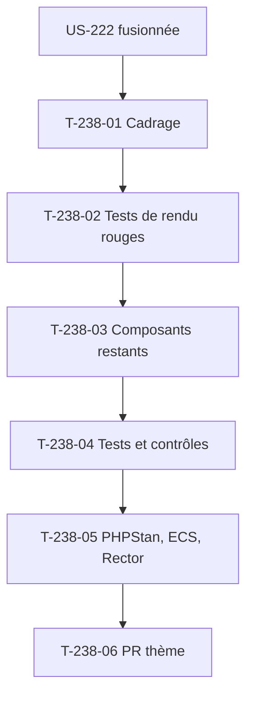

# Tâches : US-238 — Thème Industrie & Négoce : thème actif prouvé par un rendu et composants restants (suite d'US-222)

## Récapitulatif

| Story | Points | Worker | Estimation | Réalisée |
|-------|--------|--------|------------|----------|
| [US-238](../../backlog/user-stories/US-238.md) | 3 | w238 | 5,5 h | _à remplir_ |

## Dépendances

**Note** : Cette story complète le thème (suite d'US-222, fusionnée partielle le 2026-10-28, PR #1 du dépôt `thibmonier/sylius-industry-trade-theme`). L'orchestrateur fusionne CI verte ; aucun tag ni release.

## Tâches

| ID | Type | Tâche | Estimation | Réalisé | Statut |
|----|------|-------|------------|---------|--------|
| T-238-01 | DOC | Cadrage et **table des invariants de test** (règle 28) : thème créé au sprint 34 (PR #1 fusionnée), composants en-tête/pied/messages créés mais boutons/tableaux/champs à compléter, aucun test de rendu | 0,5 h | | 🔲 |
| T-238-02 | TEST | Tests de rendu rouges, **rouge prouvé (règle 27)**, commités seuls : application de test Sylius 2.2 ou 2.3 avec thème installé et activé sur le canal, page d'accueil rendue avec marqueur du gabarit de base, composants communs rendus (boutons, tableaux, champs) | 1 h | | 🔲 |
| T-238-03 | FE-WEB | Composants restants (boutons, tableaux, champs de formulaire) et leurs tests : gabarits Twig avec jetons de design, hooks enregistrés, tests unitaires de contraste, lint Twig | 2 h | | 🔲 |
| T-238-04 | TEST | Tests et contrôles : projet vierge Sylius 2.3 avec thème installé et activé, page d'accueil rendue (200, marqueur du gabarit), composants communs rendus avec jetons de design, thème inactif ne casse rien, gabarit invalide détecté par lint Twig, contraste insuffisant détecté par test unitaire | 1 h | | 🔲 |
| T-238-05 | REV | PHPStan max (dépôt entier), ECS, Rector, lints, rejoués avant le push | 0,5 h | | 🔲 |
| T-238-06 | OPS | Push branche `feature/theme-render-test`, PR sur le dépôt du thème ; **orchestrateur fusionne CI verte** ; **aucun tag ni release** (règle 30) | 0,25 h | | 🔲 |
| T-238-07 | REV | Revue (aucun détail sensible, ton neutre, pas de comparaison avec Sylius Plus) et table « scénario → test ou preuve » | 0,25 h | | 🔲 |

**Total** : 5,5 h

## Table des invariants de test (règle 28)

Remplie au cadrage (T-238-01), confirmée avant le premier commit de code.

| Test existant | Fige quoi | La story change quoi | Traitement | Ligne de registre |
|---------------|-----------|----------------------|------------|-------------------|
| CI du thème (créée au sprint 34) | Matrice Sylius 2.2/2.3, PHP 8.3/8.5, PHPStan, ECS, Rector | Ajout d'un test de rendu de la page d'accueil avec thème actif | Nouveau test ajouté, aucun test existant modifié | - |
| Composants en-tête, pied, messages (créés au sprint 34) | Structure et jetons de design | Aucun changement (déjà créés) | Inchangés | - |

**Note** : Si un test de la CI du thème casse pendant l'ajout du test de rendu, le worker le signale et attend une ligne de registre avant de modifier le test.

## Scénarios Gherkin → Tests ou preuves

| Scénario | Type | Test ou preuve |
|----------|------|----------------|
| Page d'accueil rendue avec le thème (nominal) | nominal | T-238-04 : application de test Sylius 2.2 ou 2.3, thème installé et activé, page d'accueil 200 avec marqueur du gabarit de base du thème |
| Composants communs disponibles (alternatif) | alternatif | T-238-04 : thème actif, page utilisant bouton/tableau/champ rendus par les gabarits du thème avec jetons de design |
| Thème inactif (alternatif) | alternatif | T-238-04 : thème installé mais non activé sur le canal, page d'accueil de Sylius par défaut sans erreur |
| Gabarit de thème invalide (erreur) | erreur | T-238-04 : gabarit du thème dont la syntaxe Twig est invalide, lint Twig échoue en nommant le fichier |
| Contraste insuffisant (erreur) | erreur | T-238-04 : paire de couleurs des jetons sous le ratio AAA, test de contraste échoue en nommant la paire |

## Rapport de fin (gabarit)

### Scénarios validés

- [ ] 1 nominal, 2 alternatifs, 2 erreurs (US-238 : 1+2+2)

### Livrables

- [ ] Test de rendu avec thème actif vert sur Sylius 2.2 et 2.3 (PHP 8.3 et 8.5)
- [ ] **Rouge prouvé cité** (règle 27) : échec observé de chaque test cité dans le message du commit
- [ ] Composants boutons, tableaux et champs livrés avec leurs tests
- [ ] CI du dépôt verte (rendu de smoke test)
- [ ] Branche `feature/theme-render-test` poussée, PR ouverte
- [ ] **PR fusionnée par l'orchestrateur, CI verte**
- [ ] **Aucun tag ni release** (GO de Thibaut)

### Preuves de qualité

PHPStan (dépôt entier) : commande et dernière ligne de sortie ou « non exécuté » avec raison.
ECS (`src tests`) : idem.
Rector : idem.
Lint Twig : idem.
Lint YAML : idem.
Tests : **rouge prouvé (règle 27)**, échec observé de chaque test cité dans le message du commit ; suite verte après implémentation.

### Points d'attention

- **Dépendance US-222** : le thème doit être fusionné avant de commencer US-238 (déjà fait le 2026-10-28, PR #1).
- **Règle 27** : rouge prouvé obligatoire pour le test de rendu.
- **Règle 32** : interdire de retirer ou d'affaiblir un test pour obtenir du vert.
- **Règle 29** : `git fetch` et branche contrôlés dans le dépôt du thème avant tout commit.
