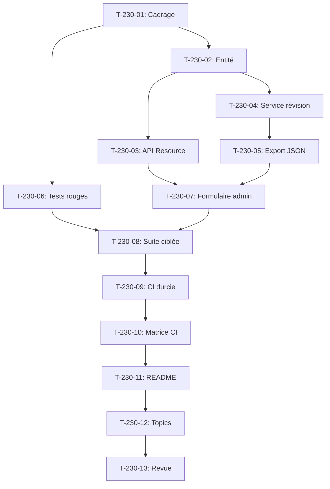

# Tâches - US-230 : Passeport numérique produit — squelette du plugin et modèle de données ouvert et versionné

## Informations US
- **Epic** : EPIC-19
- **Persona** : Sophie (back-office du marchand)
- **Story Points** : 5
- **Sprint** : sprint-36-predictif-et-passeport

## Résumé de la US
**En tant que** Sophie  
**Je veux** renseigner le passeport d'un produit dans l'admin  
**Afin de** constituer une base de données produit versionnée et exploitable

## Vue d'ensemble des tâches

| ID | Type | Tâche | Estimation | Dépend de | Statut |
|----|------|-------|------------|-----------|--------|
| T-230-01 | [DOC] | Cadrage : modèle de données ouvert et versionné, ADR 0020, champs obligatoires | 0,5 h | - | 🔲 |
| T-230-02 | [DB] | Entité `DigitalProductPassport` avec version de schéma et historique des révisions | 1,5 h | T-230-01 | 🔲 |
| T-230-03 | [BE] | Ressource API Platform : CRUD avec serialization groups | 1 h | T-230-02 | 🔲 |
| T-230-04 | [BE] | Service de révision : création, modification, historique avec date et auteur | 1 h | T-230-02 | 🔲 |
| T-230-05 | [BE] | Export JSON avec schéma versionné publié | 0,75 h | T-230-04 | 🔲 |
| T-230-06 | [TEST] | Tests rouges : passeport créé, révision, export JSON, champ manquant, version inconnue | 1,5 h | T-230-01 | 🔲 |
| T-230-07 | [FE-WEB] | Formulaire admin Symfony : création et modification du passeport | 1 h | T-230-05 | 🔲 |
| T-230-08 | [TEST] | Suite ciblée : tests API, PHPStan max, ECS, Rector, couverture ≥ 80 % | 1 h | T-230-07 | 🔲 |
| T-230-09 | [OPS] | CI durcie : workflows figés SHA, permissions minimales, zizmor, composer audit | 0,75 h | T-230-08 | 🔲 |
| T-230-10 | [OPS] | Matrice CI Sylius 2.2 et 2.3, PHP 8.2-8.5 | 0,5 h | T-230-09 | 🔲 |
| T-230-11 | [DOC] | README anglais + `README.fr.md` français avec installation, usage, captures | 1 h | T-230-10 | 🔲 |
| T-230-12 | [DOC] | Topics GitHub : ecommerce, sylius, sylius-plugin, symfony + thématiques | 0,25 h | T-230-11 | 🔲 |
| T-230-13 | [REV] | Revue : conformité DoD, ton neutre, aucun tag sans GO de Thibaut | 0,5 h | T-230-12 | 🔲 |

**Total estimé** : 11 h

---

## Détail des tâches

### T-230-01 : Cadrage du modèle de données
- **Type** : [DOC]
- **Estimation** : 0,5 h

**Description** :
Relire ADR 0020, définir le modèle de données ouvert et versionné avec les champs obligatoires.

**Champs** :
- Origine des matériaux
- Composition
- Recyclabilité
- Réparabilité (indice + instructions)
- Garantie
- Références de pièces détachées compatibles
- Documents
- Version de schéma
- Historique des révisions

**Critères** :
- [ ] ADR 0020 relu
- [ ] Champs obligatoires identifiés
- [ ] Format de version de schéma défini

---

### T-230-02 : Entité `DigitalProductPassport`
- **Type** : [DB]
- **Estimation** : 1,5 h
- **Dépend de** : T-230-01

**Description** :
Entité Doctrine avec tous les champs, relations et historique des révisions.

**Fichiers** :
- `src/Entity/DigitalProductPassport.php` (nouveau)
- `src/Entity/PassportRevision.php` (nouveau)
- Migration Doctrine

**Critères** :
- [ ] Entité avec champs définis
- [ ] Relation avec Product
- [ ] Historique des révisions (date, auteur, données)
- [ ] Version de schéma dans l'entité
- [ ] Migration générée et testée

---

### T-230-03 : Ressource API Platform
- **Type** : [BE]
- **Estimation** : 1 h
- **Dépend de** : T-230-02

**Description** :
Ressource API Platform pour le CRUD du passeport avec serialization groups.

**Fichiers** :
- Configuration API Platform dans `DigitalProductPassport.php`
- DTOs si nécessaire

**Critères** :
- [ ] Endpoints CRUD fonctionnels
- [ ] Serialization groups (`passport:read`, `passport:write`)
- [ ] Validation constraints
- [ ] OpenAPI générée

---

### T-230-04 : Service de révision
- **Type** : [BE]
- **Estimation** : 1 h
- **Dépend de** : T-230-02

**Description** :
Service qui gère la création de révisions lors de modifications du passeport.

**Fichiers** :
- `src/Service/PassportRevisionService.php` (nouveau)

**Critères** :
- [ ] Création automatique de révision à chaque modification
- [ ] Date et auteur enregistrés
- [ ] Historique consultable

---

### T-230-05 : Export JSON avec schéma versionné
- **Type** : [BE]
- **Estimation** : 0,75 h
- **Dépend de** : T-230-04

**Description** :
Export JSON du passeport respectant le schéma versionné.

**Fichiers** :
- `src/Serializer/PassportNormalizer.php` (nouveau)
- Schéma JSON publié dans `docs/schema/`

**Critères** :
- [ ] Export JSON conforme au schéma
- [ ] Version de schéma incluse
- [ ] Schéma publié et documenté

---

### T-230-06 : Tests rouges
- **Type** : [TEST]
- **Estimation** : 1,5 h
- **Dépend de** : T-230-01

**Description** :
Tests qui couvrent tous les scénarios Gherkin. **Tests rouges prouvés en CI**.

**Fichiers** :
- `tests/Functional/PassportTest.php` (nouveau)

**Scénarios** :
- [ ] Passeport créé en version 1
- [ ] Révision conservée avec date et auteur
- [ ] Export JSON valide
- [ ] Erreur si champ obligatoire manquant
- [ ] Refus si version de schéma inconnue
- [ ] **Commits de tests rouges avec échecs CI cités**

---

### T-230-07 : Formulaire admin
- **Type** : [FE-WEB]
- **Estimation** : 1 h
- **Dépend de** : T-230-05

**Description** :
Formulaire Symfony pour créer et modifier un passeport dans l'admin.

**Fichiers** :
- `src/Form/Type/PassportType.php` (nouveau)
- `src/Controller/Admin/PassportController.php` (nouveau)
- Templates Twig

**Critères** :
- [ ] Formulaire de création
- [ ] Formulaire de modification
- [ ] Validation côté serveur
- [ ] Messages de succès/erreur

---

### T-230-08 : Suite ciblée de tests
- **Type** : [TEST]
- **Estimation** : 1 h
- **Dépend de** : T-230-07

**Description** :
Suite complète : tests API, unitaires, PHPStan max, ECS, Rector.

**Critères** :
- [ ] Tous les tests passent
- [ ] PHPStan max, ECS, Rector verts
- [ ] Couverture ≥ 80 %

---

### T-230-09 : CI durcie
- **Type** : [OPS]
- **Estimation** : 0,75 h
- **Dépend de** : T-230-08

**Description** :
Workflows GitHub durcis comme US-209.

**Fichiers** :
- `.github/workflows/ci.yml`
- `.github/workflows/security.yml`

**Critères** :
- [ ] Actions figées par SHA
- [ ] `permissions` minimales
- [ ] `persist-credentials: false`
- [ ] zizmor vert
- [ ] `composer audit` en CI
- [ ] Dependabot configuré

---

### T-230-10 : Matrice CI
- **Type** : [OPS]
- **Estimation** : 0,5 h
- **Dépend de** : T-230-09

**Description** :
Matrice CI sur Sylius 2.2 et 2.3, PHP 8.2-8.5.

**Critères** :
- [ ] CI verte sur matrice complète
- [ ] Tests passent sur toutes les versions

---

### T-230-11 : README bilingue
- **Type** : [DOC]
- **Estimation** : 1 h
- **Dépend de** : T-230-10

**Description** :
README anglais + `README.fr.md` français avec installation, usage, liens, captures.

**Fichiers** :
- `README.md` (anglais)
- `README.fr.md` (français)
- `docs/images/` (captures)

**Critères** :
- [ ] README anglais complet
- [ ] `README.fr.md` français complet
- [ ] Captures dans `docs/`
- [ ] Lien vers démo
- [ ] Lien vers profil de l'auteur

---

### T-230-12 : Topics GitHub
- **Type** : [DOC]
- **Estimation** : 0,25 h
- **Dépend de** : T-230-11

**Description** :
Ajouter topics GitHub habituels.

**Topics** :
- ecommerce
- sylius
- sylius-plugin
- symfony
- digital-product-passport
- sustainability

**Critères** :
- [ ] Topics ajoutés au dépôt

---

### T-230-13 : Revue finale
- **Type** : [REV]
- **Estimation** : 0,5 h
- **Dépend de** : T-230-12

**Description** :
Revue de conformité DoD, ton neutre, aucun tag sans GO.

**Checklist** :
- [ ] DoD plugin respectée
- [ ] Ton neutre (pas de comparaison Sylius Plus)
- [ ] README bilingue + captures
- [ ] CI verte
- [ ] Aucun tag sans GO de Thibaut
- [ ] Prêt pour Packagist (sur GO de Thibaut)

---

## Graphe de dépendances

## Résumé

| Couche | Nb tâches | Heures |
|--------|-----------|--------|
| [DOC] | 3 | 1,75 h |
| [DB] | 1 | 1,5 h |
| [BE] | 3 | 2,75 h |
| [FE-WEB] | 1 | 1 h |
| [TEST] | 2 | 2,5 h |
| [OPS] | 2 | 1,25 h |
| [REV] | 1 | 0,5 h |
| **TOTAL** | **13** | **11 h** |
