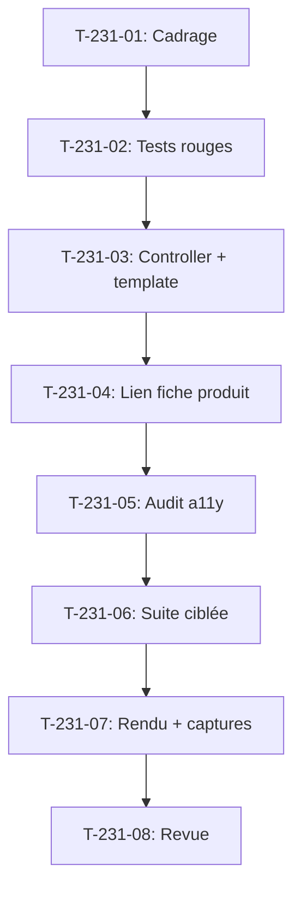

# Tâches - US-231 : Passeport numérique produit — page publique du passeport

## Informations US
- **Epic** : EPIC-19
- **Persona** : Didier (DSI), Léa (cliente particulière)
- **Story Points** : 3
- **Sprint** : sprint-36-predictif-et-passeport

## Résumé de la US
**En tant que** cliente  
**Je veux** consulter le passeport d'un produit sur une page publique  
**Afin de** connaître son origine, sa recyclabilité et comment le réparer

## Vue d'ensemble des tâches

| ID | Type | Tâche | Estimation | Dépend de | Statut |
|----|------|-------|------------|-----------|--------|
| T-231-01 | [DOC] | Cadrage : URL stable, accessibilité AAA, mention prudente, pièces compatibles | 0,5 h | US-230 | 🔲 |
| T-231-02 | [TEST] | Tests rouges : page lisible, lien depuis fiche, 404 pour inexistant/brouillon | 1 h | T-231-01 | 🔲 |
| T-231-03 | [FE-WEB] | Controller et template Twig : page publique du passeport | 1,5 h | T-231-02 | 🔲 |
| T-231-04 | [FE-WEB] | Lien « Passeport produit » sur la fiche produit (si passeport existe) | 0,5 h | T-231-03 | 🔲 |
| T-231-05 | [TEST] | Audit accessibilité pa11y WCAG2AAA FR et EN | 0,75 h | T-231-04 | 🔲 |
| T-231-06 | [TEST] | Suite ciblée : tests fonctionnels, PHPStan, ECS, Rector | 0,75 h | T-231-05 | 🔲 |
| T-231-07 | [DOC] | Rendu FR et EN vérifié en local, captures pour README du plugin | 0,75 h | T-231-06 | 🔲 |
| T-231-08 | [REV] | Revue : ton neutre, mention prudente, conformité DoD | 0,5 h | T-231-07 | 🔲 |

**Total estimé** : 6,5 h

---

## Détail des tâches

### T-231-01 : Cadrage de la page publique
- **Type** : [DOC]
- **Estimation** : 0,5 h
- **Dépend de** : US-230 livrée

**Description** :
Définir l'URL stable, les exigences d'accessibilité AAA, la mention prudente et l'affichage des pièces compatibles.

**Critères** :
- [ ] URL : `/product-passport/{id}` ou `/passport/{uuid}`
- [ ] Accessible sans compte
- [ ] Mention prudente de la portée (ADR 0020)
- [ ] Pièces compatibles affichées si plugin customer-asset-management installé

---

### T-231-02 : Tests rouges de la page publique
- **Type** : [TEST]
- **Estimation** : 1 h
- **Dépend de** : T-231-01

**Description** :
Tests qui couvrent tous les scénarios Gherkin. **Tests rouges prouvés en CI**.

**Fichiers** :
- `tests/Functional/PublicPassportTest.php` (nouveau)

**Scénarios** :
- [ ] Page lisible avec origine, recyclabilité, réparabilité
- [ ] Version et date de révision affichées
- [ ] Lien depuis la fiche produit
- [ ] Langue FR et EN
- [ ] 404 pour passeport inexistant
- [ ] 404 pour passeport en brouillon (pas de fuite)
- [ ] **Commits de tests rouges avec échecs CI cités**

---

### T-231-03 : Controller et template de la page
- **Type** : [FE-WEB]
- **Estimation** : 1,5 h
- **Dépend de** : T-231-02

**Description** :
Controller Symfony et template Twig pour afficher le passeport publiquement.

**Fichiers** :
- `src/Controller/Shop/PassportController.php` (nouveau)
- `templates/shop/passport/show.html.twig` (nouveau)

**Critères** :
- [ ] Route `/product-passport/{id}`
- [ ] Affiche origine, composition, recyclabilité, réparabilité, garantie
- [ ] Version de schéma et date de révision
- [ ] Mention prudente de la portée
- [ ] Responsive (mobile first)
- [ ] Pièces compatibles si plugin présent

---

### T-231-04 : Lien depuis la fiche produit
- **Type** : [FE-WEB]
- **Estimation** : 0,5 h
- **Dépend de** : T-231-03

**Description** :
Ajouter un lien « Passeport produit » sur la fiche produit si un passeport existe.

**Fichiers** :
- Surcharge dans la démo du template de fiche produit

**Critères** :
- [ ] Lien visible seulement si passeport existe
- [ ] Traductions FR et EN
- [ ] Icône ou badge « Passeport »

---

### T-231-05 : Audit accessibilité AAA
- **Type** : [TEST]
- **Estimation** : 0,75 h
- **Dépend de** : T-231-04

**Description** :
Audit pa11y WCAG2AAA en français et en anglais.

**Critères** :
- [ ] pa11y FR : 0 problème WCAG2AAA
- [ ] pa11y EN : 0 problème WCAG2AAA
- [ ] Navigation au clavier fonctionnelle
- [ ] Contrastes suffisants

---

### T-231-06 : Suite ciblée de tests
- **Type** : [TEST]
- **Estimation** : 0,75 h
- **Dépend de** : T-231-05

**Description** :
Suite complète : tests fonctionnels, PHPStan, ECS, Rector.

**Critères** :
- [ ] Tous les tests passent
- [ ] PHPStan max, ECS, Rector verts
- [ ] Couverture ≥ 80 %

---

### T-231-07 : Rendu vérifié et captures
- **Type** : [DOC]
- **Estimation** : 0,75 h
- **Dépend de** : T-231-06

**Description** :
Vérifier le rendu FR et EN en local, capturer pour README du plugin.

**Fichiers** :
- `docs/images/passport-public-fr.png`
- `docs/images/passport-public-en.png`
- Mise à jour README et `README.fr.md`

**Critères** :
- [ ] Rendu FR vérifié
- [ ] Rendu EN vérifié
- [ ] Captures dans README

---

### T-231-08 : Revue finale
- **Type** : [REV]
- **Estimation** : 0,5 h
- **Dépend de** : T-231-07

**Description** :
Revue de conformité DoD, ton neutre, mention prudente.

**Checklist** :
- [ ] Ton neutre (politique Sylius Plus)
- [ ] Mention prudente de la portée affichée
- [ ] Aucune promesse réglementaire
- [ ] Accessibilité AAA vérifiée
- [ ] README bilingue + captures
- [ ] CI verte

---

## Graphe de dépendances

## Résumé

| Couche | Nb tâches | Heures |
|--------|-----------|--------|
| [DOC] | 2 | 1,25 h |
| [FE-WEB] | 2 | 2 h |
| [TEST] | 3 | 2,5 h |
| [REV] | 1 | 0,5 h |
| **TOTAL** | **8** | **6,5 h** |
