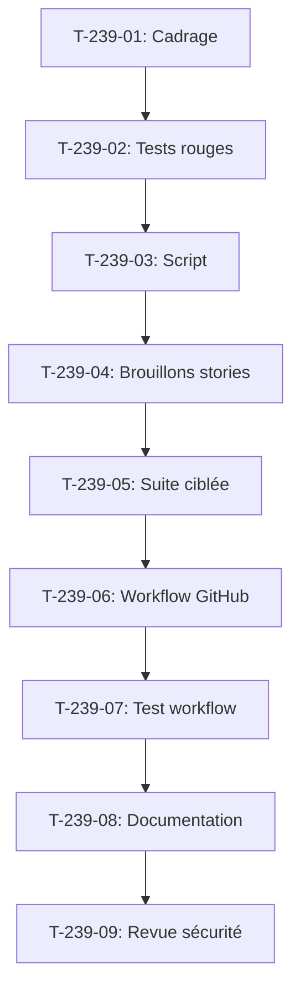

# Tâches - US-239 : Veille hebdomadaire des versions du socle et récapitulatif des montées majeures

## Informations US
- **Epic** : EPIC-10
- **Persona** : Thibaut
- **Story Points** : 3
- **Sprint** : sprint-36-predictif-et-passeport

## Résumé de la US
**En tant que** Thibaut  
**Je veux** qu'une fois par semaine les versions du socle de la démo soient remontées au plus haut, et que les montées majeures ou complexes me soient résumées dans un récapitulatif hebdomadaire  
**Afin de** garder la démo à jour sans y penser et d'inscrire en un geste au backlog ce qui demande un vrai chantier

## Vue d'ensemble des tâches

| ID | Type | Tâche | Estimation | Dépend de | Statut |
|----|------|-------|------------|-----------|--------|
| T-239-01 | [DOC] | Cadrage : format de l'issue, commande `composer outdated`, registre Docker | 0,5 h | - | 🔲 |
| T-239-02 | [TEST] | Tests rouges : script génère Markdown, sections attendues, rouge prouvé en CI | 1 h | T-239-01 | 🔲 |
| T-239-03 | [BE] | Script `bin/stack-versions-report` : Composer, npm, Docker, PR ouvertes | 1,5 h | T-239-02 | 🔲 |
| T-239-04 | [BE] | Brouillons de stories pour montées majeures avec `composer why-not` | 0,75 h | T-239-03 | 🔲 |
| T-239-05 | [TEST] | Suite ciblée : script testé, PHPStan, ECS | 0,5 h | T-239-04 | 🔲 |
| T-239-06 | [OPS] | Workflow GitHub hebdomadaire durci : actions figées SHA, permissions minimales | 1 h | T-239-05 | 🔲 |
| T-239-07 | [TEST] | Test du workflow : simulation manuelle, vérification de l'issue créée | 0,75 h | T-239-06 | 🔲 |
| T-239-08 | [DOC] | Documentation : règle de traitement des PR Dependabot, conversion en stories | 0,5 h | T-239-07 | 🔲 |
| T-239-09 | [REV] | Revue : aucun détail de sécurité dans l'issue publique, zizmor vert | 0,5 h | T-239-08 | 🔲 |

**Total estimé** : 6,5 h

---

## Détail des tâches

### T-239-01 : Cadrage du script de veille
- **Type** : [DOC]
- **Estimation** : 0,5 h

**Description** :
Définir le format de l'issue, commandes à utiliser (`composer outdated`, registres Docker).

**Critères** :
- [ ] Format Markdown de l'issue défini (sections Composer, npm, Docker, PR ouvertes)
- [ ] Commandes identifiées : `composer outdated`, `npm outdated`, requêtes registre Docker

---

### T-239-02 : Tests rouges du script
- **Type** : [TEST]
- **Estimation** : 1 h
- **Dépend de** : T-239-01

**Description** :
Tests qui vérifient que le script produit un Markdown avec les sections attendues. **Test rouge prouvé en CI**.

**Fichiers** :
- `tests/Unit/Stack/VersionsReportTest.php` (nouveau)

**Critères** :
- [ ] Test échoue si section manquante
- [ ] Test échoue si format invalide
- [ ] **Commit de test rouge avec échec CI cité**

---

### T-239-03 : Script `bin/stack-versions-report`
- **Type** : [BE]
- **Estimation** : 1,5 h
- **Dépend de** : T-239-02

**Description** :
Script qui génère un rapport Markdown : dépendances Composer et npm en retard (correctif, mineur, majeur), images Docker (tag courant et plus récent), PR Dependabot ouvertes.

**Fichiers** :
- `bin/stack-versions-report` (nouveau)
- `src/Demo/Stack/VersionsReport.php` (classe de support)

**Critères** :
- [ ] Composer : liste les dépendances directes en retard
- [ ] npm : liste les dépendances en retard
- [ ] Docker : compare images actuelles vs derniers tags
- [ ] PR Dependabot : liste les PR ouvertes via `gh pr list`
- [ ] Sortie Markdown structurée

---

### T-239-04 : Brouillons de stories pour majeures
- **Type** : [BE]
- **Estimation** : 0,75 h
- **Dépend de** : T-239-03

**Description** :
Pour chaque montée majeure, générer un brouillon de story avec `composer why-not` pour identifier la contrainte bloquante.

**Fichiers** :
- Extension de `bin/stack-versions-report`

**Critères** :
- [ ] Brouillon de story par majeure : titre, contexte, contrainte, risques
- [ ] `composer why-not` exécuté pour identifier la contrainte

---

### T-239-05 : Suite ciblée de tests
- **Type** : [TEST]
- **Estimation** : 0,5 h
- **Dépend de** : T-239-04

**Description** :
Suite ciblée : tests du script, PHPStan, ECS.

**Critères** :
- [ ] Tests unitaires verts
- [ ] PHPStan max, ECS verts

---

### T-239-06 : Workflow GitHub hebdomadaire
- **Type** : [OPS]
- **Estimation** : 1 h
- **Dépend de** : T-239-05

**Description** :
Workflow planifié chaque lundi qui exécute `bin/stack-versions-report` et ouvre ou met à jour une issue.

**Fichiers** :
- `.github/workflows/stack-versions-weekly.yml` (nouveau)

**Critères** :
- [ ] Actions figées par SHA
- [ ] `permissions: issues: write` minimal
- [ ] `persist-credentials: false`
- [ ] Cron : chaque lundi
- [ ] Crée ou met à jour issue « Veille des versions — semaine AAAA-SS »

---

### T-239-07 : Test du workflow
- **Type** : [TEST]
- **Estimation** : 0,75 h
- **Dépend de** : T-239-06

**Description** :
Simulation manuelle du workflow, vérification de l'issue créée.

**Critères** :
- [ ] Workflow exécuté manuellement
- [ ] Issue créée avec bon titre et contenu
- [ ] Relance met à jour l'issue existante (pas de doublon)

---

### T-239-08 : Documentation de la règle
- **Type** : [DOC]
- **Estimation** : 0,5 h
- **Dépend de** : T-239-07

**Description** :
Documenter la règle de traitement des PR Dependabot chaque semaine et conversion des cases cochées en stories.

**Fichiers** :
- `docs/stack-versions.md` (nouveau)
- Mise à jour de la consigne des workers

**Critères** :
- [ ] Règle documentée : traitement hebdomadaire des PR
- [ ] Conversion des cases cochées en stories au backlog

---

### T-239-09 : Revue de sécurité
- **Type** : [REV]
- **Estimation** : 0,5 h
- **Dépend de** : T-239-08

**Description** :
Vérifier qu'aucun détail de sécurité n'apparaît dans l'issue publique. Workflow durci avec zizmor.

**Checklist** :
- [ ] Aucun détail de sécurité dans l'issue
- [ ] Workflow vérifié avec `zizmor`
- [ ] Actions figées par SHA confirmées

---

## Graphe de dépendances

## Résumé

| Couche | Nb tâches | Heures |
|--------|-----------|--------|
| [DOC] | 2 | 1 h |
| [TEST] | 3 | 2,25 h |
| [BE] | 2 | 2,25 h |
| [OPS] | 1 | 1 h |
| [REV] | 1 | 0,5 h |
| **TOTAL** | **9** | **6,5 h** |
