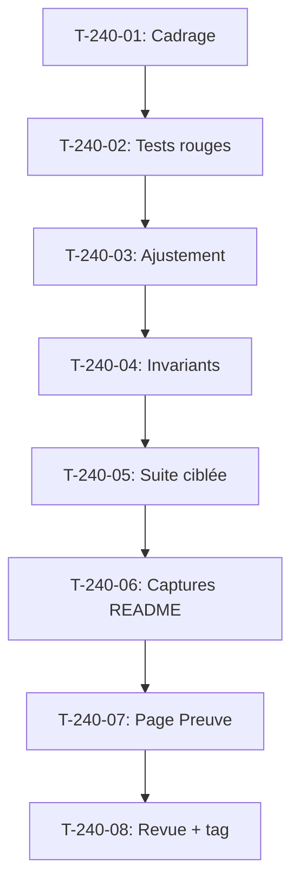

# Tâches - US-240 : Commerce prédictif — alertes garanties à toute date dans la démo et captures

## Informations US
- **Epic** : EPIC-17
- **Persona** : Camille (recruteuse), Nadia (responsable e-commerce B2B)
- **Story Points** : 3
- **Sprint** : sprint-36-predictif-et-passeport

## Résumé de la US
**En tant que** Camille  
**Je veux** voir au moins deux alertes « À réassortir bientôt » dans le compte de Claire quel que soit le jour où j'ouvre la démo  
**Afin de** comprendre la valeur du commerce prédictif sans avoir à tomber sur le bon jour

## Vue d'ensemble des tâches

| ID | Type | Tâche | Estimation | Dépend de | Statut |
|----|------|-------|------------|-----------|--------|
| T-240-01 | [DOC] | Cadrage : historique existant, règle confirmée par Thibaut, invariants testés | 0,5 h | - | 🔲 |
| T-240-02 | [TEST] | Tests rouges : minimum 2 alertes sur 12 mois (tous les 15 jours), rouge prouvé en CI | 1 h | T-240-01 | 🔲 |
| T-240-03 | [BE] | Ajustement des fixtures ou de la règle de calcul pour garantir ≥ 2 alertes | 1,5 h | T-240-02 | 🔲 |
| T-240-04 | [TEST] | Vérifier les invariants : commandes Acme ≤ 55, creux d'août, jours du mois, Paul en retard | 0,75 h | T-240-03 | 🔲 |
| T-240-05 | [TEST] | Suite ciblée : test min, invariants, PHPStan, ECS, Rector | 0,75 h | T-240-04 | 🔲 |
| T-240-06 | [DOC] | Captures README du plugin (FR et EN) : « Mon compte » avec alertes, panier pré-rempli | 1 h | T-240-05 | 🔲 |
| T-240-07 | [DOC] | Publication captures sur page « Preuve technique » de la démo | 0,5 h | T-240-06 | 🔲 |
| T-240-08 | [REV] | Revue : conformité DoD plugin (README bilingue, captures), tag v0.1.1 sur GO | 0,5 h | T-240-07 | 🔲 |

**Total estimé** : 6,5 h

---

## Détail des tâches

### T-240-01 : Cadrage de l'historique existant
- **Type** : [DOC]
- **Estimation** : 0,5 h
- **Dépend de** : -

**Description** :
Relire l'historique des commandes Acme, vérifier les invariants testés, confirmer la règle de Thibaut (client en retard dès qu'il dépasse sa date de recommande prévue).

**Fichiers à lire** :
- Plugin `/Users/tmonier/Projects/sylius_plugins/sylius-b2b-predictive-analytics-plugin`
- Fixtures de la démo
- Tests des invariants

**Critères** :
- [ ] Règle confirmée : client en retard dès dépassement de la date prévue
- [ ] Invariants listés : Acme ≤ 55 commandes, creux d'août, même jour du mois, Paul en retard
- [ ] Calendrier analysé : minimum d'alertes sur 12 mois identifié

---

### T-240-02 : Tests rouges du minimum d'alertes
- **Type** : [TEST]
- **Estimation** : 1 h
- **Dépend de** : T-240-01

**Description** :
Test qui vérifie que le minimum d'alertes est ≥ 2 pour chaque jour de remise à zéro sur 12 mois (tous les 15 jours). **Test rouge prouvé en CI** avec l'échec observé cité dans le message de commit.

**Fichiers** :
- `tests/Functional/Demo/PredictiveAlerts/MinimumAlertsTest.php` (nouveau)

**Critères** :
- [ ] Test échoue si < 2 alertes pour une date donnée
- [ ] Balaye 12 mois (remise à zéro tous les 15 jours)
- [ ] Nomme la date en échec
- [ ] **Commit de test rouge avec échec CI cité**

---

### T-240-03 : Ajustement pour garantir ≥ 2 alertes
- **Type** : [BE]
- **Estimation** : 1,5 h
- **Dépend de** : T-240-02

**Description** :
Ajuster les fixtures de la démo ou la règle de calcul du plugin pour garantir au moins 2 alertes à toute date, sans violer les invariants.

**Fichiers** :
- Plugin : règle de calcul si nécessaire
- Fixtures de la démo : ajustement de commandes relatives ou décalage de jours

**Critères** :
- [ ] Au moins 2 alertes garanties sur 12 mois
- [ ] Aucun invariant violé
- [ ] Solution documentée au registre des décisions

---

### T-240-04 : Vérifier les invariants existants
- **Type** : [TEST]
- **Estimation** : 0,75 h
- **Dépend de** : T-240-03

**Description** :
Relancer les tests des invariants : commandes Acme ≤ 55, creux d'août, jours du mois, alerte de Paul.

**Fichiers** :
- Tests existants de l'historique et des tableaux de bord

**Critères** :
- [ ] Tous les tests existants passent
- [ ] Attentes modifiées inscrites au registre avec ancienne et nouvelle valeur

---

### T-240-05 : Suite ciblée de tests
- **Type** : [TEST]
- **Estimation** : 0,75 h
- **Dépend de** : T-240-04

**Description** :
Suite ciblée : test du minimum, invariants, PHPStan, ECS, Rector.

**Critères** :
- [ ] Suite ciblée verte
- [ ] PHPStan max, ECS, Rector verts
- [ ] Couverture ≥ 80 %

---

### T-240-06 : Captures pour README du plugin
- **Type** : [DOC]
- **Estimation** : 1 h
- **Dépend de** : T-240-05

**Description** :
Capturer « Mon compte » de Claire avec le bloc d'alertes et le panier pré-rempli, en FR et EN. Images rendues par une base de test préparée.

**Fichiers** :
- `docs/images/predictive-alerts-fr.png`
- `docs/images/predictive-alerts-en.png`
- `docs/images/predictive-cart-fr.png`
- `docs/images/predictive-cart-en.png`
- `README.md` (anglais)
- `README.fr.md` (français)

**Critères** :
- [ ] 4 captures (FR/EN × alertes/panier)
- [ ] Captures dans README anglais et français
- [ ] Liens vers démo et profil de l'auteur

---

### T-240-07 : Publication sur page « Preuve technique »
- **Type** : [DOC]
- **Estimation** : 0,5 h
- **Dépend de** : T-240-06

**Description** :
Ajouter les captures à la page « Preuve technique » de la démo.

**Fichiers** :
- `templates/demo/proof.html.twig`
- `docs/images/` (captures copiées)

**Critères** :
- [ ] Captures visibles sur la page « Preuve technique »
- [ ] Rendu FR et EN vérifié

---

### T-240-08 : Revue et tag v0.1.1
- **Type** : [REV]
- **Estimation** : 0,5 h
- **Dépend de** : T-240-07

**Description** :
Revue finale : conformité DoD plugin, tag v0.1.1 sur GO de Thibaut.

**Checklist** :
- [ ] README anglais + `README.fr.md` français
- [ ] Captures dans `docs/`
- [ ] CI verte
- [ ] Tag v0.1.1 sur GO de Thibaut

---

## Graphe de dépendances

## Résumé

| Couche | Nb tâches | Heures |
|--------|-----------|--------|
| [DOC] | 3 | 2 h |
| [TEST] | 3 | 2,5 h |
| [BE] | 1 | 1,5 h |
| [REV] | 1 | 0,5 h |
| **TOTAL** | **8** | **6,5 h** |
