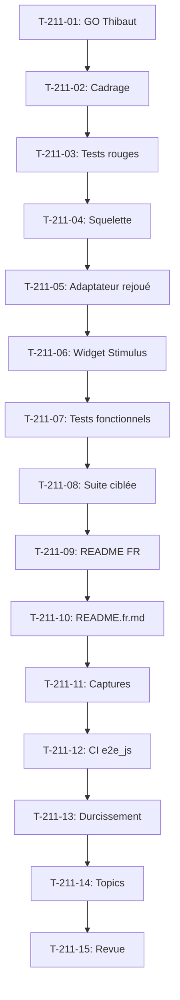

# Tâches - US-211 : Copilote d'achat — squelette du plugin, widget du compte et adaptateur rejoué

## Informations US
- **Epic** : EPIC-16
- **Persona** : Claire (acheteuse, Acme Industries)
- **Story Points** : 5
- **Sprint** : sprint-37-copilote-et-passeport

## Résumé de la US
**En tant que** Claire, acheteuse chez Acme Industries  
**Je veux** un widget d'assistant dans mon espace client B2B  
**Afin de** formuler une demande d'achat en langage courant depuis mon compte

## Vue d'ensemble des tâches

| ID | Type | Tâche | Estimation | Dépend de | Statut |
|----|------|-------|------------|-----------|--------|
| T-211-01 | [OPS] | GO de Thibaut : création du dépôt `thibmonier/sylius-b2b-sales-copilot-plugin`, public, MIT, durci | 0 h | - | 🔲 |
| T-211-02 | [DOC] | Cadrage : copier le squelette de company-insights-plugin, vérifier US-210 (spike), adaptateur rejoué | 0,5 h | T-211-01 | 🔲 |
| T-211-03 | [TEST] | Tests rouges : installation du plugin, rouge prouvé en CI (règle 33) | 1 h | T-211-02 | 🔲 |
| T-211-04 | [BE] | Squelette du plugin : config/routes, src/Controller/, DependencyInjection, Doctrine config, config services | 1,5 h | T-211-03 | 🔲 |
| T-211-05 | [BE] | Port CopilotModel et adaptateur rejoué (lit des réponses enregistrées, message de repli si inconnu) | 2 h | T-211-04 | 🔲 |
| T-211-06 | [FE-WEB] | Widget Stimulus + Twig dans « Mon compte » B2B : affichage conversation, champ, envoi, bouton « Voir mon panier » | 2 h | T-211-05 | 🔲 |
| T-211-07 | [TEST] | Tests fonctionnels : demande reconnue, widget au clavier, canal B2C sans widget, demande non enregistrée, session expirée | 1,5 h | T-211-06 | 🔲 |
| T-211-08 | [TEST] | Suite ciblée : tests d'installation, fonctionnels, PHPStan max, ECS, Rector | 0,5 h | T-211-07 | 🔲 |
| T-211-09 | [DOC] | README FR : installation, usage, lien vers la démo, lien vers le profil de l'auteur | 0,5 h | T-211-08 | 🔲 |
| T-211-10 | [DOC] | README.fr.md : lien au top du README.md, contenu français | 0,25 h | T-211-09 | 🔲 |
| T-211-11 | [DOC] | Captures d'écran : widget dans « Mon compte », conversation, réponse enregistrée, panier pré-rempli | 0,75 h | T-211-10 | 🔲 |
| T-211-12 | [TEST] | CI avec e2e_js: "yes" et suite all incluant tests/Functional (règle 42, action de rétro 2) | 0,5 h | T-211-11 | 🔲 |
| T-211-13 | [BE] | Durcissement du dépôt comme US-209 : workflows figés par SHA, permissions minimales, zizmor, composer audit, Dependabot | 1 h | T-211-12 | 🔲 |
| T-211-14 | [DOC] | GitHub topics : ecommerce, sylius, sylius-plugin, symfony, b2b, copilot, sales-assistant | 0,25 h | T-211-13 | 🔲 |
| T-211-15 | [REV] | Revue : conformité DoD (README FR, captures, CI, durcissement), PR ouverte, attente de GO de Thibaut pour fusion et tag | 0,25 h | T-211-14 | 🔲 |

**Total estimé** : 11 h (dont 0 h calendaire pour T-211-01)

---

## Détail des tâches

### T-211-01 : GO de Thibaut pour créer le dépôt
- **Type** : [OPS]
- **Estimation** : 0 h (action de Thibaut)
- **Dépend de** : -

**Description** :
Thibaut crée le dépôt `thibmonier/sylius-b2b-sales-copilot-plugin` (Composer `tmonier/sylius-b2b-sales-copilot-plugin`), public, MIT, avec les topics habituels.

**Critères** :
- [ ] Dépôt créé à `https://github.com/thibmonier/sylius-b2b-sales-copilot-plugin`
- [ ] Licence MIT
- [ ] Public

---

### T-211-02 : Cadrage du squelette
- **Type** : [DOC]
- **Estimation** : 0,5 h
- **Dépend de** : T-211-01

**Description** :
Copier le squelette de `/Users/tmonier/Projects/sylius_plugins/sylius-company-insights-plugin`, relire US-210 (spike) pour le format de rejeu et l'adaptateur, vérifier les invariants de l'adaptateur rejoué.

**Fichiers à lire** :
- `/Users/tmonier/Projects/sylius_plugins/sylius-company-insights-plugin` (squelette de référence)
- `project-management/sprints/sprint-34-spikes-et-theme/tasks/US-210-tasks.md` (spike du copilote)
- `project-management/backlog/user-stories/US-210.md`

**Critères** :
- [ ] Squelette identifié (structure de dossiers, config, DependencyInjection, services)
- [ ] Format de rejeu défini (structure des réponses enregistrées)
- [ ] Message de repli défini (scénario non enregistré en démo)
- [ ] Règle : l'assistant ne voit que ce que le compte connecté a le droit de voir

---

### T-211-03 : Tests rouges d'installation
- **Type** : [TEST]
- **Estimation** : 1 h
- **Dépend de** : T-211-02

**Description** :
Premier commit du nouveau dépôt : test d'installation rouge (règle 33). **Test rouge prouvé en CI** avec l'échec observé cité dans le message de commit. Vérifier `.gitignore` incluant `vendor/` (règle 42, action de rétro 5).

**Fichiers** :
- `tests/Application/app/config/bundles.php` (bundle à activer)
- `tests/Functional/InstallationTest.php` (nouveau)
- `.gitignore` (doit inclure `vendor/`, `var/`, `public/bundles/`, `.env.local`, `.env.*.local`, `.phpunit.result.cache`)

**Critères** :
- [ ] `.gitignore` vérifié au premier commit (règle 42)
- [ ] Test échoue si le bundle n'est pas activé
- [ ] **Commit de test rouge avec échec CI cité**

---

### T-211-04 : Squelette du plugin
- **Type** : [BE]
- **Estimation** : 1,5 h
- **Dépend de** : T-211-03

**Description** :
Créer la structure du plugin : `config/routes.yaml`, `src/Controller/`, `src/DependencyInjection/`, config Doctrine si nécessaire, `config/services.yaml`.

**Fichiers** :
- `config/routes.yaml` (routes du widget)
- `src/DependencyInjection/SyliusBXXSalesCopilotExtension.php`
- `config/services.yaml`

**Critères** :
- [ ] Structure de dossiers conforme au squelette
- [ ] Routes définies (page du widget, endpoint API)
- [ ] Services configurés
- [ ] Extension DependencyInjection présente

---

### T-211-05 : Port CopilotModel et adaptateur rejoué
- **Type** : [BE]
- **Estimation** : 2 h
- **Dépend de** : T-211-04

**Description** :
Port `CopilotModel` (interface) et adaptateur rejoué qui lit les réponses enregistrées. Si la demande est reconnue, renvoie la réponse enregistrée en < 1 s ; sinon, message de repli « scénario non enregistré en démo ».

**Fichiers** :
- `src/Model/CopilotModelInterface.php` (port)
- `src/Infrastructure/Replay/ReplayCopilotAdapter.php` (adaptateur)
- `config/replay_responses.yaml` (réponses enregistrées)

**Critères** :
- [ ] Port `CopilotModelInterface` créé
- [ ] Adaptateur lit les réponses enregistrées
- [ ] Message de repli si demande non reconnue
- [ ] Réponse en < 1 s (pas d'appel réseau externe)
- [ ] Respect de la règle : l'assistant ne voit que ce que le compte connecté a le droit de voir

---

### T-211-06 : Widget Stimulus + Twig
- **Type** : [FE-WEB]
- **Estimation** : 2 h
- **Dépend de** : T-211-05

**Description** :
Widget Stimulus + Twig dans l'espace « Mon compte » B2B : affichage de la conversation, champ de saisie, bouton d'envoi, bouton « Voir mon panier ». Le widget n'est affiché que pour les clients B2B.

**Fichiers** :
- `assets/controllers/copilot_controller.js` (Stimulus)
- `templates/bundles/SyliusShopBundle/Account/_copilot_widget.html.twig` (Twig)
- `assets/styles/copilot.css` (styles)

**Critères** :
- [ ] Widget affiché dans « Mon compte » B2B
- [ ] Champ de saisie, bouton d'envoi, bouton « Voir mon panier »
- [ ] Affichage de la conversation (demandes + réponses)
- [ ] Accessible au clavier (focus visible, région live pour les réponses)
- [ ] Non affiché pour les clients B2C

---

### T-211-07 : Tests fonctionnels
- **Type** : [TEST]
- **Estimation** : 1,5 h
- **Dépend de** : T-211-06

**Description** :
Tests fonctionnels pour les 5 scénarios Gherkin : demande reconnue, widget au clavier, visiteur B2C, demande non enregistrée, session expirée.

**Fichiers** :
- `tests/Functional/Copilot/RecognizedRequestTest.php`
- `tests/Functional/Copilot/KeyboardNavigationTest.php`
- `tests/Functional/Copilot/B2CVisitorTest.php`
- `tests/Functional/Copilot/UnrecognizedRequestTest.php`
- `tests/Functional/Copilot/ExpiredSessionTest.php`

**Critères** :
- [ ] Test demande reconnue : réponse enregistrée en < 1 s
- [ ] Test widget au clavier : champ, envoi, fermeture atteignables, focus visible, région live
- [ ] Test visiteur B2C : aucun widget affiché
- [ ] Test demande non enregistrée : message de repli, aucune erreur technique
- [ ] Test session expirée : redirection vers la connexion, aucune perte d'affichage, aucune fuite de données

---

### T-211-08 : Suite ciblée
- **Type** : [TEST]
- **Estimation** : 0,5 h
- **Dépend de** : T-211-07

**Description** :
Lancer la suite ciblée : tests d'installation, tests fonctionnels, PHPStan max, ECS, Rector.

**Critères** :
- [ ] Suite d'installation verte
- [ ] Suite fonctionnelle verte
- [ ] PHPStan max sans erreur
- [ ] ECS sans erreur
- [ ] Rector sans suggestion

---

### T-211-09 : README FR
- **Type** : [DOC]
- **Estimation** : 0,5 h
- **Dépend de** : T-211-08

**Description** :
README en français : installation, usage, lien vers la démo, lien vers le profil de l'auteur (https://www.linkedin.com/in/thibautmonier/).

**Fichiers** :
- `README.md` (anglais)

**Critères** :
- [ ] Installation documentée (Composer, configuration)
- [ ] Usage documenté (widget, réponses enregistrées)
- [ ] Lien vers la démo
- [ ] Lien vers le profil de l'auteur
- [ ] Ton neutre (politique Sylius Plus)

---

### T-211-10 : README.fr.md
- **Type** : [DOC]
- **Estimation** : 0,25 h
- **Dépend de** : T-211-09

**Description** :
Créer `README.fr.md` avec le contenu français, lien au top de `README.md`.

**Fichiers** :
- `README.fr.md` (français)
- `README.md` (lien au top)

**Critères** :
- [ ] `README.fr.md` créé avec contenu français
- [ ] Lien au top de `README.md`

---

### T-211-11 : Captures d'écran
- **Type** : [DOC]
- **Estimation** : 0,75 h
- **Dépend de** : T-211-10

**Description** :
Captures d'écran du widget : « Mon compte » avec widget, conversation, réponse enregistrée, bouton « Voir mon panier ». Captures EN et FR.

**Fichiers** :
- `docs/screenshots/copilot-widget-account.png`
- `docs/screenshots/copilot-conversation.png`
- `docs/screenshots/copilot-cart-button.png`

**Critères** :
- [ ] Captures EN et FR
- [ ] Widget visible dans « Mon compte »
- [ ] Conversation affichée
- [ ] Bouton « Voir mon panier » visible

---

### T-211-12 : CI avec e2e_js et suite all
- **Type** : [TEST]
- **Estimation** : 0,5 h
- **Dépend de** : T-211-11

**Description** :
CI avec `e2e_js: "yes"` dans `BuildTestAppAction` et suite `all` dans `phpunit.xml.dist` incluant `tests/Functional` (règle 42, action de rétro 2).

**Fichiers** :
- `.github/workflows/build.yaml`
- `phpunit.xml.dist`

**Critères** :
- [ ] `e2e_js: "yes"` dans `BuildTestAppAction`
- [ ] Suite `all` incluant `tests/Functional`
- [ ] CI Sylius 2.2 et 2.3 verte

---

### T-211-13 : Durcissement du dépôt
- **Type** : [BE]
- **Estimation** : 1 h
- **Dépend de** : T-211-12

**Description** :
Durcissement du dépôt comme US-209 : workflows figés par SHA, `permissions` minimales, `persist-credentials: false`, zizmor, `composer audit`, Dependabot.

**Fichiers** :
- `.github/workflows/build.yaml` (actions figées par SHA)
- `.github/dependabot.yml`

**Critères** :
- [ ] Actions figées par SHA
- [ ] `permissions` minimales
- [ ] `persist-credentials: false`
- [ ] zizmor passé
- [ ] `composer audit` en CI
- [ ] Dependabot configuré

---

### T-211-14 : GitHub topics
- **Type** : [DOC]
- **Estimation** : 0,25 h
- **Dépend de** : T-211-13

**Description** :
Ajouter les topics GitHub : ecommerce, sylius, sylius-plugin, symfony, b2b, copilot, sales-assistant.

**Critères** :
- [ ] Topics ajoutés au dépôt

---

### T-211-15 : Revue finale
- **Type** : [REV]
- **Estimation** : 0,25 h
- **Dépend de** : T-211-14

**Description** :
Revue de conformité DoD : README FR, `README.fr.md`, captures, CI, durcissement. PR ouverte, attente de GO de Thibaut pour fusion et tag.

**Critères** :
- [ ] DoD conforme (README FR, `README.fr.md`, captures, CI, durcissement)
- [ ] PR ouverte
- [ ] Aucun tag ni release sans GO de Thibaut
- [ ] Packagist soumis par Thibaut

## Lien vers les critères d'acceptation Gherkin

Voir [US-211](../../backlog/user-stories/US-211.md).

## Dépendances

