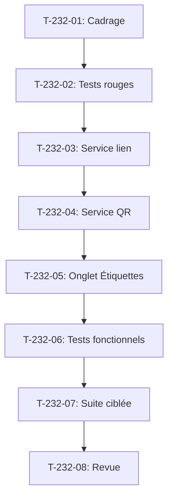

# Tâches - US-232 : Passeport numérique produit — QR et lien GS1 Digital Link

## Informations US
- **Epic** : EPIC-19
- **Persona** : Sophie (back-office du marchand)
- **Story Points** : 3
- **Sprint** : sprint-37-copilote-et-passeport

## Résumé de la US
**En tant que** Sophie  
**Je veux** générer un QR et un lien de type GS1 Digital Link pour chaque passeport  
**Afin de** les imprimer sur le produit et son emballage

## Vue d'ensemble des tâches

| ID | Type | Tâche | Estimation | Dépend de | Statut |
|----|------|-------|------------|-----------|--------|
| T-232-01 | [DOC] | Cadrage : US-229 (spike), structure GS1 Digital Link, génération QR, téléchargement SVG/PNG | 0,5 h | - | 🔲 |
| T-232-02 | [TEST] | Tests rouges : lien GS1 Digital Link généré, QR généré, clé de contrôle GTIN, rouge prouvé en CI | 1 h | T-232-01 | 🔲 |
| T-232-03 | [BE] | Service de génération de lien GS1 Digital Link (GTIN + lot optionnel) | 1,5 h | T-232-02 | 🔲 |
| T-232-04 | [BE] | Service de génération de QR (bibliothèque QR PHP, SVG et PNG) | 1 h | T-232-03 | 🔲 |
| T-232-05 | [FE-WEB] | Onglet « Étiquettes » dans l'admin : affichage du lien et du QR, téléchargement SVG/PNG | 1,5 h | T-232-04 | 🔲 |
| T-232-06 | [TEST] | Tests fonctionnels : QR généré, lien avec lot, téléchargement, GTIN invalide, scan du lien | 1 h | T-232-05 | 🔲 |
| T-232-07 | [TEST] | Suite ciblée : tests fonctionnels, PHPStan max, ECS, Rector, couverture ≥ 80 % | 0,5 h | T-232-06 | 🔲 |
| T-232-08 | [REV] | Revue : conformité DoD (tests, couverture, contraste QR), PR ouverte, attente de fusion | 0,25 h | T-232-07 | 🔲 |

**Total estimé** : 6,5 h

---

## Détail des tâches

### T-232-01 : Cadrage GS1 Digital Link
- **Type** : [DOC]
- **Estimation** : 0,5 h
- **Dépend de** : -

**Description** :
Relire US-229 (spike) pour la structure GS1 Digital Link, vérifier le format du lien (GTIN + lot optionnel), choisir la bibliothèque QR PHP, contraste du QR.

**Fichiers à lire** :
- `project-management/sprints/sprint-34-spikes-et-theme/tasks/US-229-tasks.md` (spike du passeport)
- `project-management/backlog/user-stories/US-229.md`
- Plugin passeport `/Users/tmonier/Projects/sylius_plugins/sylius-digital-product-passport-plugin`

**Critères** :
- [ ] Structure GS1 Digital Link définie (GTIN + lot optionnel)
- [ ] Bibliothèque QR choisie (endroid/qr-code ou équivalent)
- [ ] Contraste suffisant (AAA)
- [ ] Formats de téléchargement : SVG et PNG

---

### T-232-02 : Tests rouges de génération
- **Type** : [TEST]
- **Estimation** : 1 h
- **Dépend de** : T-232-01

**Description** :
Tests rouges : lien GS1 Digital Link généré, QR généré, clé de contrôle GTIN. **Test rouge prouvé en CI** avec l'échec observé cité dans le message de commit.

**Fichiers** :
- `tests/Functional/DigitalLink/GenerateLinkTest.php` (nouveau)
- `tests/Functional/DigitalLink/GenerateQrTest.php` (nouveau)
- `tests/Unit/DigitalLink/GtinValidatorTest.php` (nouveau)

**Critères** :
- [ ] Test échoue si le lien n'est pas généré
- [ ] Test échoue si le QR n'est pas généré
- [ ] Test échoue si la clé de contrôle GTIN est invalide
- [ ] **Commit de test rouge avec échec CI cité**

---

### T-232-03 : Service de génération de lien
- **Type** : [BE]
- **Estimation** : 1,5 h
- **Dépend de** : T-232-02

**Description** :
Service de génération de lien GS1 Digital Link : GTIN + lot optionnel, vérification de la clé de contrôle GTIN.

**Fichiers** :
- `src/Service/DigitalLink/DigitalLinkGenerator.php` (nouveau)
- `src/Service/DigitalLink/GtinValidator.php` (nouveau)

**Critères** :
- [ ] Lien généré au format GS1 Digital Link
- [ ] Clé de contrôle GTIN validée
- [ ] Lot optionnel inclus dans l'URL
- [ ] Exception si GTIN invalide (clé de contrôle fausse)

---

### T-232-04 : Service de génération de QR
- **Type** : [BE]
- **Estimation** : 1 h
- **Dépend de** : T-232-03

**Description** :
Service de génération de QR : bibliothèque endroid/qr-code, génération SVG et PNG, contraste AAA.

**Fichiers** :
- `src/Service/DigitalLink/QrGenerator.php` (nouveau)
- `composer.json` (dépendance endroid/qr-code)

**Critères** :
- [ ] QR généré en SVG
- [ ] QR généré en PNG
- [ ] Contraste AAA (21:1 pour le contraste du QR)
- [ ] Lien encodé dans le QR

---

### T-232-05 : Onglet « Étiquettes » dans l'admin
- **Type** : [FE-WEB]
- **Estimation** : 1,5 h
- **Dépend de** : T-232-04

**Description** :
Onglet « Étiquettes » dans l'admin du passeport : affichage du lien GS1 Digital Link, affichage du QR, boutons de téléchargement SVG et PNG.

**Fichiers** :
- `templates/bundles/SyliusAdminBundle/Product/Passport/_labels_tab.html.twig` (nouveau)
- `src/Controller/Admin/DigitalLinkController.php` (nouveau)
- `assets/styles/passport-labels.css`

**Critères** :
- [ ] Onglet « Étiquettes » visible
- [ ] Lien GS1 Digital Link affiché
- [ ] QR affiché
- [ ] Boutons de téléchargement SVG et PNG fonctionnels

---

### T-232-06 : Tests fonctionnels
- **Type** : [TEST]
- **Estimation** : 1 h
- **Dépend de** : T-232-05

**Description** :
Tests fonctionnels pour les 5 scénarios Gherkin : QR généré, lien avec lot, téléchargement, GTIN invalide, scan du lien.

**Fichiers** :
- `tests/Functional/DigitalLink/QrGeneratedTest.php`
- `tests/Functional/DigitalLink/LinkWithLotTest.php`
- `tests/Functional/DigitalLink/DownloadTest.php`
- `tests/Functional/DigitalLink/InvalidGtinTest.php`
- `tests/Functional/DigitalLink/ScanLinkTest.php`

**Critères** :
- [ ] Test QR généré : lien et QR proposés
- [ ] Test lien avec lot : lot dans l'URL
- [ ] Test téléchargement : SVG et PNG au contraste suffisant
- [ ] Test GTIN invalide : erreur explique la clé de contrôle
- [ ] Test scan du lien : redirection vers la page publique du bon produit

---

### T-232-07 : Suite ciblée
- **Type** : [TEST]
- **Estimation** : 0,5 h
- **Dépend de** : T-232-06

**Description** :
Lancer la suite ciblée : tests fonctionnels, PHPStan max, ECS, Rector, couverture ≥ 80 %.

**Critères** :
- [ ] Suite fonctionnelle verte
- [ ] PHPStan max sans erreur
- [ ] ECS sans erreur
- [ ] Rector sans suggestion
- [ ] Couverture ≥ 80 %

---

### T-232-08 : Revue finale
- **Type** : [REV]
- **Estimation** : 0,25 h
- **Dépend de** : T-232-07

**Description** :
Revue de conformité DoD : tests, couverture, contraste QR. PR ouverte, attente de fusion.

**Critères** :
- [ ] DoD conforme (tests, couverture ≥ 80 %, contraste QR AAA)
- [ ] PR ouverte
- [ ] Rendu réel vérifié en FR et EN

## Lien vers les critères d'acceptation Gherkin

Voir [US-232](../../backlog/user-stories/US-232.md).

## Dépendances

