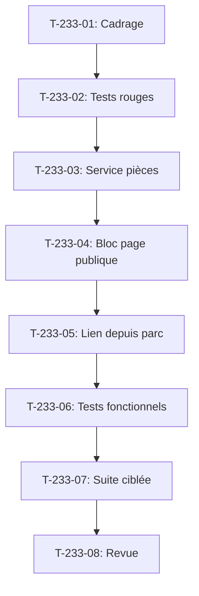

# Tâches - US-233 : Passeport numérique produit — pièces détachées compatibles

## Informations US
- **Epic** : EPIC-19
- **Persona** : Isabelle (administratrice), Claire (acheteuse)
- **Story Points** : 3
- **Sprint** : sprint-37-copilote-et-passeport

## Résumé de la US
**En tant que** Claire  
**Je veux** voir les pièces détachées compatibles d'un équipement depuis son passeport  
**Afin de** commander la bonne pièce

## Vue d'ensemble des tâches

| ID | Type | Tâche | Estimation | Dépend de | Statut |
|----|------|-------|------------|-----------|--------|
| T-233-01 | [DOC] | Cadrage : lien optionnel avec customer-asset-management, pièces compatibles, cloisonnement | 0,5 h | - | 🔲 |
| T-233-02 | [TEST] | Tests rouges : pièces affichées, plugin parc absent, cloisonnement, rouge prouvé en CI | 1 h | T-233-01 | 🔲 |
| T-233-03 | [BE] | Service optionnel de récupération des pièces compatibles (dépend de customer-asset-management) | 1,5 h | T-233-02 | 🔲 |
| T-233-04 | [FE-WEB] | Bloc « Pièces compatibles » sur la page publique du passeport, lien vers les fiches produits | 1,5 h | T-233-03 | 🔲 |
| T-233-05 | [FE-WEB] | Lien vers le passeport depuis la fiche d'un équipement du parc | 1 h | T-233-04 | 🔲 |
| T-233-06 | [TEST] | Tests fonctionnels : pièces affichées, depuis le parc, plugin parc absent, pièce retirée, cloisonnement | 1 h | T-233-05 | 🔲 |
| T-233-07 | [TEST] | Suite ciblée : tests fonctionnels, PHPStan max, ECS, Rector, couverture ≥ 80 % | 0,5 h | T-233-06 | 🔲 |
| T-233-08 | [REV] | Revue : conformité DoD (lien optionnel, cloisonnement), PR ouverte, attente de fusion | 0,25 h | T-233-07 | 🔲 |

**Total estimé** : 6,5 h

---

## Détail des tâches

### T-233-01 : Cadrage du lien optionnel
- **Type** : [DOC]
- **Estimation** : 0,5 h
- **Dépend de** : -

**Description** :
Cadrage du lien optionnel entre le passeport et customer-asset-management : pièces compatibles déclarées dans le parc, affichage dans la page publique et dans la fiche d'équipement, cloisonnement des données.

**Fichiers à lire** :
- Plugin customer-asset-management `/Users/tmonier/Projects/sylius_plugins/sylius-customer-asset-management-plugin`
- Plugin passeport `/Users/tmonier/Projects/sylius_plugins/sylius-digital-product-passport-plugin`

**Critères** :
- [ ] Lien optionnel défini (le DPP ne dépend pas du plugin customer-asset-management)
- [ ] Pièces compatibles déclarées dans le parc
- [ ] Cloisonnement : aucune donnée d'une autre entreprise n'apparaît

---

### T-233-02 : Tests rouges du lien optionnel
- **Type** : [TEST]
- **Estimation** : 1 h
- **Dépend de** : T-233-01

**Description** :
Tests rouges : pièces affichées, plugin parc absent, cloisonnement. **Test rouge prouvé en CI** avec l'échec observé cité dans le message de commit.

**Fichiers** :
- `tests/Functional/CompatibleParts/PartsDisplayedTest.php` (nouveau)
- `tests/Functional/CompatibleParts/PluginAbsentTest.php` (nouveau)
- `tests/Functional/CompatibleParts/IsolationTest.php` (nouveau)

**Critères** :
- [ ] Test échoue si les pièces ne sont pas affichées
- [ ] Test échoue si une erreur survient quand le plugin parc est absent
- [ ] Test échoue si une donnée d'une autre entreprise apparaît
- [ ] **Commit de test rouge avec échec CI cité**

---

### T-233-03 : Service optionnel de pièces compatibles
- **Type** : [BE]
- **Estimation** : 1,5 h
- **Dépend de** : T-233-02

**Description** :
Service optionnel de récupération des pièces compatibles : dépend de customer-asset-management, aucune erreur si le plugin est absent, cloisonnement des données.

**Fichiers** :
- `src/Service/CompatibleParts/CompatiblePartsProvider.php` (nouveau)

**Critères** :
- [ ] Service vérifie la présence de customer-asset-management
- [ ] Aucune erreur si le plugin est absent
- [ ] Cloisonnement : seules les pièces de l'entreprise du compte connecté sont retournées
- [ ] Pièces non vendables listées comme indisponibles

---

### T-233-04 : Bloc « Pièces compatibles » page publique
- **Type** : [FE-WEB]
- **Estimation** : 1,5 h
- **Dépend de** : T-233-03

**Description** :
Bloc « Pièces compatibles » sur la page publique du passeport : affichage des pièces, lien vers les fiches produits, indisponibilité si pièce retirée du catalogue.

**Fichiers** :
- `templates/bundles/SyliusShopBundle/Product/Passport/_compatible_parts.html.twig` (nouveau)
- `assets/styles/compatible-parts.css`

**Critères** :
- [ ] Bloc affiché si des pièces compatibles existent
- [ ] Lien vers la fiche produit de chaque pièce
- [ ] Pièce indisponible sans lien d'achat
- [ ] Aucune erreur si customer-asset-management absent

---

### T-233-05 : Lien depuis le parc d'équipements
- **Type** : [FE-WEB]
- **Estimation** : 1 h
- **Dépend de** : T-233-04

**Description** :
Lien vers le passeport depuis la fiche d'un équipement du parc (si customer-asset-management présent).

**Fichiers** :
- `templates/bundles/SyliusCustomerAssetManagementBundle/Equipment/_passport_link.html.twig` (nouveau)

**Critères** :
- [ ] Lien vers le passeport affiché
- [ ] Lien vers les pièces compatibles affiché
- [ ] Aucune erreur si le plugin passeport est absent

---

### T-233-06 : Tests fonctionnels
- **Type** : [TEST]
- **Estimation** : 1 h
- **Dépend de** : T-233-05

**Description** :
Tests fonctionnels pour les 5 scénarios Gherkin : pièces affichées, depuis le parc, plugin parc absent, pièce retirée, cloisonnement.

**Fichiers** :
- `tests/Functional/CompatibleParts/PartsDisplayedTest.php`
- `tests/Functional/CompatibleParts/FromFleetTest.php`
- `tests/Functional/CompatibleParts/PluginAbsentTest.php`
- `tests/Functional/CompatibleParts/PartRemovedTest.php`
- `tests/Functional/CompatibleParts/IsolationTest.php`

**Critères** :
- [ ] Test pièces affichées : 3 pièces avec lien vers leur fiche
- [ ] Test depuis le parc : lien vers le passeport et les pièces
- [ ] Test plugin parc absent : bloc absent, aucune erreur
- [ ] Test pièce retirée : listée comme indisponible, aucun lien d'achat
- [ ] Test cloisonnement : aucune donnée d'une autre entreprise

---

### T-233-07 : Suite ciblée
- **Type** : [TEST]
- **Estimation** : 0,5 h
- **Dépend de** : T-233-06

**Description** :
Lancer la suite ciblée : tests fonctionnels, PHPStan max, ECS, Rector, couverture ≥ 80 %.

**Critères** :
- [ ] Suite fonctionnelle verte
- [ ] PHPStan max sans erreur
- [ ] ECS sans erreur
- [ ] Rector sans suggestion
- [ ] Couverture ≥ 80 %

---

### T-233-08 : Revue finale
- **Type** : [REV]
- **Estimation** : 0,25 h
- **Dépend de** : T-233-07

**Description** :
Revue de conformité DoD : lien optionnel, cloisonnement. PR ouverte, attente de fusion.

**Critères** :
- [ ] DoD conforme (lien optionnel, cloisonnement, tests, couverture ≥ 80 %)
- [ ] PR ouverte
- [ ] Rendu réel vérifié en FR et EN

## Lien vers les critères d'acceptation Gherkin

Voir [US-233](../../backlog/user-stories/US-233.md).

## Dépendances

