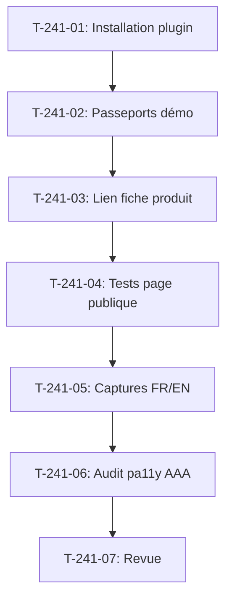

# Tâches - US-241 : Passeport numérique produit — installation dans la démo, captures et audit pa11y AAA

## Informations US
- **Epic** : EPIC-19
- **Persona** : Claire (cliente), Thibaut (démonstrateur)
- **Story Points** : 2
- **Sprint** : sprint-37-copilote-et-passeport

## Résumé de la US
**En tant que** Claire  
**Je veux** consulter le passeport numérique d'un produit depuis la démo B2B  
**Afin de** connaître son origine, sa recyclabilité et comment le réparer

## Vue d'ensemble des tâches

| ID | Type | Tâche | Estimation | Dépend de | Statut |
|----|------|-------|------------|-----------|--------|
| T-241-01 | [BE] | Installation du plugin `tmonier/sylius-digital-product-passport-plugin` ^0.1 dans la démo | 0,5 h | - | 🔲 |
| T-241-02 | [BE] | Configuration de passeports de démonstration pour au moins 3 produits | 1 h | T-241-01 | 🔲 |
| T-241-03 | [FE-WEB] | Lien « Passeport produit » sur la fiche produit (shop) | 0,5 h | T-241-02 | 🔲 |
| T-241-04 | [TEST] | Tests de la page publique : contenu, langue, produit sans passeport | 0,5 h | T-241-03 | 🔲 |
| T-241-05 | [DOC] | Captures de la page publique FR et EN pour les README du plugin passeport | 1 h | T-241-04 | 🔲 |
| T-241-06 | [TEST] | Audit pa11y AAA de la page publique : aucune erreur détectée | 0,5 h | T-241-05 | 🔲 |
| T-241-07 | [REV] | Revue : conformité DoD (plugin installé, passeports configurés, captures, audit pa11y), CI verte | 0,25 h | T-241-06 | 🔲 |

**Total estimé** : 4 h

---

## Détail des tâches

### T-241-01 : Installation du plugin passeport
- **Type** : [BE]
- **Estimation** : 0,5 h
- **Dépend de** : -

**Description** :
Installer le plugin `tmonier/sylius-digital-product-passport-plugin` ^0.1 dans la démo, activer le bundle, configurer les routes.

**Fichiers** :
- `composer.json` (ajout de la dépendance)
- `config/bundles.php` (activation du bundle)
- `config/routes/sylius_digital_product_passport.yaml` (routes)

**Critères** :
- [ ] Plugin installé avec Composer
- [ ] Bundle activé
- [ ] Routes configurées
- [ ] CI verte

---

### T-241-02 : Configuration de passeports de démonstration
- **Type** : [BE]
- **Estimation** : 1 h
- **Dépend de** : T-241-01

**Description** :
Configurer des passeports de démonstration pour au moins 3 produits du catalogue : données structurées cohérentes (origine, recyclabilité, réparabilité, version, date de révision).

**Fichiers** :
- `src/Command/DemoResetCommand.php` (fixtures de passeports)
- `config/services.yaml` (service de fixtures)

**Critères** :
- [ ] Au moins 3 passeports configurés
- [ ] Données cohérentes avec le catalogue
- [ ] Origine, recyclabilité, réparabilité renseignées
- [ ] Version et date de révision présentes

---

### T-241-03 : Lien « Passeport produit » sur la fiche
- **Type** : [FE-WEB]
- **Estimation** : 0,5 h
- **Dépend de** : T-241-02

**Description** :
Ajouter un lien « Passeport produit » sur la fiche produit du shop, visible uniquement si un passeport existe pour ce produit.

**Fichiers** :
- `templates/bundles/SyliusShopBundle/Product/show.html.twig` (surcharge)

**Critères** :
- [ ] Lien « Passeport produit » visible
- [ ] Lien renvoie vers la page publique du passeport
- [ ] Lien absent si aucun passeport n'existe

---

### T-241-04 : Tests de la page publique
- **Type** : [TEST]
- **Estimation** : 0,5 h
- **Dépend de** : T-241-03

**Description** :
Tests de la page publique : contenu (origine, recyclabilité, réparabilité, version, date), langue (FR/EN), produit sans passeport.

**Fichiers** :
- `tests/Functional/Passport/PublicPageTest.php` (nouveau)
- `tests/Functional/Passport/LocalizationTest.php` (nouveau)
- `tests/Functional/Passport/ProductWithoutPassportTest.php` (nouveau)

**Critères** :
- [ ] Test contenu : origine, recyclabilité, réparabilité, version, date affichés
- [ ] Test langue : libellés en français et en anglais
- [ ] Test produit sans passeport : aucun lien affiché

---

### T-241-05 : Captures pour les README du plugin
- **Type** : [DOC]
- **Estimation** : 1 h
- **Dépend de** : T-241-04

**Description** :
Captures de la page publique du passeport en français et en anglais pour les README EN et FR du plugin passeport. Chromium headless : `/Applications/Chromium.app/Contents/MacOS/Chromium --headless=new --window-size=1280,1500 --screenshot`.

**Fichiers** :
- Plugin passeport `/Users/tmonier/Projects/sylius_plugins/sylius-digital-product-passport-plugin/docs/screenshots/public-page-fr.png`
- Plugin passeport `/Users/tmonier/Projects/sylius_plugins/sylius-digital-product-passport-plugin/docs/screenshots/public-page-en.png`

**Critères** :
- [ ] Capture FR de la page publique
- [ ] Capture EN de la page publique
- [ ] Captures ajoutées au dépôt du plugin passeport
- [ ] PR du plugin ouverte, fusion à CI verte

---

### T-241-06 : Audit pa11y AAA
- **Type** : [TEST]
- **Estimation** : 0,5 h
- **Dépend de** : T-241-05

**Description** :
Audit pa11y AAA de la page publique du passeport : aucune erreur d'accessibilité détectée.

**Fichiers** :
- `bin/pa11y-audit` (script d'audit)

**Critères** :
- [ ] Audit pa11y AAA de la page publique
- [ ] Aucune erreur d'accessibilité détectée
- [ ] Rapport d'audit conservé

---

### T-241-07 : Revue finale
- **Type** : [REV]
- **Estimation** : 0,25 h
- **Dépend de** : T-241-06

**Description** :
Revue de conformité DoD : plugin installé, passeports configurés, captures, audit pa11y, CI verte. Rendu réel vérifié en FR et EN.

**Critères** :
- [ ] DoD conforme (plugin installé, passeports configurés, captures, audit pa11y AAA)
- [ ] CI de la démo verte
- [ ] Rendu réel vérifié en FR et EN
- [ ] PR du plugin passeport (captures) fusionnée

## Lien vers les critères d'acceptation Gherkin

Voir [US-241](../../backlog/user-stories/US-241.md).

## Dépendances

