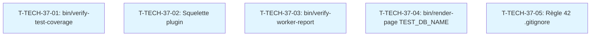

# Tâches transverses : Sprint 037 (actions de la rétro du sprint 36)

> Actions de la rétrospective du sprint 36 (lignes ~155-205 de `sprint-36-predictif-et-passeport/sprint-retro.md`). Ces tâches sont hors points mais comptent dans la capacité (environ 4 h).

## Vue d'ensemble

| ID | Type | Tâche | Estimation | Dépend de | Statut |
|----|------|-------|------------|-----------|--------|
| T-TECH-37-01 | [TEST] | Vérification automatique que chaque fichier de tests/ appartient à une suite exécutée en CI | 1 h | - | 🔲 |
| T-TECH-37-02 | [DOC] | Squelette de plugin avec e2e_js: "yes" et suite all par défaut | 0,5 h | - | 🔲 |
| T-TECH-37-03 | [TEST] | Contrôle de conformité des rapports de workers (SHA, run ID) | 0,75 h | - | 🔲 |
| T-TECH-37-04 | [BE] | bin/render-page respecte TEST_DB_NAME | 0,75 h | - | 🔲 |
| T-TECH-37-05 | [DOC] | Règle 42 : vérifier .gitignore au premier commit d'un nouveau dépôt | 0,5 h | - | 🔲 |

**Total estimé** : 3,5 h (arrondi à 4 h dans la capacité)

---

## Détail des tâches

### T-TECH-37-01 : Script bin/verify-test-coverage
- **Type** : [TEST]
- **Estimation** : 1 h
- **Dépend de** : -

**Description** :
Script `bin/verify-test-coverage` qui vérifie que chaque fichier de `tests/` appartient à une suite exécutée en CI : (1) lire `phpunit.xml.dist`, extraire les chemins de toutes les suites ; (2) lister tous les fichiers `tests/**/*Test.php` ; (3) vérifier que chaque fichier est dans un chemin de suite ; (4) comparer le compte de tests dans le log CI (`grep "Tests:"`) au nombre de méthodes `test*` dans le code (`find tests/ -name "*.php" -exec grep -c "function test" {} +`). Si un fichier ou une méthode n'est pas couverte, le script échoue avec un message explicite. Le script est lancé par le hook `pre-push` et en CI après les tests.

**Fichiers** :
- `bin/verify-test-coverage` (nouveau script)
- `.git/hooks/pre-push` (intégration du hook)
- `.github/workflows/build.yaml` (intégration en CI)

**Critères** :
- [ ] Script écrit et testé (fichier hors suite détecté, écart entre log et code détecté)
- [ ] Intégré au hook `pre-push`
- [ ] Intégré en CI après les tests
- [ ] Au sprint 37, 0 fichier de tests non couvert par une suite exécutée

---

### T-TECH-37-02 : Squelette de plugin avec e2e_js et suite all
- **Type** : [DOC]
- **Estimation** : 0,5 h
- **Dépend de** : -

**Description** :
Squelette de plugin (copié de `sylius-company-insights-plugin`) avec `e2e_js: "yes"` dans `BuildTestAppAction` et suite `all` dans `phpunit.xml.dist` incluant `tests/Integration` et `tests/Functional`. Aucun `entrypoints.json` en dur (toujours construit par Webpack). `.gitignore` incluant `vendor/` vérifié au premier commit (règle 33 renforcée : test d'installation en premier, puis `.gitignore` validé avant tout `composer install`). Ce squelette devient le gabarit pour tous les nouveaux plugins.

**Fichiers** (révisé par l'orchestrateur le 2026-10-30 : pas de copie de squelette dans `docs/`, qui ferait doublon ; `BuildTestAppAction` se règle dans le workflow, pas dans un Kernel) :
- `project-management/templates/checklist-integration.md` : point « Nouveau dépôt de plugin », avec le plugin passeport comme référence

**Critères** :
- [ ] Squelette mis à jour dans `docs/plugin-skeleton/`
- [ ] `.gitignore` incluant `vendor/`
- [ ] `phpunit.xml.dist` avec suite `all`
- [ ] `BuildTestAppAction` avec `e2e_js: "yes"`
- [ ] Au sprint 37, 0 nouveau plugin sans ces éléments

---

### T-TECH-37-03 : Script bin/verify-worker-report
- **Type** : [TEST]
- **Estimation** : 0,75 h
- **Dépend de** : -

**Description** :
Script `bin/verify-worker-report <sha> <run-id>` qui vérifie que le SHA et le run ID existent avant d'accepter un rapport de worker : (1) `git rev-parse <sha>` : vérifie que le commit existe ; (2) `gh run view <run-id>` : vérifie que le run existe et récupère son statut ; (3) si le run est en cours ou inexistant, le script échoue ; (4) si le run a échoué, le script affiche la dernière ligne de sortie et échoue. Le script est lancé par l'orchestrateur avant de valider un rapport de worker.

**Fichiers** :
- `bin/verify-worker-report` (nouveau script)

**Critères** :
- [ ] Script écrit et testé (SHA inexistant détecté, run ID inexistant détecté, run en cours détecté)
- [ ] Au sprint 37, 0 rapport de worker accepté sans vérification des faits

---

### T-TECH-37-04 : bin/render-page respecte TEST_DB_NAME
- **Type** : [BE]
- **Estimation** : 0,75 h
- **Dépend de** : -

**Description** :
`bin/run-tests` et `bin/prepare-test-db` respectent déjà `TEST_DB_NAME` ; `bin/render-page` l'ignore et rend sur la base de test par défaut `sylius_b2b_demo_test`, sans les tables d'un plugin préparé dans `b2b_<worker>` (500 constaté au sprint 36). `bin/render-page` doit lire `TEST_DB_NAME` (même validation du nom que `bin/run-tests`, refus de `sylius_b2b_demo`), avec un test de script et une ligne dans `docs/tests-locaux.md`.

**Fichiers** :
- `bin/render-page` (modification)
- `tests/bin/test-render-page.sh` (test de script)
- `docs/tests-locaux.md` (documentation)

**Critères** :
- [ ] `TEST_DB_NAME=b2b_x bin/render-page …` interroge `b2b_x` (prouvé par un test de script rouge puis vert)
- [ ] Documentation mise à jour
- [ ] Au sprint 37, 0 rendu en échec à cause de la base

---

### T-TECH-37-05 : Règle 42 : vérifier .gitignore au premier commit
- **Type** : [DOC]
- **Estimation** : 0,5 h
- **Dépend de** : -

**Description** :
Règle 42 de la consigne de worker : au premier commit d'un nouveau dépôt (règle 33 : test d'installation en premier), vérifier que `.gitignore` inclut `vendor/`, `var/`, `public/bundles/`, `.env.local`, `.env.*.local`, `.phpunit.result.cache` avant tout `composer install` ou `npm install`. Si `.gitignore` est absent ou incomplet, le worker doit le corriger et le commiter avant d'installer les dépendances. Cette règle s'applique à tous les nouveaux dépôts (plugins, bibliothèques).

**Fichiers** :
- `project-management/sprints/sprint-37-copilote-et-passeport/consigne-worker.md` (règle 42)

**Critères** :
- [ ] Règle écrite dans `consigne-worker.md`
- [ ] Au sprint 37, 0 nouveau dépôt sans `.gitignore` vérifié au premier commit

---

## Dépendances

Les tâches transverses sont **parallèles** et peuvent être lancées en même temps.

