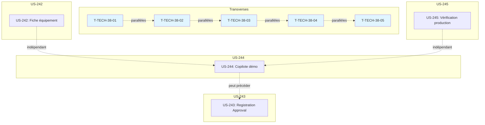

# Tâches : Sprint 038 (consolidation vitrine)

> Sprint Planning Part 2 : décomposition faite au planning, le 2026-10-30 ; développement sur la branche `feature/sprint-38-consolidation-vitrine` (arbre principal, déjà créée). Source de vérité du statut : `.bmad/sprint-status.yaml` (`sprint-38`).
>
> Liens : [objectif](../sprint-goal.md), [tableau](../task-board.md), [dépendances](../sprint-dependencies.md), [consigne de worker](../consigne-worker.md), [checklist](../checklist-integration.md), [registre des décisions](../registre-decisions.md), [tâches transverses](./technical-tasks.md), [rétro du sprint 37](../../sprint-37-copilote-et-passeport/sprint-retro.md).

## Vue d'ensemble

| US | Titre | Points | Tâches | Heures | Statut |
|----|-------|--------|--------|--------|--------|
| [US-244](./US-244-tasks.md) | Copilote d'achat : installation dans la démo et captures du widget | 3 | 8 | 5,75 h | 🔲 prête |
| [US-243](./US-243-tasks.md) | Vitrine : démo Registration Approval en mode public et contrôle des boutons « Voir la démo » | 3 | 7 | 5,25 h | 🔲 prête |
| [US-242](./US-242-tasks.md) | Parc d'équipements : fiche équipement avec lien vers le passeport et les pièces compatibles | 3 | 9 | 6,5 h | 🔲 prête |
| [US-245](./US-245-tasks.md) | Passeport produit : vérification en production et test de fumée du lien passeport | 1 | 4 | 2 h | 🔲 prête |
| [Transverse](./technical-tasks.md) | Actions de la rétro du sprint 37 (sans points) | 0 | 5 | 4,25 h | 🔲 |
| **Total** | | **10** | **33** | **23,75 h** | |

**Total décomposé : 10 points, 33 tâches, 23,75 h** (toutes les heures pour Claude).

> **Périmètre décidé par Thibaut le 2026-10-30** (voir [../registre-decisions.md](../registre-decisions.md)) : installation du copilote d'achat avec captures (US-244), démo Registration Approval en mode public (US-243), fiche équipement avec passeport (US-242), vérification passeport en production (US-245), plus les actions de la rétro du sprint 37 (T-TECH-38-01 à 05).

## Capacité

Méthode des sprints précédents : 2,1 h par point + 6 h de tâches transverses.

| Périmètre | Capacité | Charge de Claude | Marge |
|-----------|----------|------------------|-------|
| 10 points | 10 × 2,1 + 6 = **27 h** | 23,75 h | **3,25 h** (12 %) |

**Les 10 points tiennent**, avec une marge de 3,25 h (12 %).

## Répartition par type

| Type | Tâches | Heures |
|------|--------|--------|
| [DB] | 0 | 0 h |
| [BE] | 6 | 4,5 h |
| [FE-WEB] | 2 | 2 h |
| [TEST] | 9 | 8 h |
| [DOC] | 11 | 7,25 h |
| [REV] | 4 | 1 h |
| [OPS] | 1 | 1 h |
| **Total** | **33** | **23,75 h** |

## Ordre d'exécution proposé

1. **T-TECH-38-01 à 05** : actions de rétro (parallèles)
2. **US-244** : installation du copilote dans la démo (démo seule)
3. **US-243** : démo Registration Approval en mode public (démo seule)
4. **US-242** : fiche équipement avec passeport (deux plugins + démo)
5. **US-245** : vérification passeport en production (démo seule)

## Workers proposés et parallélisme

| Worker | Story | Domaine de fichiers | Chevauchements |
|--------|-------|---------------------|----------------|
| wtech | T-TECH-38-01 à 05 | docs/, consigne-worker.md | aucun |
| w244 | US-244 | démo, fixtures, config/demo/plugins.yaml, captures (plugin copilote) | aucun |
| w243 | US-243 | démo, controller, template, config/demo/plugins.yaml, tests | chevauchement avec w244 sur config/demo/plugins.yaml |
| w242 | US-242 | plugin customer-asset-management, plugin passeport, démo | aucun |
| w245 | US-245 | démo, tests, vérification production | aucun |

**Parallélisme recommandé :**
- **Lot 1 (parallèle)** : wtech (T-TECH-38-01 à 05), w244 (US-244), w245 (US-245)
- **Lot 2 (parallèle après lot 1)** : w243 (US-243, après w244 pour éviter conflit sur config/demo/plugins.yaml), w242 (US-242, séquentiel dans les deux plugins)

Contrainte : au plus 3 workers lancent des tests en même temps (8 Go RAM). Un dépôt n'a qu'un seul worker à la fois.

## Graphe des dépendances

## Notes

- Disque : 7,1 Go libres le 2026-10-30 ; alerte sous 15 Go ; aucune suite complète locale, tests ciblés seulement
- TDD : rouge prouvé en CI pour US-244, US-243, US-242, US-245
- Tests en local avant push (règle 46, T-TECH-38-02) : "Tests: N" cité dans chaque rapport
- Captures Chromium headless, audit pa11y AAA
- GO de Thibaut pour les tags : copilote, customer-asset-management, passeport
