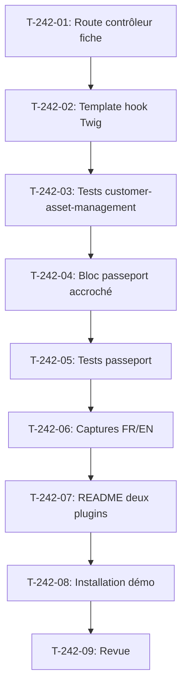

# Tâches - US-242 : Parc d'équipements — fiche équipement avec lien vers le passeport et les pièces compatibles

## Informations US
- **Epic** : EPIC-19
- **Persona** : Claire (acheteuse)
- **Story Points** : 3
- **Sprint** : sprint-38-consolidation-vitrine

## Résumé de la US
**En tant que** Claire  
**Je veux** ouvrir la fiche d'un équipement de mon parc  
**Afin de** accéder à son passeport et aux pièces compatibles sans repasser par le catalogue

## Vue d'ensemble des tâches

| ID | Type | Tâche | Estimation | Dépend de | Statut |
|----|------|-------|------------|-----------|--------|
| T-242-01 | [BE] | Plugin customer-asset-management : route et contrôleur de la fiche équipement | 1 h | - | ✅ |
| T-242-02 | [FE-WEB] | Plugin customer-asset-management : template de la fiche avec hook Twig | 0,5 h | T-242-01 | ✅ |
| T-242-03 | [TEST] | Plugin customer-asset-management : tests fonctionnels (fiche, hook, autre entreprise, non connecté) | 1 h | T-242-02 | ✅ |
| T-242-04 | [BE] | Plugin passeport : bloc passeport et pièces compatibles accroché au hook de la fiche | 0,75 h | T-242-03 | ✅ |
| T-242-05 | [TEST] | Plugin passeport : tests fonctionnels (bloc affiché, plugin absent, modèle sans passeport) | 0,75 h | T-242-04 | ✅ |
| T-242-06 | [DOC] | Captures FR et EN de la fiche équipement pour les README des deux plugins | 1 h | T-242-05 | ✅ |
| T-242-07 | [DOC] | Mise à jour README EN et FR des deux plugins avec la fiche et le bloc passeport | 0,5 h | T-242-06 | ✅ |
| T-242-08 | [BE] | Démo : installation de customer-asset-management v0.2.0 et fixtures d'équipements | 0,75 h | T-242-07 | ✅ |
| T-242-09 | [REV] | Revue : conformité DoD (fiche, bloc, tests, captures, README), CI verte | 0,25 h | T-242-08 | 👀 |

**Total estimé** : 6,5 h

---

## Détail des tâches

### T-242-01 : Route et contrôleur de la fiche équipement
- **Type** : [BE]
- **Estimation** : 1 h
- **Dépend de** : -

**Description** :
Dans le plugin customer-asset-management, créer la route `/shop/account/equipment/{id}` et le contrôleur `EquipmentShowController` qui affiche la fiche d'un équipement. Le contrôleur vérifie que l'équipement appartient au parc de l'entreprise du client connecté (403 sinon), et redirige vers la connexion si non connecté.

**Fichiers** :
- Plugin customer-asset-management `src/Controller/Shop/EquipmentShowController.php` (nouveau)
- Plugin customer-asset-management `config/routes/shop.yaml` (nouvelle route)

**Critères** :
- [ ] Route `customer_asset_management_shop_equipment_show` créée
- [ ] Contrôleur vérifie l'appartenance au parc (403 si autre entreprise)
- [ ] Redirection vers la connexion si non connecté
- [ ] Tests en local (`bin/run-tests --testsuite=all`) et "Tests: N" cité

---

### T-242-02 : Template de la fiche avec hook Twig
- **Type** : [FE-WEB]
- **Estimation** : 0,5 h
- **Dépend de** : T-242-01

**Description** :
Template Twig de la fiche équipement : affiche le nom, le code modèle, la date d'acquisition, le statut. Ajouter un hook Twig `customer_asset_management_equipment_show_content` où d'autres plugins peuvent accrocher des blocs (comme le bloc passeport).

**Fichiers** :
- Plugin customer-asset-management `templates/shop/equipment/show.html.twig` (nouveau)

**Critères** :
- [ ] Template affiche les données de l'équipement
- [ ] Hook Twig `customer_asset_management_equipment_show_content` présent
- [ ] Template accessible en local

---

### T-242-03 : Tests fonctionnels du plugin customer-asset-management
- **Type** : [TEST]
- **Estimation** : 1 h
- **Dépend de** : T-242-02

**Description** :
Tests fonctionnels du plugin customer-asset-management : (1) fiche accessible pour un équipement du parc, (2) hook Twig rendu, (3) équipement d'une autre entreprise → 403, (4) visiteur non connecté → redirection. **Test rouge prouvé en CI** sur une assertion de comportement.

**Fichiers** :
- Plugin customer-asset-management `tests/Functional/Shop/EquipmentShowTest.php` (nouveau)
- Plugin customer-asset-management `tests/Functional/Shop/EquipmentAccessControlTest.php` (nouveau)

**Critères** :
- [ ] Test fiche équipement accessible
- [ ] Test hook Twig rendu
- [ ] Test équipement autre entreprise → 403
- [ ] Test visiteur non connecté → redirection
- [ ] **Commit de test rouge avec échec CI cité**
- [ ] Tests en local et "Tests: N" cité
- [ ] CI du plugin verte

---

### T-242-04 : Bloc passeport accroché au hook
- **Type** : [BE]
- **Estimation** : 0,75 h
- **Dépend de** : T-242-03

**Description** :
Dans le plugin passeport, créer un EventSubscriber qui accroche le bloc passeport au hook `customer_asset_management_equipment_show_content`. Le bloc affiche le lien vers le passeport du modèle d'équipement (`equipmentModelCode`) et les pièces compatibles (US-233). Dépendance optionnelle : le plugin passeport fonctionne sans customer-asset-management, et vice versa.

**Fichiers** :
- Plugin passeport `src/EventSubscriber/EquipmentPassportBlockSubscriber.php` (nouveau)
- Plugin passeport `templates/shop/equipment/_passport_block.html.twig` (nouveau)

**Critères** :
- [ ] EventSubscriber accroche le bloc au hook
- [ ] Bloc affiche le lien vers le passeport
- [ ] Bloc affiche les pièces compatibles (US-233)
- [ ] Dépendance optionnelle (pas de require dur)
- [ ] Tests en local et "Tests: N" cité

---

### T-242-05 : Tests fonctionnels du plugin passeport
- **Type** : [TEST]
- **Estimation** : 0,75 h
- **Dépend de** : T-242-04

**Description** :
Tests fonctionnels du plugin passeport : (1) bloc affiché sur la fiche équipement si le modèle a un passeport, (2) plugin customer-asset-management absent → aucune erreur, (3) modèle sans passeport → aucun lien affiché. **Test rouge prouvé en CI**.

**Fichiers** :
- Plugin passeport `tests/Functional/Integration/EquipmentPassportBlockTest.php` (nouveau)
- Plugin passeport `tests/Functional/Integration/PluginAbsentTest.php` (vérifie que le passeport fonctionne sans customer-asset-management)

**Critères** :
- [ ] Test bloc affiché si passeport existe
- [ ] Test plugin customer-asset-management absent → pas d'erreur
- [ ] Test modèle sans passeport → aucun lien
- [ ] **Commit de test rouge avec échec CI cité**
- [ ] Tests en local et "Tests: N" cité
- [ ] CI du plugin verte

---

### T-242-06 : Captures de la fiche équipement
- **Type** : [DOC]
- **Estimation** : 1 h
- **Dépend de** : T-242-05

**Description** :
Captures FR et EN de la fiche équipement avec le bloc passeport et les pièces compatibles. Chromium headless : `/Applications/Chromium.app/Contents/MacOS/Chromium --headless=new --window-size=1280,1500 --screenshot`. Sauvegarder dans les dépôts des deux plugins.

**Fichiers** :
- Plugin customer-asset-management `/Users/tmonier/Projects/sylius_plugins/sylius-customer-asset-management-plugin/docs/screenshots/equipment-show-fr.png`
- Plugin customer-asset-management `/Users/tmonier/Projects/sylius_plugins/sylius-customer-asset-management-plugin/docs/screenshots/equipment-show-en.png`
- Plugin passeport `/Users/tmonier/Projects/sylius_plugins/sylius-digital-product-passport-plugin/docs/screenshots/equipment-passport-block-fr.png`
- Plugin passeport `/Users/tmonier/Projects/sylius_plugins/sylius-digital-product-passport-plugin/docs/screenshots/equipment-passport-block-en.png`

**Critères** :
- [ ] Capture FR de la fiche équipement (plugin customer-asset-management)
- [ ] Capture EN de la fiche équipement (plugin customer-asset-management)
- [ ] Capture FR du bloc passeport (plugin passeport)
- [ ] Capture EN du bloc passeport (plugin passeport)
- [ ] Captures ajoutées aux dépôts respectifs

---

### T-242-07 : Mise à jour README des deux plugins
- **Type** : [DOC]
- **Estimation** : 0,5 h
- **Dépend de** : T-242-06

**Description** :
Mettre à jour les README EN et FR des deux plugins avec la section « Fiche équipement » (customer-asset-management) et « Bloc passeport sur la fiche équipement » (passeport), avec les captures.

**Fichiers** :
- Plugin customer-asset-management `README.md` (section Equipment details)
- Plugin customer-asset-management `README.fr.md` (section Fiche équipement)
- Plugin passeport `README.md` (section Equipment passport block)
- Plugin passeport `README.fr.md` (section Bloc passeport sur la fiche équipement)

**Critères** :
- [ ] Section « Equipment details » ajoutée au README EN de customer-asset-management
- [ ] Section « Fiche équipement » ajoutée au README FR de customer-asset-management
- [ ] Section « Equipment passport block » ajoutée au README EN du passeport
- [ ] Section « Bloc passeport sur la fiche équipement » ajoutée au README FR du passeport
- [ ] Captures référencées

---

### T-242-08 : Installation de customer-asset-management dans la démo
- **Type** : [BE]
- **Estimation** : 0,75 h
- **Dépend de** : T-242-07

**Description** :
Installer le plugin customer-asset-management v0.2.0 dans la démo (après tag du plugin) : `composer require`, activer le bundle, importer les routes, ajouter des fixtures d'équipements pour Acme Industries (au moins 3 équipements avec passeports).

**Fichiers** :
- Démo `composer.json` (ajout de la dépendance)
- Démo `config/bundles.php` (activation du bundle)
- Démo `config/routes/tmonier_customer_asset_management.yaml` (import routes)
- Démo `src/Command/DemoResetCommand.php` (fixtures d'équipements)

**Critères** :
- [ ] Plugin customer-asset-management installé
- [ ] Au moins 3 équipements avec passeports pour Acme
- [ ] Fiche accessible en local
- [ ] `bin/check-lock-diff --base=main` cité
- [ ] CI de la démo verte

---

### T-242-09 : Revue finale
- **Type** : [REV]
- **Estimation** : 0,25 h
- **Dépend de** : T-242-08

**Description** :
Revue de conformité DoD : fiche équipement dans customer-asset-management, bloc passeport dans passeport, tests fonctionnels, captures, README à jour, CI verte des deux plugins et de la démo.

**Critères** :
- [ ] DoD conforme (fiche, bloc, tests, captures, README)
- [ ] CI de customer-asset-management verte
- [ ] CI du passeport verte
- [ ] CI de la démo verte
- [ ] Fiche équipement avec passeport visible en local

## Lien vers les critères d'acceptation Gherkin

Voir [US-242](../../backlog/user-stories/US-242.md).

## Dépendances

