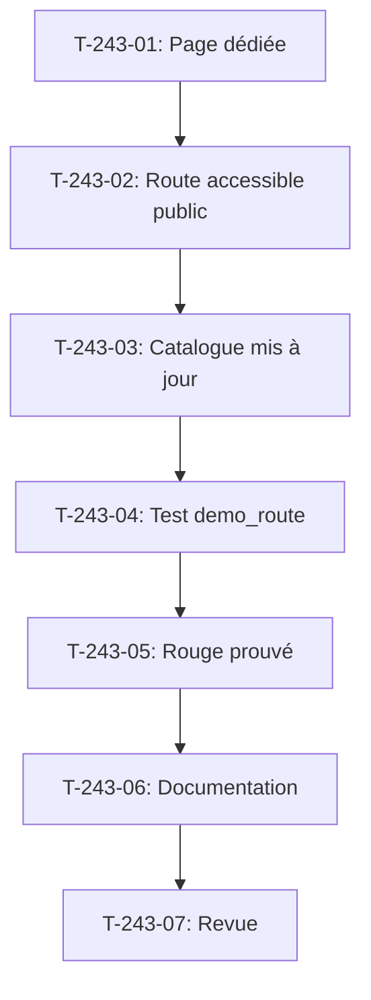

# Tâches - US-243 : Vitrine — démo Registration Approval en mode public et contrôle des boutons « Voir la démo »

## Informations US
- **Epic** : EPIC-12
- **Persona** : Visiteur de la démo publique (recruteur, intégrateur)
- **Story Points** : 3
- **Sprint** : sprint-38-consolidation-vitrine

## Résumé de la US
**En tant que** visiteur de la démo publique  
**Je veux** que chaque bouton « Voir la démo » de la page Plugins ouvre une page utilisable  
**Afin de** comprendre ce que fait chaque plugin sans tomber sur une erreur

## Vue d'ensemble des tâches

| ID | Type | Tâche | Estimation | Dépend de | Statut |
|----|------|-------|------------|-----------|--------|
| T-243-01 | [FE-WEB] | Page dédiée /demo/registration-approval FR et EN (explique la validation par Sophie) | 1,5 h | - | ✅ |
| T-243-02 | [BE] | Route accessible en mode public (vérifier RegistrationGateListener, pas de 403) | 0,5 h | T-243-01 | ✅ |
| T-243-03 | [DOC] | Mise à jour de config/demo/plugins.yaml : demo_route vers la nouvelle page | 0,5 h | T-243-02 | ✅ |
| T-243-04 | [TEST] | Test qui parcourt toutes les demo_route du catalogue en mode public (DEMO_REGISTRATION_OPEN=0) | 1,5 h | T-243-03 | ✅ |
| T-243-05 | [TEST] | Test rouge prouvé : une demo_route actuelle répond 403 en mode public avant la correction | 0,5 h | T-243-04 | ✅ |
| T-243-06 | [DOC] | Documentation : docs/durcissement-demo.md, section démo Registration Approval en mode public | 0,5 h | T-243-05 | ✅ |
| T-243-07 | [REV] | Revue : conformité DoD (page dédiée, test demo_route, rouge prouvé), CI verte | 0,25 h | T-243-06 | 👀 |

**Total estimé** : 5,25 h

---

## Détail des tâches

### T-243-01 : Page dédiée /demo/registration-approval
- **Type** : [FE-WEB]
- **Estimation** : 1,5 h
- **Dépend de** : -

**Description** :
Créer une page dédiée `/fr_FR/demo/registration-approval` et `/en_US/demo/registration-approval` qui explique le processus de validation des inscriptions par Sophie (admin). La page inclut : (1) description du plugin, (2) explication du workflow (inscription → attente → validation par Sophie), (3) captures d'écran du processus, (4) lien vers le compte de test de Sophie pour voir les inscriptions en attente.

**Fichiers** :
- `src/Controller/Demo/RegistrationApprovalDemoController.php` (nouveau)
- `templates/demo/registration_approval.html.twig` (nouveau)
- `config/routes/demo.yaml` (nouvelle route)

**Critères** :
- [ ] Route `/fr_FR/demo/registration-approval` créée
- [ ] Route `/en_US/demo/registration-approval` créée
- [ ] Page explique le workflow de validation
- [ ] Textes FR et EN
- [ ] Lien vers le compte admin de Sophie

---

### T-243-02 : Route accessible en mode public
- **Type** : [BE]
- **Estimation** : 0,5 h
- **Dépend de** : T-243-01

**Description** :
Vérifier que la route `/demo/registration-approval` est accessible en mode public (`DEMO_REGISTRATION_OPEN=0`) et ne passe pas par le `RegistrationGateListener` qui bloque `sylius_shop_register`. Si nécessaire, exclure cette route du listener ou créer une route dédiée.

**Fichiers** :
- `src/EventListener/RegistrationGateListener.php` (vérifier le pattern de route)
- `config/services.yaml` (vérifier l'exclusion)

**Critères** :
- [ ] Route accessible en mode public (pas de 403)
- [ ] RegistrationGateListener ne bloque pas cette route
- [ ] Test manuel en local : DEMO_REGISTRATION_OPEN=0, route répond 200

---

### T-243-03 : Mise à jour du catalogue
- **Type** : [DOC]
- **Estimation** : 0,5 h
- **Dépend de** : T-243-02

**Description** :
Mettre à jour `config/demo/plugins.yaml` : changer la demo_route du plugin Registration Approval de `sylius_shop_register` vers `demo_registration_approval`. Lancer `bin/compat-refresh` et `bin/proof-refresh`.

**Fichiers** :
- `config/demo/plugins.yaml` (modification demo_route)

**Critères** :
- [ ] demo_route du plugin Registration Approval mise à jour
- [ ] `bin/compat-refresh` et `bin/proof-refresh` lancés sans erreur
- [ ] Bouton « Voir la démo » pointe vers la nouvelle route

---

### T-243-04 : Test de parcours des demo_route
- **Type** : [TEST]
- **Estimation** : 1,5 h
- **Dépend de** : T-243-03

**Description** :
Test qui parcourt toutes les `demo_route` du catalogue (`config/demo/plugins.yaml`) en mode public (`DEMO_REGISTRATION_OPEN=0`) et vérifie qu'aucune ne répond 403 ou 404. Le test lit le fichier YAML, extrait chaque demo_route, génère l'URL pour chaque locale (FR, EN) et vérifie le statut HTTP. Si une route échoue, le test affiche le nom du plugin et la route.

**Fichiers** :
- `tests/Functional/Demo/DemoRoutesPublicAccessTest.php` (nouveau)

**Critères** :
- [ ] Test lit config/demo/plugins.yaml
- [ ] Test parcourt chaque demo_route en FR et EN
- [ ] Test vérifie que le statut est 200 (ou 302 vers une page autorisée)
- [ ] Test refuse 403 et 404
- [ ] Test affiche le plugin et la route en cas d'échec
- [ ] Test lancé en local et "Tests: N" cité

---

### T-243-05 : Test rouge prouvé
- **Type** : [TEST]
- **Estimation** : 0,5 h
- **Dépend de** : T-243-04

**Description** :
Prouver que le test échoue sur l'état actuel (avant la correction de T-243-01 et T-243-03) : la route `sylius_shop_register` répond 403 en mode public. **Commit de test rouge avec échec CI cité** dans le message de commit.

**Critères** :
- [ ] Test échoue sur main avant la correction
- [ ] **Commit de test rouge avec échec CI cité**
- [ ] Échec mentionne le plugin Registration Approval et la route sylius_shop_register

---

### T-243-06 : Documentation
- **Type** : [DOC]
- **Estimation** : 0,5 h
- **Dépend de** : T-243-05

**Description** :
Mettre à jour `docs/durcissement-demo.md` avec une section « Démo Registration Approval en mode public » qui explique la page dédiée, l'exclusion du `RegistrationGateListener` et le test de parcours des demo_route.

**Fichiers** :
- `docs/durcissement-demo.md` (nouvelle section)

**Critères** :
- [ ] Section « Démo Registration Approval en mode public » ajoutée
- [ ] Explication de la page dédiée
- [ ] Explication du test de parcours
- [ ] Exemple de config DEMO_REGISTRATION_OPEN

---

### T-243-07 : Revue finale
- **Type** : [REV]
- **Estimation** : 0,25 h
- **Dépend de** : T-243-06

**Description** :
Revue de conformité DoD : page dédiée FR et EN, test de parcours des demo_route en mode public, rouge prouvé, CI verte.

**Critères** :
- [ ] DoD conforme (page dédiée, test demo_route, rouge prouvé)
- [ ] CI de la démo verte
- [ ] Page `/demo/registration-approval` accessible en local en mode public
- [ ] Toutes les demo_route du catalogue accessibles en mode public

## Lien vers les critères d'acceptation Gherkin

Voir [US-243](../../backlog/user-stories/US-243.md).

## Dépendances

