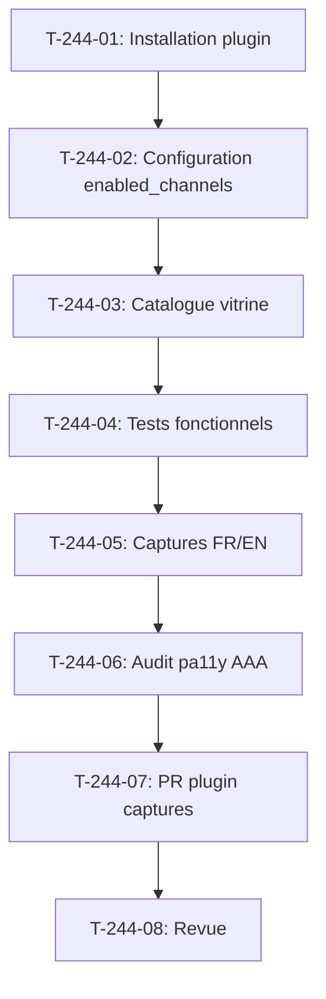

# Tâches - US-244 : Copilote d'achat — installation dans la démo et captures du widget

## Informations US
- **Epic** : EPIC-16
- **Persona** : Claire (acheteuse), Thibaut (démonstrateur)
- **Story Points** : 3
- **Sprint** : sprint-38-consolidation-vitrine

## Résumé de la US
**En tant que** Claire  
**Je veux** trouver le copilote d'achat dans mon compte sur la démo  
**Afin de** essayer une demande enregistrée comme « état de mon panier »

## Vue d'ensemble des tâches

| ID | Type | Tâche | Estimation | Dépend de | Statut |
|----|------|-------|------------|-----------|--------|
| T-244-01 | [BE] | Installation du plugin copilote ^0.1 dans la démo (composer, bundles, routes, assets) | 1 h | - | ✅ |
| T-244-02 | [BE] | Configuration enabled_channels B2B et cassettes de démonstration | 0,5 h | T-244-01 | ✅ |
| T-244-03 | [DOC] | Entrée du catalogue vitrine (config/demo/plugins.yaml), bin/compat-refresh, bin/proof-refresh | 0,5 h | T-244-02 | ✅ |
| T-244-04 | [TEST] | Tests fonctionnels : widget B2B, demande enregistrée, canal particulier sans widget, demande non enregistrée | 1,5 h | T-244-03 | ✅ |
| T-244-05 | [DOC] | Captures FR et EN du widget pour les README du plugin (Chromium headless) | 1 h | T-244-04 | ✅ |
| T-244-06 | [TEST] | Audit pa11y AAA du tableau de bord avec le widget : aucune erreur détectée | 0,5 h | T-244-05 | ✅ |
| T-244-07 | [DOC] | PR du plugin avec captures et section Screenshots README EN/FR, fusion à CI verte | 0,5 h | T-244-06 | ✅ |
| T-244-08 | [REV] | Revue : conformité DoD (plugin installé, canal B2B, catalogue, tests, captures, audit pa11y), CI verte | 0,25 h | T-244-07 | 👀 |

**Total estimé** : 5,75 h

---

## Détail des tâches

### T-244-01 : Installation du plugin copilote
- **Type** : [BE]
- **Estimation** : 1 h
- **Dépend de** : -

**Description** :
Installer le plugin `tmonier/sylius-b2b-sales-copilot-plugin` ^0.1 dans la démo : `composer require`, activer le bundle dans `config/bundles.php`, importer les routes dans `config/routes/tmonier_sylius_b2b_sales_copilot.yaml`, importer les assets dans `assets/shop/entrypoint.js`.

**Fichiers** :
- `composer.json` (ajout de la dépendance)
- `config/bundles.php` (activation du bundle)
- `config/routes/tmonier_sylius_b2b_sales_copilot.yaml` (import routes)
- `assets/shop/entrypoint.js` (import widget controller)

**Critères** :
- [ ] Plugin installé avec Composer ^0.1
- [ ] Bundle activé dans `config/bundles.php`
- [ ] Routes importées
- [ ] Assets importés
- [ ] `bin/check-lock-diff --base=main` cité dans le commit
- [ ] CI verte

---

### T-244-02 : Configuration enabled_channels et cassettes
- **Type** : [BE]
- **Estimation** : 0,5 h
- **Dépend de** : T-244-01

**Description** :
Configurer `enabled_channels: ['B2B']` dans `config/packages/tmonier_sylius_b2b_sales_copilot.yaml` et créer au moins 2 cassettes de démonstration dans `config/cassettes.jsonl` (« état de mon panier », « aide »).

**Fichiers** :
- `config/packages/tmonier_sylius_b2b_sales_copilot.yaml` (nouveau, configuration)
- `config/cassettes.jsonl` (nouveau, cassettes de démo)

**Critères** :
- [ ] Canal B2B dans enabled_channels
- [ ] Au moins 2 cassettes enregistrées (« état de mon panier », « aide »)
- [ ] Format JSONL conforme au README du plugin
- [ ] CI verte

---

### T-244-03 : Entrée du catalogue vitrine
- **Type** : [DOC]
- **Estimation** : 0,5 h
- **Dépend de** : T-244-02

**Description** :
Ajouter l'entrée du copilote dans `config/demo/plugins.yaml` (nom, description FR/EN, demo_route vers le compte, tags), puis lancer `bin/compat-refresh` et `bin/proof-refresh`.

**Fichiers** :
- `config/demo/plugins.yaml` (nouvelle entrée copilote)

**Critères** :
- [ ] Entrée copilote dans le catalogue
- [ ] Description FR et EN
- [ ] demo_route vers sylius_shop_account_dashboard
- [ ] Tags : b2b, conversationnel, assistant
- [ ] `bin/compat-refresh` et `bin/proof-refresh` lancés sans erreur

---

### T-244-04 : Tests fonctionnels
- **Type** : [TEST]
- **Estimation** : 1,5 h
- **Dépend de** : T-244-03

**Description** :
Tests fonctionnels de la démo pour les scénarios Gherkin : (1) widget dans le compte B2B, (2) demande enregistrée renvoie la réponse, (3) canal particulier sans widget, (4) demande non enregistrée renvoie le message de repli. **Test rouge prouvé en CI** sur une assertion de comportement, avec l'échec cité dans le commit.

**Fichiers** :
- `tests/Functional/Copilot/WidgetB2BTest.php` (nouveau)
- `tests/Functional/Copilot/RecordedRequestTest.php` (nouveau)
- `tests/Functional/Copilot/ChannelGuardTest.php` (nouveau)
- `tests/Functional/Copilot/UnknownRequestTest.php` (nouveau)

**Critères** :
- [ ] Test widget dans le compte B2B
- [ ] Test demande enregistrée
- [ ] Test canal particulier sans widget
- [ ] Test demande non enregistrée (message de repli)
- [ ] **Commit de test rouge avec échec CI cité**
- [ ] Tests lancés en local (`bin/run-tests --testsuite=all`) et "Tests: N" cité
- [ ] CI verte

---

### T-244-05 : Captures pour les README du plugin
- **Type** : [DOC]
- **Estimation** : 1 h
- **Dépend de** : T-244-04

**Description** :
Captures FR et EN du widget dans le compte B2B pour les README du plugin. Chromium headless : `/Applications/Chromium.app/Contents/MacOS/Chromium --headless=new --window-size=1280,1500 --screenshot`. Sauvegarder dans le dépôt du plugin à `/Users/tmonier/Projects/sylius_plugins/sylius-b2b-sales-copilot-plugin/docs/screenshots/`.

**Fichiers** :
- Plugin copilote `/Users/tmonier/Projects/sylius_plugins/sylius-b2b-sales-copilot-plugin/docs/screenshots/widget-dashboard-fr.png`
- Plugin copilote `/Users/tmonier/Projects/sylius_plugins/sylius-b2b-sales-copilot-plugin/docs/screenshots/widget-dashboard-en.png`
- Plugin copilote `/Users/tmonier/Projects/sylius_plugins/sylius-b2b-sales-copilot-plugin/docs/screenshots/copilot-response-fr.png`
- Plugin copilote `/Users/tmonier/Projects/sylius_plugins/sylius-b2b-sales-copilot-plugin/docs/screenshots/copilot-response-en.png`

**Critères** :
- [ ] Capture FR du widget dans le compte
- [ ] Capture EN du widget dans le compte
- [ ] Capture FR d'une réponse du copilote
- [ ] Capture EN d'une réponse du copilote
- [ ] Captures ajoutées au dépôt du plugin copilote

---

### T-244-06 : Audit pa11y AAA
- **Type** : [TEST]
- **Estimation** : 0,5 h
- **Dépend de** : T-244-05

**Description** :
Audit pa11y AAA du tableau de bord avec le widget : aucune erreur d'accessibilité détectée. Lancer `bin/pa11y-audit` sur le compte B2B.

**Fichiers** :
- `bin/pa11y-audit` (script existant)

**Critères** :
- [ ] Audit pa11y AAA du tableau de bord B2B avec le widget
- [ ] Aucune erreur d'accessibilité détectée
- [ ] Rapport d'audit conservé

---

### T-244-07 : PR du plugin avec captures
- **Type** : [DOC]
- **Estimation** : 0,5 h
- **Dépend de** : T-244-06

**Description** :
PR du plugin copilote ajoutant la section Screenshots aux README EN et FR, avec les 4 captures. Fusion à CI verte.

**Fichiers** :
- Plugin copilote `README.md` (section Screenshots)
- Plugin copilote `README.fr.md` (section Screenshots)

**Critères** :
- [ ] Section Screenshots ajoutée au README EN
- [ ] Section Screenshots ajoutée au README FR
- [ ] Les 4 captures référencées
- [ ] PR ouverte sur le dépôt du plugin
- [ ] CI du plugin verte
- [ ] PR fusionnée

---

### T-244-08 : Revue finale
- **Type** : [REV]
- **Estimation** : 0,25 h
- **Dépend de** : T-244-07

**Description** :
Revue de conformité DoD : plugin installé, canal B2B configuré, catalogue vitrine, tests fonctionnels, captures, audit pa11y AAA, CI de la démo verte.

**Critères** :
- [ ] DoD conforme (plugin installé, canal B2B, catalogue, tests, captures, audit pa11y AAA)
- [ ] CI de la démo verte
- [ ] Widget visible en local sur le compte B2B
- [ ] PR du plugin copilote (captures) fusionnée

## Lien vers les critères d'acceptation Gherkin

Voir [US-244](../../backlog/user-stories/US-244.md).

## Dépendances

