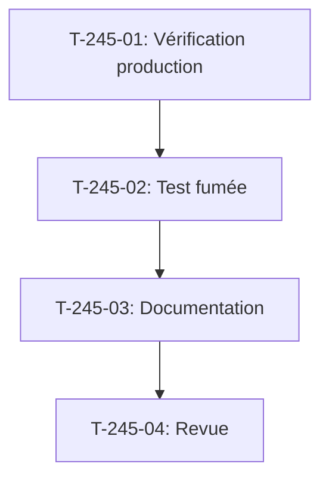

# Tâches - US-245 : Passeport produit — vérification en production et test de fumée du lien passeport

## Informations US
- **Epic** : EPIC-19
- **Persona** : Claire (cliente)
- **Story Points** : 1
- **Sprint** : sprint-38-consolidation-vitrine

## Résumé de la US
**En tant que** Claire  
**Je veux** trouver le lien « Passeport produit » sur la fiche d'un casque de chantier de la démo publique  
**Afin de** consulter son passeport

## Vue d'ensemble des tâches

| ID | Type | Tâche | Estimation | Dépend de | Statut |
|----|------|-------|------------|-----------|--------|
| T-245-01 | [TEST] | Vérification en production : fiches EPI-CASK-001 à 003, lien passeport, page publique répond 200 | 0,5 h | - | 🔲 |
| T-245-02 | [TEST] | Test de fumée : lien passeport sur EPI-CASK-001, rouge prouvé si lien absent | 1 h | T-245-01 | 🔲 |
| T-245-03 | [DOC] | Documentation : consigner les URL de vérification et le résultat | 0,25 h | T-245-02 | 🔲 |
| T-245-04 | [REV] | Revue : conformité DoD (vérification production, test fumée, rouge prouvé), CI verte | 0,25 h | T-245-03 | 🔲 |

**Total estimé** : 2 h

---

## Détail des tâches

### T-245-01 : Vérification en production
- **Type** : [TEST]
- **Estimation** : 0,5 h
- **Dépend de** : -

**Description** :
Vérifier en production après une remise à zéro que les fiches EPI-CASK-001 à 003 affichent le lien « Passeport produit » et que la page publique du passeport répond 200. Consigner les URL et les statuts HTTP.

**URLs à vérifier** :
- `https://sylius-b2b.thibaut-monier.fr/fr_FR/products/epi-cask-001-fr` (lien passeport présent)
- `https://sylius-b2b.thibaut-monier.fr/fr_FR/product-passport/...` (statut 200)
- `https://sylius-b2b.thibaut-monier.fr/en_US/products/epi-cask-001-en` (lien passeport présent)
- `https://sylius-b2b.thibaut-monier.fr/en_US/product-passport/...` (statut 200)

**Critères** :
- [ ] Fiche EPI-CASK-001 FR affiche le lien « Passeport produit »
- [ ] Page publique du passeport répond 200 en FR
- [ ] Fiche EPI-CASK-001 EN affiche le lien « Product Passport »
- [ ] Page publique du passeport répond 200 en EN
- [ ] URLs et statuts consignés

---

### T-245-02 : Test de fumée du lien passeport
- **Type** : [TEST]
- **Estimation** : 1 h
- **Dépend de** : T-245-01

**Description** :
Test de fumée qui vérifie que le lien « Passeport produit » est présent sur la fiche EPI-CASK-001 et que la page publique du passeport répond 200. Le test utilise la suite `demo` (fixtures chargées). **Test rouge prouvé** si les passeports ne sont pas chargés par les fixtures.

**Fichiers** :
- `tests/Functional/Passport/ProductPassportLinkSmokeTest.php` (nouveau)

**Critères** :
- [ ] Test vérifie la présence du lien sur EPI-CASK-001
- [ ] Test suit le lien et vérifie le statut 200
- [ ] Test échoue si le lien est absent
- [ ] **Commit de test rouge avec échec CI cité** (passeports non chargés avant correction)
- [ ] Test lancé en local et "Tests: N" cité
- [ ] CI verte

---

### T-245-03 : Documentation
- **Type** : [DOC]
- **Estimation** : 0,25 h
- **Dépend de** : T-245-02

**Description** :
Consigner les URLs de vérification et le résultat dans `project-management/sprints/sprint-38-consolidation-vitrine/verification-production.md` : fiches vérifiées, liens présents, statuts HTTP.

**Fichiers** :
- `project-management/sprints/sprint-38-consolidation-vitrine/verification-production.md` (nouveau)

**Critères** :
- [ ] URLs de vérification consignées
- [ ] Statuts HTTP consignés
- [ ] Date de vérification notée

---

### T-245-04 : Revue finale
- **Type** : [REV]
- **Estimation** : 0,25 h
- **Dépend de** : T-245-03

**Description** :
Revue de conformité DoD : vérification en production consignée, test de fumée, rouge prouvé, CI verte.

**Critères** :
- [ ] DoD conforme (vérification production, test fumée, rouge prouvé)
- [ ] CI de la démo verte
- [ ] Lien passeport visible en production après remise à zéro
- [ ] Test de fumée dans la suite `demo`

## Lien vers les critères d'acceptation Gherkin

Voir [US-245](../../backlog/user-stories/US-245.md).

## Dépendances

