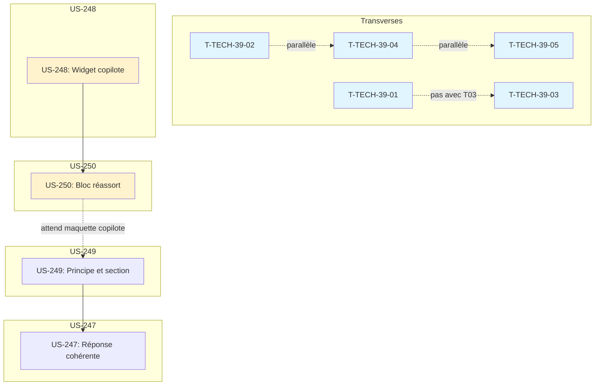

# Tâches : Sprint 039 (conception graphique)

> Sprint Planning Part 2 : décomposition faite au planning, le 2026-10-31 ; développement sur la branche `feature/sprint-39-conception-graphique` (arbre principal, déjà créée). Source de vérité du statut : `.bmad/sprint-status.yaml` (`sprint-39`).
>
> Liens : [objectif](../sprint-goal.md), [tableau](../task-board.md), [consigne de worker](../consigne-worker.md), [registre des décisions](../registre-decisions.md), [tâches transverses](./technical-tasks.md), [rétro du sprint 38](../../sprint-38-consolidation-vitrine/sprint-retro.md).

## Vue d'ensemble

| US | Titre | Points | Tâches | Heures | Statut |
|----|-------|--------|--------|--------|--------|
| [US-248](./US-248-tasks.md) | Copilote d'achat : conception graphique du widget dans Claude Design | 2 | 8 | 5 h | 🔲 prête |
| [US-250](./US-250-tasks.md) | Commerce prédictif : conception graphique du bloc de réassort dans Claude Design | 2 | 8 | 4,5 h | 🔲 prête |
| [US-249](./US-249-tasks.md) | Conception graphique dans Claude Design : principe écrit et maquettes montrées dans la démo | 3 | 9 | 6,25 h | 🔲 prête |
| [US-247](./US-247-tasks.md) | Copilote d'achat : réponse enregistrée cohérente avec le panier de Claire | 1 | 6 | 2,75 h | 🔲 prête |
| [Transverse](./technical-tasks.md) | Actions de la rétro du sprint 38 (sans points) | 0 | 5 | 6 h | 🔲 |
| **Total** | | **8** | **36** | **24,5 h** | |

**Total décomposé : 8 points, 36 tâches, 24,5 h** (toutes les heures pour Claude).

> **Périmètre décidé par Thibaut le 2026-10-31** (voir [../registre-decisions.md](../registre-decisions.md)) : conception graphique du widget du copilote et du bloc de réassort dans Claude Design (US-248, US-250), principe écrit et maquettes montrées dans la démo (US-249), réponse enregistrée cohérente avec le panier de Claire (US-247), plus les actions de la rétro du sprint 38 (T-TECH-39-01 à 05). **US-246 et US-251 exclues** (portes humaines de validation).

## Capacité

Méthode des sprints précédents : 2,1 h par point + 6 h de tâches transverses.

| Périmètre | Capacité | Charge de Claude | Marge |
|-----------|----------|------------------|-------|
| 8 points | 8 × 2,1 + 6 = **22,8 h** | 24,5 h | **-1,7 h** (-7 %) |

**Les 8 points tiennent**, avec un léger dépassement de 1,7 h (-7 %). La marge négative est acceptable compte tenu de la nature des tâches (maquettes dans Claude Design, peu de code).

## Répartition par type

| Type | Tâches | Heures |
|------|--------|--------|
| [BE] | 4 | 1,75 h |
| [FE-WEB] | 6 | 5,75 h |
| [TEST] | 9 | 6,75 h |
| [DOC] | 14 | 8,75 h |
| [REV] | 3 | 0,75 h |
| [OPS] | 0 | 0 h |
| **Total** | **36** | **24,5 h** |

## Ordre d'exécution proposé

1. **Lot 1 (parallèle)** : wtech (T-TECH-39-01 à 05, sauf T-TECH-39-01 et T-TECH-39-03 qui modifient les plugins)
2. **Lot 2 (séquentiel)** : wdesign (US-248 puis US-250, **dans cet ordre**, par le même worker)
3. **Lot 3 (séquentiel)** : w249 (US-249, après wdesign pour exporter la maquette du copilote)
4. **Lot 4 (séquentiel)** : w247 (US-247, après w249)

**Contrainte critique** : US-248 et US-250 par le **même worker**, dans l'ordre US-248 puis US-250, pour partager les jetons de design (critère d'acceptation explicite d'US-250).

## Workers proposés et parallélisme

| Worker | Story | Domaine de fichiers | Chevauchements |
|--------|-------|---------------------|----------------|
| wtech | T-TECH-39-01 à 05 | docs/, démo tests, plugins parc et copilote | conflit git entre T-TECH-39-01 et T-TECH-39-03 (plugins) |
| wdesign | US-248, US-250 | canevas Claude Design `G2StRQigRKD6SqNRoyHpkW` (aucun dépôt git) | aucun |
| w249 | US-249 | démo (docs/, templates/, translations/, tests/) | aucun |
| w247 | US-247 | démo (config/cassettes.jsonl, tests/, README copilote) | aucun |

**Parallélisme recommandé :**
- **Lot 1 (parallèle partiel)** : wtech (T-TECH-39-02, T-TECH-39-04, T-TECH-39-05), puis T-TECH-39-01, puis T-TECH-39-03
- **Lot 2 (séquentiel)** : wdesign (US-248 puis US-250, **impératif**)
- **Lot 3 (séquentiel après lot 2)** : w249 (US-249, attend l'export de la maquette du copilote)
- **Lot 4 (séquentiel après lot 3)** : w247 (US-247)

Contrainte : au plus 2 workers lancent des tests en même temps (8 Go RAM, disque 18 Go libres).

## Graphe des dépendances

## Notes

- **Contrainte critique** : US-248 et US-250 par le même worker wdesign, dans l'ordre US-248 puis US-250, pour partager les jetons de design (règle inscrite au registre)
- Disque : 18 Go libres le 2026-10-31 ; alerte sous 15 Go ; aucune suite complète locale, tests ciblés seulement
- TDD : rouge prouvé pour US-247, US-249
- Tests en local avant push (règle 46) : « Tests: N » cité dans chaque rapport
- wdesign ne fait **aucun commit git** ni aucune commande (seulement maquettes dans Claude Design)
- Toutes les maquettes dans le canevas unique `G2StRQigRKD6SqNRoyHpkW` (pas de nouveau projet)
- US-246 et US-251 **exclues** (portes humaines de validation)
- Réserve : US-252 (5 points) si périmètre fini en avance
