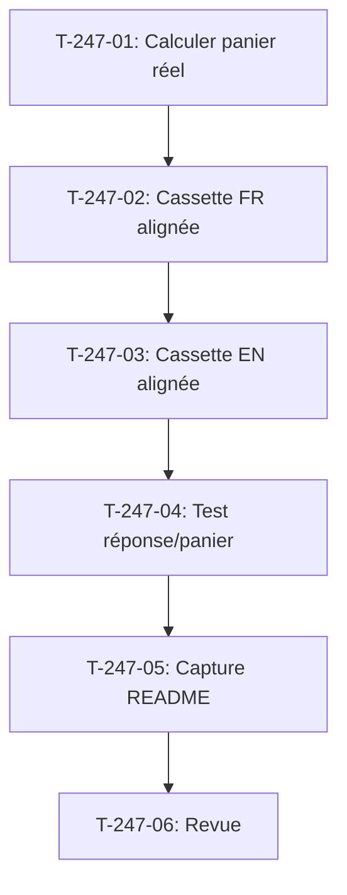

# Tâches - US-247 : Copilote d'achat — réponse enregistrée cohérente avec le panier de Claire

## Informations US
- **Epic** : EPIC-16
- **Persona** : Camille (recruteuse), Claire (acheteuse)
- **Story Points** : 1
- **Sprint** : sprint-39-conception-graphique

## Résumé de la US
**En tant que** visiteuse de la démo  
**Je veux** que la réponse du copilote corresponde au panier affiché à côté  
**Afin de** croire ce que la démonstration montre

## Vue d'ensemble des tâches

| ID | Type | Tâche | Estimation | Dépend de | Statut |
|----|------|-------|------------|-----------|--------|
| T-247-01 | [BE] | Calculer le panier réel de Claire après remise à zéro (nombre d'articles, total) | 0,5 h | - | 🔲 |
| T-247-02 | [BE] | Cassette de démo : réponse FR « 47 articles, 1 017,35 € » (ou panier réel) | 0,5 h | T-247-01 | 🔲 |
| T-247-03 | [BE] | Cassette de démo : réponse EN « 47 items, €1,017.35 » (format anglais) | 0,25 h | T-247-02 | 🔲 |
| T-247-04 | [TEST] | Test comparant la réponse enregistrée au panier de Claire (rouge puis vert) | 1 h | T-247-03 | 🔲 |
| T-247-05 | [DOC] | Capture du README du copilote refaite si la réponse y figure | 0,25 h | T-247-04 | 🔲 |
| T-247-06 | [REV] | Revue : réponse alignée FR/EN, test rouge puis vert, CI verte | 0,25 h | T-247-05 | 🔲 |

**Total estimé** : 2,75 h

---

## Détail des tâches

### T-247-01 : Calculer le panier réel de Claire
- **Type** : [BE]
- **Estimation** : 0,5 h
- **Dépend de** : -

**Description** :
Lancer la démo en local, se connecter avec le compte de Claire (`claire@acme-industries.com`), consulter son panier après la remise à zéro (3h du matin) et relever le nombre d'articles et le total exact en euros. Ces chiffres serviront de base aux réponses enregistrées FR et EN.

**Fichiers** :
- Aucun (vérification manuelle locale)

**Critères** :
- [ ] Nombre d'articles et total du panier de Claire relevés
- [ ] Chiffres exacts cités dans le rapport du worker

---

### T-247-02 : Cassette de démo FR alignée
- **Type** : [BE]
- **Estimation** : 0,5 h
- **Dépend de** : T-247-01

**Description** :
Modifier la cassette de démonstration `config/cassettes.jsonl` pour aligner la réponse FR à « état de mon panier » sur les fixtures : « Vous avez 47 articles dans votre panier, pour un total de 1 017,35 €. » (ou les chiffres réels relevés à T-247-01).

**Fichiers** :
- `config/cassettes.jsonl` (modification de la réponse FR)

**Critères** :
- [ ] Réponse FR alignée sur le panier réel de Claire
- [ ] Format : nombre d'articles et total en euros
- [ ] Commit git cité dans le rapport

---

### T-247-03 : Cassette de démo EN alignée
- **Type** : [BE]
- **Estimation** : 0,25 h
- **Dépend de** : T-247-02

**Description** :
Modifier la cassette de démonstration pour aligner la réponse EN à « what's in my cart » sur les fixtures : « You have 47 items in your cart, totaling €1,017.35. » (format anglais : virgule des milliers, point décimal).

**Fichiers** :
- `config/cassettes.jsonl` (modification de la réponse EN)

**Critères** :
- [ ] Réponse EN alignée sur le panier réel de Claire
- [ ] Format anglais : « 47 items, €1,017.35 »
- [ ] Commit git cité dans le rapport

---

### T-247-04 : Test comparant réponse et panier
- **Type** : [TEST]
- **Estimation** : 1 h
- **Dépend de** : T-247-03

**Description** :
Test fonctionnel de la démo : se connecter avec Claire, consulter son panier (nombre d'articles et total), demander « état de mon panier » au copilote, et vérifier que la réponse contient les mêmes chiffres. **Test rouge prouvé** en conservant l'ancienne réponse (« 3 articles, 150 € »), échec cité dans le commit, puis vert après correction.

**Fichiers** :
- `tests/Functional/Copilot/CartStateResponseTest.php` (nouveau)

**Critères** :
- [ ] Test se connecte avec Claire, consulte son panier
- [ ] Test demande « état de mon panier » au copilote
- [ ] Test vérifie que la réponse contient le nombre d'articles et le total du panier
- [ ] **Commit de test rouge avec échec cité** (ancienne réponse « 3 articles, 150 € »)
- [ ] Test vert après correction
- [ ] Tests lancés en local (`bin/run-tests`) et « Tests: N » cité
- [ ] CI verte

---

### T-247-05 : Capture du README refaite si nécessaire
- **Type** : [DOC]
- **Estimation** : 0,25 h
- **Dépend de** : T-247-04

**Description** :
Vérifier si la réponse « état de mon panier » figure dans une capture du README EN ou FR du plugin copilote. Si oui, refaire la capture avec la nouvelle réponse. Sinon, aucune action.

**Fichiers** :
- Plugin copilote `/Users/tmonier/Projects/sylius_plugins/sylius-b2b-sales-copilot-plugin/docs/screenshots/*` (si nécessaire)
- Plugin copilote `README.md` et `README.fr.md` (si nécessaire)

**Critères** :
- [ ] README EN et FR vérifiés
- [ ] Si capture contient l'ancienne réponse : refaite avec la nouvelle réponse
- [ ] Si aucune capture concernée : consigné dans le rapport

---

### T-247-06 : Revue finale
- **Type** : [REV]
- **Estimation** : 0,25 h
- **Dépend de** : T-247-05

**Description** :
Revue de conformité DoD : réponse enregistrée alignée sur les fixtures (FR et EN), test comparant la réponse au panier, rouge prouvé avec l'ancienne réponse, CI verte.

**Critères** :
- [ ] DoD conforme (réponse alignée FR/EN, test rouge puis vert, CI verte)
- [ ] Réponse visible en local sur le compte B2B de Claire
- [ ] Capture du README refaite si nécessaire

## Lien vers les critères d'acceptation Gherkin

Voir [US-247](../../backlog/user-stories/US-247.md).

## Dépendances

