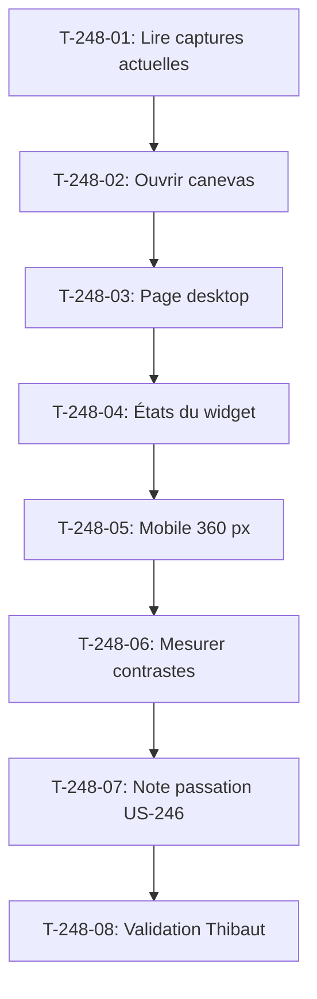

# Tâches - US-248 : Copilote d'achat — conception graphique du widget dans Claude Design

## Informations US
- **Epic** : EPIC-16
- **Persona** : Claire (acheteuse), Thibaut (démonstrateur)
- **Story Points** : 2
- **Sprint** : sprint-39-conception-graphique

## Résumé de la US
**En tant que** Thibaut  
**Je veux** valider une maquette du widget du copilote avant qu'il soit codé  
**Afin que** le chat s'intègre au tableau de bord B2B de la démo au lieu d'y être posé

## Vue d'ensemble des tâches

| ID | Type | Tâche | Estimation | Dépend de | Statut |
|----|------|-------|------------|-----------|--------|
| T-248-01 | [DOC] | Lire captures actuelles du widget (README copilote, démo) | 0,25 h | - | 🔲 |
| T-248-02 | [FE-WEB] | Ouvrir le canevas Claude Design `G2StRQigRKD6SqNRoyHpkW` | 0,25 h | T-248-01 | 🔲 |
| T-248-03 | [FE-WEB] | Ajouter la page « Copilote d'achat » : tableau de bord B2B desktop 1280 px avec le widget | 1,5 h | T-248-02 | 🔲 |
| T-248-04 | [FE-WEB] | États du widget : vide, question envoyée, réponse en cours, réponse, repli, erreur | 1 h | T-248-03 | 🔲 |
| T-248-05 | [FE-WEB] | Responsive mobile 360 px | 0,75 h | T-248-04 | 🔲 |
| T-248-06 | [TEST] | Mesurer les contrastes : chaque texte AAA (7:1, ou 4,5:1 pour texte large) | 0,5 h | T-248-05 | 🔲 |
| T-248-07 | [DOC] | Note de passation pour US-246 : jetons, styles plugin, styles thème, contrastes | 0,5 h | T-248-06 | 🔲 |
| T-248-08 | [REV] | Maquette validée par Thibaut, consignée au registre | 0,25 h | T-248-07 | 🔲 |

**Total estimé** : 5 h

---

## Détail des tâches

### T-248-01 : Lire captures actuelles
- **Type** : [DOC]
- **Estimation** : 0,25 h
- **Dépend de** : -

**Description** :
Lire les captures actuelles du widget du copilote dans le README du plugin et dans la démo. Relever la disposition, les couleurs, les textes, les états visibles. Ces captures servent de point de départ pour la maquette.

**Fichiers** :
- Plugin copilote `/Users/tmonier/Projects/sylius_plugins/sylius-b2b-sales-copilot-plugin/docs/screenshots/widget-dashboard-fr.png`
- Plugin copilote `/Users/tmonier/Projects/sylius_plugins/sylius-b2b-sales-copilot-plugin/docs/screenshots/copilot-response-fr.png`

**Critères** :
- [ ] Captures actuelles lues et analysées
- [ ] Disposition, couleurs, textes relevés dans le rapport

---

### T-248-02 : Ouvrir le canevas Claude Design
- **Type** : [FE-WEB]
- **Estimation** : 0,25 h
- **Dépend de** : T-248-01

**Description** :
Ouvrir le canevas Claude Design unique `G2StRQigRKD6SqNRoyHpkW` (pas de nouveau projet). Vérifier les pages existantes et les jetons de design du thème Industrie & Négoce.

**Fichiers** :
- Canevas Claude Design `G2StRQigRKD6SqNRoyHpkW`

**Critères** :
- [ ] Canevas ouvert
- [ ] Pages existantes vérifiées
- [ ] Jetons de design du thème relevés (couleurs, typographie, espacements)

---

### T-248-03 : Ajouter la page « Copilote d'achat » desktop
- **Type** : [FE-WEB]
- **Estimation** : 1,5 h
- **Dépend de** : T-248-02

**Description** :
Ajouter la page « Copilote d'achat » au canevas, desktop 1280 px. Maquetter le tableau de bord B2B de Claire (en-tête, navigation, widgets existants) avec le widget du copilote. Points à trancher : place du widget (bloc dans la colonne, panneau latéral ou bouton flottant).

**Fichiers** :
- Canevas Claude Design `G2StRQigRKD6SqNRoyHpkW` (nouvelle page « Copilote d'achat »)

**Critères** :
- [ ] Page « Copilote d'achat » ajoutée au canevas
- [ ] Tableau de bord B2B desktop 1280 px avec le widget
- [ ] Place du widget décidée et consignée dans le rapport

---

### T-248-04 : États du widget
- **Type** : [FE-WEB]
- **Estimation** : 1 h
- **Dépend de** : T-248-03

**Description** :
Maquetter les 6 états du widget : (1) vide (aucune question posée), (2) question envoyée, (3) réponse en cours (chargement), (4) réponse affichée, (5) repli « Scénario non enregistré en démo », (6) erreur. Ajouter aussi les suggestions cliquables d'US-215 et la mention « Réponses enregistrées en démo ».

**Fichiers** :
- Canevas Claude Design `G2StRQigRKD6SqNRoyHpkW` (page « Copilote d'achat », états du widget)

**Critères** :
- [ ] 6 états maquettés : vide, question, chargement, réponse, repli, erreur
- [ ] Suggestions cliquables d'US-215 visibles
- [ ] Mention « Réponses enregistrées en démo »
- [ ] Question et réponse distinguées visuellement

---

### T-248-05 : Responsive mobile 360 px
- **Type** : [FE-WEB]
- **Estimation** : 0,75 h
- **Dépend de** : T-248-04

**Description** :
Adapter la maquette du tableau de bord et du widget pour mobile 360 px. Le widget doit rester utilisable et lisible sur petit écran.

**Fichiers** :
- Canevas Claude Design `G2StRQigRKD6SqNRoyHpkW` (page « Copilote d'achat », version mobile)

**Critères** :
- [ ] Maquette mobile 360 px ajoutée à la page
- [ ] Widget utilisable et lisible sur petit écran
- [ ] États principaux visibles en mobile (au moins vide, réponse, repli)

---

### T-248-06 : Mesurer les contrastes
- **Type** : [TEST]
- **Estimation** : 0,5 h
- **Dépend de** : T-248-05

**Description** :
Mesurer les contrastes de tous les textes du widget (question, réponse, suggestions, mention, repli, erreur) par rapport à leur fond. Chaque texte doit atteindre le niveau AAA : 7:1 pour texte normal, 4,5:1 pour texte large (>= 18 pt ou >= 14 pt gras). Citer les contrastes dans le rapport.

**Fichiers** :
- Aucun (mesure externe, outil de contraste)

**Critères** :
- [ ] Contrastes mesurés pour tous les textes du widget
- [ ] Chaque texte atteint AAA (7:1 ou 4,5:1)
- [ ] Contrastes cités dans le rapport

---

### T-248-07 : Note de passation pour US-246
- **Type** : [DOC]
- **Estimation** : 0,5 h
- **Dépend de** : T-248-06

**Description** :
Rédiger la note de passation pour US-246 (mise en forme du widget) : jetons utilisés (couleurs, typographie, espacements), styles livrés par le plugin (neutre, variables Bootstrap), styles propres au thème de la démo (habillage Industrie & Négoce), contrastes mesurés. Cette note servira de base à l'implémentation.

**Fichiers** :
- `project-management/sprints/sprint-39-conception-graphique/tasks/note-passation-US-246.md` (nouveau)

**Critères** :
- [ ] Note de passation créée
- [ ] Jetons utilisés listés (couleurs, typographie, espacements)
- [ ] Styles du plugin distingués des styles du thème
- [ ] Contrastes mesurés cités
- [ ] Critères d'acceptation d'US-246 mis à jour d'après la maquette

---

### T-248-08 : Maquette validée par Thibaut
- **Type** : [REV]
- **Estimation** : 0,25 h
- **Dépend de** : T-248-07

**Description** :
Présenter la maquette à Thibaut pour validation. Si acceptée, consigner la validation au registre du sprint. Si refusée, consigner les retours et reprendre la maquette (US-246 reste bloquée jusqu'à validation).

**Fichiers** :
- `project-management/sprints/sprint-39-conception-graphique/registre-decisions.md` (validation de Thibaut)

**Critères** :
- [ ] Maquette présentée à Thibaut
- [ ] Si validée : consignée au registre avec date et auteur (Thibaut)
- [ ] Si refusée : retours consignés et maquette à reprendre

---

**IMPORTANT** : Cette US est faite par le worker `wdesign`, qui ne fait **aucun commit git** ni aucune commande. Il travaille uniquement dans le canevas Claude Design `G2StRQigRKD6SqNRoyHpkW`.

## Lien vers les critères d'acceptation Gherkin

Voir [US-248](../../backlog/user-stories/US-248.md).

## Dépendances

