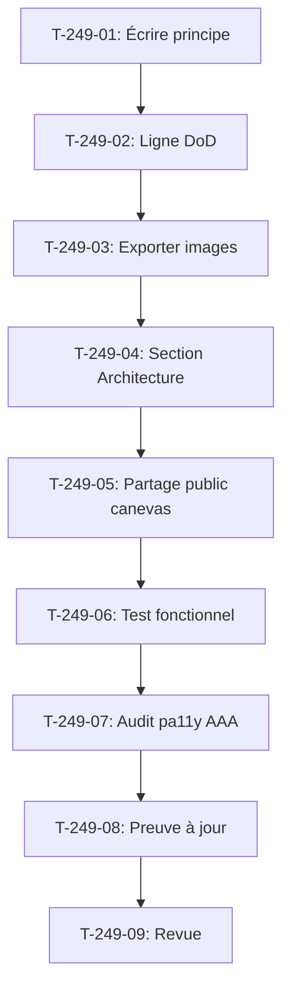

# Tâches - US-249 : Conception graphique dans Claude Design — principe écrit et maquettes montrées dans la démo

## Informations US
- **Epic** : EPIC-12
- **Persona** : Camille (recruteuse), Thibaut (démonstrateur)
- **Story Points** : 3
- **Sprint** : sprint-39-conception-graphique

## Résumé de la US
**En tant que** recruteuse  
**Je veux** voir comment un écran de la démo est passé de la maquette à la page livrée  
**Afin de** juger la démarche de conception et pas seulement le résultat

## Vue d'ensemble des tâches

| ID | Type | Tâche | Estimation | Dépend de | Statut |
|----|------|-------|------------|-----------|--------|
| T-249-01 | [DOC] | Écrire `docs/conception-graphique.md` : principe, canevas unique, validation avant Twig, export images | 1 h | - | 🔲 |
| T-249-02 | [DOC] | Ajouter la ligne à la Definition of Done des stories d'écran | 0,25 h | T-249-01 | 🔲 |
| T-249-03 | [DOC] | Exporter les images des maquettes existantes depuis le canevas `G2StRQigRKD6SqNRoyHpkW` | 1 h | T-249-02 | 🔲 |
| T-249-04 | [FE-WEB] | Section « De la maquette à l'écran » sur la page Architecture (FR et EN) | 1,5 h | T-249-03 | 🔲 |
| T-249-05 | [TEST] | Vérifier le partage public du canevas (lecture seule sans compte), consigner au registre | 0,5 h | T-249-04 | 🔲 |
| T-249-06 | [TEST] | Test fonctionnel : images présentes, textes alternatifs, poids < 300 Ko (rouge puis vert) | 1 h | T-249-05 | 🔲 |
| T-249-07 | [TEST] | Audit pa11y AAA de la section : aucune erreur détectée | 0,5 h | T-249-06 | 🔲 |
| T-249-08 | [DOC] | Page « Preuve technique » à jour (`bin/proof-refresh`), CI verte | 0,25 h | T-249-07 | 🔲 |
| T-249-09 | [REV] | Revue : principe écrit, DoD mise à jour, section Architecture, test rouge puis vert, pa11y AAA, CI verte | 0,25 h | T-249-08 | 🔲 |

**Total estimé** : 6,25 h

---

## Détail des tâches

### T-249-01 : Écrire `docs/conception-graphique.md`
- **Type** : [DOC]
- **Estimation** : 1 h
- **Dépend de** : -

**Description** :
Créer `docs/conception-graphique.md` qui documente le principe de conception graphique : (1) tout nouvel écran ou toute refonte visible passe par une page du canevas Claude Design unique `G2StRQigRKD6SqNRoyHpkW` ; (2) validation par Thibaut avant le premier gabarit Twig ; (3) export des images pour la démo (optimisées, textes alternatifs). Lister les écrans refondus depuis le sprint 29 : home et vitrine (US-186), « Mon compte » (US-198, US-200), pages de compte des plugins (US-203), Preuve et Architecture (US-205, US-206), thème (EPIC-18), copilote (US-248).

**Fichiers** :
- `docs/conception-graphique.md` (nouveau)

**Critères** :
- [ ] Principe écrit : canevas unique, validation avant Twig, export images
- [ ] Canevas `G2StRQigRKD6SqNRoyHpkW` cité
- [ ] Liste des écrans refondus depuis le sprint 29
- [ ] Méthode d'export des images décrite

---

### T-249-02 : Ligne à la Definition of Done des stories d'écran
- **Type** : [DOC]
- **Estimation** : 0,25 h
- **Dépend de** : T-249-01

**Description** :
Ajouter la ligne « [ ] Maquette Claude Design validée par Thibaut avant le premier gabarit Twig, consignée au registre » au gabarit de Definition of Done des stories d'écran (création ou refonte d'un écran).

**Fichiers** :
- Gabarit de DoD (à localiser : `project-management/templates/` ou `docs/`)

**Critères** :
- [ ] Ligne ajoutée au gabarit de DoD des stories d'écran
- [ ] Formulation exacte reprise de `docs/conception-graphique.md`

---

### T-249-03 : Exporter les images des maquettes existantes
- **Type** : [DOC]
- **Estimation** : 1 h
- **Dépend de** : T-249-02

**Description** :
Exporter les images des maquettes existantes depuis le canevas `G2StRQigRKD6SqNRoyHpkW` : home, vitrine, « Mon compte », pages de compte des plugins, Preuve, Architecture, thème, copilote (après US-248). Une image par page (desktop et mobile si pertinent), optimisée (< 300 Ko), avec texte alternatif descriptif. Sauvegarder dans `docs/mockups/`.

**Fichiers** :
- `docs/mockups/home-desktop.png` (nouveau)
- `docs/mockups/vitrine-desktop.png` (nouveau)
- `docs/mockups/mon-compte-desktop.png` (nouveau)
- `docs/mockups/mon-compte-mobile.png` (nouveau)
- `docs/mockups/preuve-desktop.png` (nouveau)
- `docs/mockups/architecture-desktop.png` (nouveau)
- `docs/mockups/copilote-desktop.png` (nouveau, après US-248)
- etc. (autres pages refondues)

**Critères** :
- [ ] Images exportées depuis le canevas Claude Design
- [ ] Une image par page, desktop et mobile si pertinent
- [ ] Optimisées (< 300 Ko chacune)
- [ ] Textes alternatifs descriptifs préparés
- [ ] Images sauvegardées dans `docs/mockups/`

---

### T-249-04 : Section « De la maquette à l'écran » sur la page Architecture
- **Type** : [FE-WEB]
- **Estimation** : 1,5 h
- **Dépend de** : T-249-03

**Description** :
Ajouter la section « De la maquette à l'écran » à la page Architecture (FR et EN). Pour chaque écran refondu : (1) titre de l'écran, (2) maquette exportée, (3) capture de la page livrée (si disponible), (4) lien vers la page livrée. Si le partage public du canevas existe (T-249-05), ajouter un lien « Voir toutes les maquettes ». Sinon, ne rien ajouter et consigner au registre.

**Fichiers** :
- `templates/frontend/page/architecture.html.twig` (section ajoutée)
- `translations/messages.fr.yaml` (titres, légendes FR)
- `translations/messages.en.yaml` (titres, légendes EN)

**Critères** :
- [ ] Section « De la maquette à l'écran » ajoutée à la page Architecture (FR et EN)
- [ ] Pour chaque écran refondu : maquette + page livrée côte à côte + lien
- [ ] Images avec textes alternatifs descriptifs
- [ ] Lien public vers le canevas ajouté si T-249-05 le confirme
- [ ] Langue anglaise : titres, légendes et textes alternatifs en anglais

---

### T-249-05 : Vérifier le partage public du canevas
- **Type** : [TEST]
- **Estimation** : 0,5 h
- **Dépend de** : T-249-04

**Description** :
Vérifier si Claude Design permet un partage public en lecture seule du canevas `G2StRQigRKD6SqNRoyHpkW` sans compte. Si oui, ajouter le lien « Voir toutes les maquettes » à la section. Si non, consigner la vérification au registre et ne rien ajouter.

**Fichiers** :
- `project-management/sprints/sprint-39-conception-graphique/registre-decisions.md` (vérification consignée)

**Critères** :
- [ ] Vérification du partage public effectuée
- [ ] Si partage public existe : lien ajouté à la section Architecture
- [ ] Si partage public n'existe pas : vérification consignée au registre, aucun lien ajouté

---

### T-249-06 : Test fonctionnel de la section
- **Type** : [TEST]
- **Estimation** : 1 h
- **Dépend de** : T-249-05

**Description** :
Test fonctionnel de la démo : vérifier que toutes les images de la section « De la maquette à l'écran » sont présentes, ont un texte alternatif non vide, et pèsent moins de 300 Ko chacune. **Test rouge prouvé** en omettant un texte alternatif ou en ajoutant une image trop lourde, échec cité dans le commit, puis vert après correction.

**Fichiers** :
- `tests/Functional/Architecture/MockupsTest.php` (nouveau)

**Critères** :
- [ ] Test vérifie la présence de toutes les images de la section
- [ ] Test vérifie que chaque image a un texte alternatif non vide
- [ ] Test vérifie que chaque image pèse moins de 300 Ko
- [ ] **Commit de test rouge avec échec cité** (texte alternatif manquant ou image trop lourde)
- [ ] Test vert après correction
- [ ] Tests lancés en local (`bin/run-tests`) et « Tests: N » cité
- [ ] CI verte

---

### T-249-07 : Audit pa11y AAA de la section
- **Type** : [TEST]
- **Estimation** : 0,5 h
- **Dépend de** : T-249-06

**Description** :
Audit pa11y AAA de la page Architecture avec la section « De la maquette à l'écran » : aucune erreur d'accessibilité détectée. Lancer `bin/pa11y-audit` sur la page Architecture.

**Fichiers** :
- `bin/pa11y-audit` (script existant)

**Critères** :
- [ ] Audit pa11y AAA de la page Architecture
- [ ] Aucune erreur d'accessibilité détectée
- [ ] Rapport d'audit conservé

---

### T-249-08 : Page « Preuve technique » à jour
- **Type** : [DOC]
- **Estimation** : 0,25 h
- **Dépend de** : T-249-07

**Description** :
Lancer `bin/proof-refresh` pour mettre à jour la page « Preuve technique » avec les dernières informations. Vérifier que la CI est verte.

**Fichiers** :
- `bin/proof-refresh` (script existant)

**Critères** :
- [ ] `bin/proof-refresh` lancé sans erreur
- [ ] Page « Preuve technique » à jour
- [ ] CI verte

---

### T-249-09 : Revue finale
- **Type** : [REV]
- **Estimation** : 0,25 h
- **Dépend de** : T-249-08

**Description** :
Revue de conformité DoD : principe écrit dans `docs/conception-graphique.md`, ligne ajoutée au gabarit de DoD, section « De la maquette à l'écran » sur la page Architecture (FR et EN), test fonctionnel rouge puis vert, audit pa11y AAA sans erreur, page Preuve à jour, CI verte.

**Critères** :
- [ ] DoD conforme (principe, DoD mise à jour, section Architecture, test, pa11y AAA, Preuve, CI verte)
- [ ] Section visible en local sur la page Architecture (FR et EN)
- [ ] Toutes les images présentes et optimisées

## Lien vers les critères d'acceptation Gherkin

Voir [US-249](../../backlog/user-stories/US-249.md).

## Dépendances

