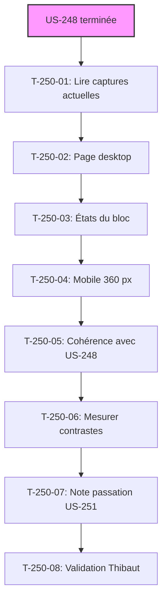

# Tâches - US-250 : Commerce prédictif — conception graphique du bloc de réassort dans Claude Design

## Informations US
- **Epic** : EPIC-17
- **Persona** : Claire (acheteuse), Thibaut (démonstrateur)
- **Story Points** : 2
- **Sprint** : sprint-39-conception-graphique

## Résumé de la US
**En tant que** Thibaut  
**Je veux** valider une maquette du bloc de réassort avant de le reprendre  
**Afin qu'**il s'intègre au tableau de bord B2B au lieu d'y être posé

## Vue d'ensemble des tâches

| ID | Type | Tâche | Estimation | Dépend de | Statut |
|----|------|-------|------------|-----------|--------|
| T-250-01 | [DOC] | Lire captures actuelles du bloc de réassort (README commerce prédictif, démo) | 0,25 h | US-248 terminée | 🔲 |
| T-250-02 | [FE-WEB] | Ajouter la page « Réassort » : tableau de bord B2B desktop 1280 px avec le bloc | 1 h | T-250-01 | 🔲 |
| T-250-03 | [FE-WEB] | États du bloc : aucune alerte, une alerte, plusieurs alertes dont une en retard | 1 h | T-250-02 | 🔲 |
| T-250-04 | [FE-WEB] | Responsive mobile 360 px | 0,5 h | T-250-03 | 🔲 |
| T-250-05 | [TEST] | Vérifier cohérence avec US-248 : jetons, espacements, en-têtes de bloc | 0,5 h | T-250-04 | 🔲 |
| T-250-06 | [TEST] | Mesurer les contrastes : AAA, retard non signalé par la seule couleur | 0,5 h | T-250-05 | 🔲 |
| T-250-07 | [DOC] | Note de passation pour US-251 : jetons, styles plugin, styles thème, contrastes | 0,5 h | T-250-06 | 🔲 |
| T-250-08 | [REV] | Maquette validée par Thibaut, consignée au registre | 0,25 h | T-250-07 | 🔲 |

**Total estimé** : 4,5 h

---

## Détail des tâches

### T-250-01 : Lire captures actuelles
- **Type** : [DOC]
- **Estimation** : 0,25 h
- **Dépend de** : US-248 terminée

**Description** :
Lire les captures actuelles du bloc de réassort dans le README du plugin commerce prédictif et dans la démo. Relever la disposition, les couleurs, les textes, les états visibles. **Cette tâche ne commence qu'après US-248 terminée**, car la maquette du réassort doit partager les jetons de design du copilote.

**Fichiers** :
- Plugin commerce prédictif `/Users/tmonier/Projects/sylius_plugins/sylius-b2b-predictive-commerce-plugin/docs/screenshots/*` (si existants)

**Critères** :
- [ ] US-248 terminée (page « Copilote d'achat » validée)
- [ ] Captures actuelles du bloc de réassort lues et analysées
- [ ] Disposition, couleurs, textes relevés dans le rapport

---

### T-250-02 : Ajouter la page « Réassort » desktop
- **Type** : [FE-WEB]
- **Estimation** : 1 h
- **Dépend de** : T-250-01

**Description** :
Ajouter la page « Réassort » au canevas `G2StRQigRKD6SqNRoyHpkW`, desktop 1280 px. Maquetter le tableau de bord B2B de Claire avec le bloc d'alertes de réassort. **Utiliser les jetons de design de la page « Copilote d'achat »** (couleurs, typographie, espacements). Points à trancher : place du bloc et sa cohabitation avec le widget du copilote.

**Fichiers** :
- Canevas Claude Design `G2StRQigRKD6SqNRoyHpkW` (nouvelle page « Réassort »)

**Critères** :
- [ ] Page « Réassort » ajoutée au canevas
- [ ] Tableau de bord B2B desktop 1280 px avec le bloc de réassort
- [ ] Jetons de design de la page « Copilote d'achat » réutilisés
- [ ] Place du bloc décidée et consignée dans le rapport

---

### T-250-03 : États du bloc
- **Type** : [FE-WEB]
- **Estimation** : 1 h
- **Dépend de** : T-250-02

**Description** :
Maquetter les 3 états du bloc : (1) aucune alerte (message d'absence ou bloc masqué), (2) une alerte (référence, date estimée, retard, quantité habituelle, action « Préparer le panier »), (3) plusieurs alertes dont une en retard marqué. Le retard ne doit pas être signalé par la seule couleur (icône, mention textuelle).

**Fichiers** :
- Canevas Claude Design `G2StRQigRKD6SqNRoyHpkW` (page « Réassort », états du bloc)

**Critères** :
- [ ] 3 états maquettés : aucune alerte, une alerte, plusieurs alertes dont une en retard
- [ ] Alerte présente : référence, date estimée, retard, quantité, action
- [ ] Retard signalé par icône + mention, pas seulement par couleur

---

### T-250-04 : Responsive mobile 360 px
- **Type** : [FE-WEB]
- **Estimation** : 0,5 h
- **Dépend de** : T-250-03

**Description** :
Adapter la maquette du tableau de bord et du bloc de réassort pour mobile 360 px. Le bloc doit rester lisible et l'action « Préparer le panier » accessible sur petit écran.

**Fichiers** :
- Canevas Claude Design `G2StRQigRKD6SqNRoyHpkW` (page « Réassort », version mobile)

**Critères** :
- [ ] Maquette mobile 360 px ajoutée à la page
- [ ] Bloc lisible et action accessible sur petit écran
- [ ] États principaux visibles en mobile (au moins une alerte, retard)

---

### T-250-05 : Vérifier cohérence avec US-248
- **Type** : [TEST]
- **Estimation** : 0,5 h
- **Dépend de** : T-250-04

**Description** :
Vérifier que les maquettes du copilote (US-248) et du réassort partagent les mêmes jetons (couleurs primaires, secondaires, neutres, typographie, corps de texte, titres), les mêmes espacements (marges, paddings) et les mêmes en-têtes de bloc. Citer les jetons partagés dans le rapport.

**Fichiers** :
- Canevas Claude Design `G2StRQigRKD6SqNRoyHpkW` (pages « Copilote d'achat » et « Réassort »)

**Critères** :
- [ ] Jetons partagés vérifiés (couleurs, typographie, corps, titres)
- [ ] Espacements cohérents (marges, paddings)
- [ ] En-têtes de bloc cohérents
- [ ] Jetons partagés cités dans le rapport

---

### T-250-06 : Mesurer les contrastes
- **Type** : [TEST]
- **Estimation** : 0,5 h
- **Dépend de** : T-250-05

**Description** :
Mesurer les contrastes de tous les textes du bloc (référence, date, retard, quantité, action) par rapport à leur fond. Chaque texte doit atteindre le niveau AAA : 7:1 pour texte normal, 4,5:1 pour texte large. Vérifier que le retard n'est pas signalé par la seule couleur (icône + mention). Citer les contrastes dans le rapport.

**Fichiers** :
- Aucun (mesure externe, outil de contraste)

**Critères** :
- [ ] Contrastes mesurés pour tous les textes du bloc
- [ ] Chaque texte atteint AAA (7:1 ou 4,5:1)
- [ ] Retard signalé par icône + mention, pas seulement par couleur
- [ ] Contrastes cités dans le rapport

---

### T-250-07 : Note de passation pour US-251
- **Type** : [DOC]
- **Estimation** : 0,5 h
- **Dépend de** : T-250-06

**Description** :
Rédiger la note de passation pour US-251 (mise en forme du bloc) : jetons utilisés (couleurs, typographie, espacements), styles livrés par le plugin (neutre, variables Bootstrap), styles propres au thème de la démo (habillage Industrie & Négoce), contrastes mesurés. Cette note servira de base à l'implémentation.

**Fichiers** :
- `project-management/sprints/sprint-39-conception-graphique/tasks/note-passation-US-251.md` (nouveau)

**Critères** :
- [ ] Note de passation créée
- [ ] Jetons utilisés listés (couleurs, typographie, espacements)
- [ ] Styles du plugin distingués des styles du thème
- [ ] Contrastes mesurés cités

---

### T-250-08 : Maquette validée par Thibaut
- **Type** : [REV]
- **Estimation** : 0,25 h
- **Dépend de** : T-250-07

**Description** :
Présenter la maquette à Thibaut pour validation. Si acceptée, consigner la validation au registre du sprint. Si refusée, consigner les retours et reprendre la maquette (US-251 reste bloquée jusqu'à validation).

**Fichiers** :
- `project-management/sprints/sprint-39-conception-graphique/registre-decisions.md` (validation de Thibaut)

**Critères** :
- [ ] Maquette présentée à Thibaut
- [ ] Si validée : consignée au registre avec date et auteur (Thibaut)
- [ ] Si refusée : retours consignés et maquette à reprendre

---

**IMPORTANT** : Cette US est faite par le même worker `wdesign` qu'US-248, **après US-248**, pour partager les jetons de design. wdesign ne fait **aucun commit git** ni aucune commande, seulement des maquettes dans le canevas Claude Design `G2StRQigRKD6SqNRoyHpkW`.

## Lien vers les critères d'acceptation Gherkin

Voir [US-250](../../backlog/user-stories/US-250.md).

## Dépendances

