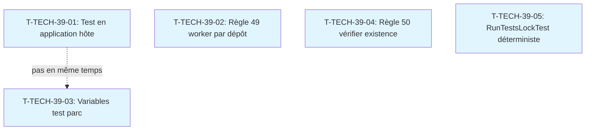

# Tâches transverses : Sprint 039 (actions de la rétro du sprint 38)

> Actions de la rétrospective du sprint 38 (lignes ~141-191 de `sprint-38-consolidation-vitrine/sprint-retro.md`). Ces tâches sont hors points mais comptent dans la capacité (environ 6 h).

## Vue d'ensemble

| ID | Type | Tâche | Estimation | Dépend de | Statut |
|----|------|-------|------------|-----------|--------|
| T-TECH-39-01 | [TEST][DOC] | Test en application hôte avant chaque tag de plugin (gabarit + application aux plugins parc et copilote) | 1,5 h | - | 🔲 |
| T-TECH-39-02 | [DOC] | Règle 49 : un worker par dépôt pour les stories multi-dépôts | 0,5 h | - | 🔲 |
| T-TECH-39-03 | [TEST] | Variables de test du plugin parc en `<server>` dans phpunit.xml.dist | 1,5 h | - | 🔲 |
| T-TECH-39-04 | [DOC] | Règle 50 : vérifier existence d'un fichier avant de le créer | 0,5 h | - | 🔲 |
| T-TECH-39-05 | [TEST] | Rendre RunTestsLockTest déterministe (synchronisation par fichier) | 2 h | - | 🔲 |

**Total estimé** : 6 h

---

## Détail des tâches

### T-TECH-39-01 : Test en application hôte avant chaque tag de plugin
- **Type** : [TEST][DOC]
- **Estimation** : 1,5 h
- **Dépend de** : -

**Description** :
Ajouter à `docs/gabarits-tests.md` un gabarit de test fonctionnel qui rend chaque page shop du plugin par une route préfixée par la langue (`/en_US/...`, `/fr_FR/...`) et vérifie les textes visibles : titre, fil d'Ariane, boutons, et aucune clé de traduction brute (`/\b[a-z_]+\.[a-z_.]+\b/` absent du texte). Appliquer le gabarit aux plugins parc et copilote. Ce test évite les défauts trouvés au sprint 38 : hook préfixé, fil d'Ariane « Edit the machine », clé brute `sylius.ui.back_to_list`, adresse `/api/copilot/chat` sans préfixe de langue.

**Fichiers** :
- `docs/gabarits-tests.md` (nouveau gabarit ajouté)
- Plugin parc `/Users/tmonier/Projects/sylius_plugins/sylius-customer-asset-management-plugin/tests/Functional/EquipmentPageTest.php` (nouveau)
- Plugin copilote `/Users/tmonier/Projects/sylius_plugins/sylius-b2b-sales-copilot-plugin/tests/Functional/WidgetOnDashboardTest.php` (nouveau)

**Critères** :
- [ ] Gabarit ajouté à `docs/gabarits-tests.md` : route préfixée, vérification des textes visibles, regex clé brute
- [ ] Test de la page machine du plugin parc : route `/fr_FR/account/equipment/...`, fil d'Ariane, titre, aucune clé brute
- [ ] Test du widget du copilote : route du tableau de bord, widget présent, adresse de chat avec préfixe
- [ ] Rouge prouvé en réintroduisant l'un des défauts du sprint 38 (CI citée)
- [ ] CI des deux plugins verte
- [ ] Au sprint 39, 0 release corrective pour libellé ou adresse

---

### T-TECH-39-02 : Règle 49 — un worker par dépôt
- **Type** : [DOC]
- **Estimation** : 0,5 h
- **Dépend de** : -

**Description** :
Nouvelle règle 49 dans `consigne-worker.md` : une story qui touche plusieurs dépôts est découpée en un worker par dépôt, lancés dans l'ordre des dépendances (plugin, puis démo). Chaque worker cite dans son rapport la commande `grep` dans `vendor/` qui prouve l'existence de chaque méthode, route ou fonction Twig utilisée (règle 38). Cette règle évite les erreurs de w242 et w242b au sprint 38 (méthode inventée, route inexistante, fonctions Twig supprimées).

**Fichiers** :
- `project-management/sprints/sprint-39-conception-graphique/consigne-worker.md` (règle 49)

**Critères** :
- [ ] Règle 49 écrite dans `consigne-worker.md`
- [ ] Obligation de découper en un worker par dépôt
- [ ] Obligation de citer `grep` dans `vendor/` pour chaque nom utilisé
- [ ] Au sprint 39, 0 worker sur deux dépôts et 0 nom inventé

---

### T-TECH-39-03 : Variables de test du plugin parc en `<server>`
- **Type** : [TEST]
- **Estimation** : 1,5 h
- **Dépend de** : -

**Description** :
Dans le plugin customer-asset-management, déclarer les variables `SYLIUS_TEST_APP_*` en `<server>` dans `phpunit.xml.dist`, comme le passeport, et étiqueter le repository comme service Doctrine (issue #14), avec un test qui appelle `getRepository(CustomerAsset::class)`. Les tests du plugin tournent ainsi en local sans fichier `.env` interdit aux workers. Rouge prouvé en CI avant la correction (repository non étiqueté), puis vert après.

**Fichiers** :
- Plugin parc `/Users/tmonier/Projects/sylius_plugins/sylius-customer-asset-management-plugin/phpunit.xml.dist` (variables en `<server>`)
- Plugin parc `src/Infrastructure/Persistence/Doctrine/Repository/CustomerAssetRepository.php` (service étiqueté)
- Plugin parc `tests/Functional/RepositoryAsServiceTest.php` (nouveau, teste l'issue #14)

**Critères** :
- [ ] Variables `SYLIUS_TEST_APP_*` en `<server>` dans `phpunit.xml.dist`
- [ ] Repository étiqueté comme service Doctrine
- [ ] Test de l'issue #14 : appel à `getRepository(CustomerAsset::class)`, rouge puis vert en CI
- [ ] `bin/run-tests` du plugin passe en local
- [ ] Issue #14 fermée par la PR
- [ ] Exception à la règle 46 levée

---

### T-TECH-39-04 : Règle 50 — vérifier existence avant création
- **Type** : [DOC]
- **Estimation** : 0,5 h
- **Dépend de** : -

**Description** :
Nouvelle règle 50 dans `consigne-worker.md`, appliquée aussi par l'orchestrateur : avant de créer un fichier, lancer `git ls-files <chemin>` et `ls <chemin>`. Si le fichier existe, le lire et le modifier, ou choisir un autre nom. Cette règle évite d'écraser un fichier existant (au sprint 38, l'orchestrateur a écrasé `RegistrationApprovalDemoTest.php`, 9 cas perdus, restaurés depuis git).

**Fichiers** :
- `project-management/sprints/sprint-39-conception-graphique/consigne-worker.md` (règle 50)

**Critères** :
- [ ] Règle 50 écrite dans `consigne-worker.md`
- [ ] Obligation de lancer `git ls-files` et `ls` avant création
- [ ] Obligation de lire ou choisir un autre nom si le fichier existe
- [ ] Au sprint 39, 0 fichier écrasé par erreur

---

### T-TECH-39-05 : Rendre RunTestsLockTest déterministe
- **Type** : [TEST]
- **Estimation** : 2 h
- **Dépend de** : -

**Description** :
Remplacer les délais `STUB_CAT_DELAY` et `STUB_LOCK_OP_DELAY` du test de prise d'un verrou périmé par une synchronisation par fichier : chaque run attend un fichier de feu vert au point critique. Le test reste rouge si le verrou de `bin/run-tests` n'est plus atomique. Ce test a échoué au sprint 22 et de nouveau au sprint 38 à cause des délais fixes, trop courts sous la charge de la CI avec couverture.

**Fichiers** :
- `tests/Unit/Tests/RunTestsLockTest.php` (remplacer délais par synchronisation)

**Critères** :
- [ ] Délais `STUB_CAT_DELAY` et `STUB_LOCK_OP_DELAY` remplacés par synchronisation par fichier
- [ ] Test passé 20 fois de suite en CI, sous la couverture
- [ ] Rouge prouvé en retirant l'opération atomique du verrou
- [ ] Au sprint 39, 0 échec de ce test

---

## Dépendances

Les tâches transverses sont **parallèles** et peuvent être lancées en même temps, sauf T-TECH-39-01 et T-TECH-39-03 qui modifient les plugins (risque de conflit git).

