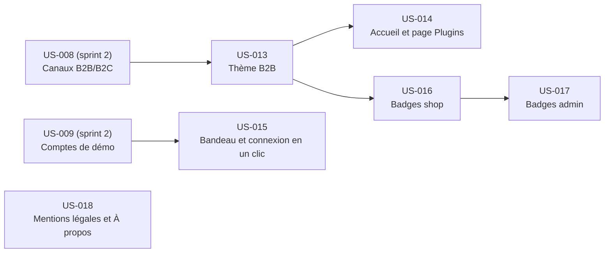

# Sprint 4 — Thème B2B

## Informations

| Attribut | Valeur |
|----------|--------|
| Numéro | 4 |
| Nom | theme-b2b |
| Début | 2026-10-16 |
| Fin | 2026-10-30 |
| Durée | 10 jours ouvrés |
| Points engagés | 28 |

## Sprint Goal

> Une démo qui a l'allure d'un shop B2B et qui guide la visite : thème, accueil et page Plugins, connexion en un clic, badges de plugin dans le shop et l'admin, mentions légales.

## Périmètre

- Thème B2B du shop par twig hooks et feuille Encore propre (`assets/`), actif sur le canal B2B (cookie, ADR-0011), sans remplacer les hookables des plugins.
- Page d'accueil B2B et page Plugins (21 plugins tmonier + nouveaux) alimentées par un registre YAML.
- Bandeau de démo, connexion en un clic, comptes de démo affichés sur les pages de login du shop et de l'admin, correction de `/demo/accounts` (Marc : TechParts uniquement) et **source unique des comptes** (fixtures, `/demo/accounts`, pages de login).
- Badges de plugin (registre YAML hook → plugin) dans le shop puis l'admin, désactivables.
- Mentions légales et page À propos.

Hors périmètre : nouveaux plugins publiés, refonte du back-office, thème du canal B2C.

## Lien avec le Sprint 3

Le sprint 3 livre les fonctionnalités B2B (référence PO, correctifs inter-plugins). Prérequis du sprint 4 : US-008 (canaux B2B/B2C) et US-009 (un client = une entreprise, comptes de démo) livrées.

## Sprint Backlog

| ID | Titre | Points | Dépend de | Tâches | Heures | Statut |
|----|-------|--------|-----------|--------|--------|--------|
| US-013 | Thème B2B du shop | 8 | US-008 | 8 | 10h30 | 🔵 To Do |
| US-014 | Page d'accueil B2B et page Plugins | 5 | US-013 | 7 | 11h30 | 🔵 To Do |
| US-015 | Bandeau de démo et connexion en un clic | 5 | US-009 | 10 | 16h30 | 🔵 To Do |
| US-016 | Badges de plugin dans le shop | 5 | US-013 | 6 | 8h30 | 🔵 To Do |
| US-017 | Badges de plugin dans l'admin | 3 | US-016 | 4 | 5h | 🔵 To Do |
| US-018 | Mentions légales et page À propos | 2 | — | 5 | 5h30 | 🔵 To Do |

**Total engagé : 28 points, 40 tâches, 57h30.** US-015 a été ré-estimée de 3 à 5 points (compléments décidés : login pages, source unique, correctif). Elle reste la story la plus lourde (16h30) : à ordonnancer tôt.

## Ordre de réalisation recommandé

1. US-013 (bloque US-014 et US-016), US-015 et US-018 en parallèle dès J1
2. US-014 et US-016 (après le squelette du thème T-013-01/02)
3. US-017 (après US-016)

Dépendance souple : le bouton de bascule des badges (T-016-04) vit dans le bandeau de US-015 (T-015-06).

## Dépendances inter-stories

## Definition of Done (rappel)

- [ ] Critères d'acceptation automatisés (tests fonctionnels ou de fumée) et verts
- [ ] ECS et PHPStan passent sur le code ajouté/modifié
- [ ] Libellés en français et en anglais si interface
- [ ] Aucun secret ni identifiant réel dans le dépôt (les comptes de démo fictifs vivent dans la source unique uniquement)
- [ ] Hookables des plugins non remplacés par le thème
- [ ] Documentation mise à jour si comportement visible
- [ ] CI verte sur la branche `feature/sprint-4-theme-b2b`

## Risques identifiés

| Risque | Probabilité | Impact | Mitigation |
|--------|-------------|--------|------------|
| Le thème remplace un hookable de plugin | Moyenne | Élevé | Test de snapshot des hookables (T-013-06) |
| Connexion en un clic exposée hors démo (porte dérobée) | Faible | Élevé | Garde `DemoMode`, 404 hors démo, CSRF, test dédié |
| Refactor de la source unique casse les fixtures | Moyenne | Moyen | Source unique introduite avant le refactor, `app:fixtures:load` en CI |
| Rendu des badges difficile sans toucher aux hooks de plugin | Moyenne | Moyen | Décorateur de rendu, spike de 2h dans T-016-02 |
| Build webpack (assets) cassé en CI | Faible | Moyen | Test de fumée du build |
| Ressemblance avec Sylius Plus (badges) | Faible | Moyen | Badges neutres, politique de communication Plus respectée |

## Cérémonies

| Cérémonie | Date indicative | Durée |
|-----------|----------------|-------|
| Sprint Planning Part 1 (Quoi) | 2026-10-16 | 2 h |
| Sprint Planning Part 2 (Comment) | 2026-10-16 | 2 h |
| Daily Scrum | Chaque jour | 15 min |
| Sprint Review | 2026-10-30 (matin) | 1 h |
| Rétrospective | 2026-10-30 (après-midi) | 1 h 30 |
| Affinage Backlog | 2026-10-23 (mid-sprint) | 1 h |
