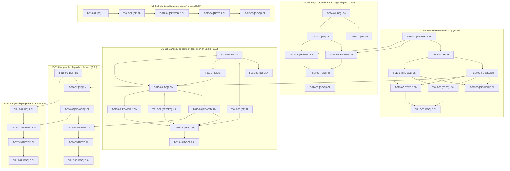

# Task Board — Sprint 4 (Thème B2B)

## Légende

- 🔲 À faire
- 🔄 En cours
- 👀 En review
- ✅ Terminé
- 🚫 Bloqué

---

## Graphe de dépendances global

> Liens inter-US : T-013-01 → T-014-04/05 (US-013 → US-014) ; T-013-03 → T-016-02 (US-013 → US-016) ; T-016-01/03 → T-017 (US-016 → US-017) ; T-015-06 → T-016-04 (emplacement du bouton badges dans le bandeau, dépendance souple).

---

## 🔲 À faire

### US-013 — Thème B2B du shop (dès J1)

| ID | Tâche | Type | Estimation |
|----|-------|------|------------|
| T-013-01 | Squelette du thème : entrée Encore `shop-b2b` + feuille de style propre | [FE-WEB] | 1.5h |
| T-013-02 | Activation du thème par canal B2B (cookie, ADR-0011), B2C inchangé | [BE] | 1h |
| T-013-03 | Listes de produits denses via twig hooks (SKU, conditionnement, stock, prix HT, palier « dès ») | [FE-WEB] | 2h |
| T-013-04 | Fiche produit : références et documents | [FE-WEB] | 2h |
| T-013-05 | Libellés FR/EN du thème | [FE-WEB] | 0.5h |
| T-013-06 | Test de non-régression des hooks de plugins (aucun hookable remplacé) | [TEST] | 1.5h |
| T-013-07 | Tests fonctionnels : catalogue connecté, anonyme, B2C, produit sans conditionnement, asset absent | [TEST] | 1.5h |
| T-013-08 | Documentation du thème (structure assets, hooks ajoutés) | [DOC] | 0.5h |

### US-014 — Page d'accueil B2B et page Plugins (après US-013)

| ID | Tâche | Type | Estimation |
|----|-------|------|------------|
| T-014-01 | Registre YAML des plugins + service `PluginRegistry` avec validation | [BE] | 1.5h |
| T-014-02 | Contenu des cartes : 21 plugins + nouveaux (descriptions, scénarios, comptes conseillés FR/EN) | [BE] | 3h |
| T-014-03 | Contrôleur et route `/plugins` (accessible canal fermé) | [BE] | 1h |
| T-014-04 | Template de la page Plugins (cartes) | [FE-WEB] | 2h |
| T-014-05 | Page d'accueil B2B (accroche, parcours suggérés, lien Plugins) | [FE-WEB] | 1.5h |
| T-014-06 | Tests fonctionnels page Plugins et accueil (FR/EN, plugin sans Packagist, registre invalide) | [TEST] | 2h |
| T-014-07 | Documentation : ajouter un plugin au registre | [DOC] | 0.5h |

### US-015 — Bandeau de démo et connexion en un clic (dès J1, indépendante)

| ID | Tâche | Type | Estimation |
|----|-------|------|------------|
| T-015-01 | Source unique des comptes de démo : `config/demo/accounts.yaml` + service `DemoAccountCatalog` | [BE] | 2h |
| T-015-02 | Fixtures alimentées par la source unique (CustomerDemoFixture, CompanyDemoFixture, demo_fixtures.yaml) | [BE] | 1.5h |
| T-015-03 | `/demo/accounts` : consommer la source unique et corriger Marc (TechParts uniquement) | [BE] | 1h |
| T-015-04 | Garde « mode démo » (paramètre/env) pour bandeau, login rapide et listes de comptes | [BE] | 1h |
| T-015-05 | Connexion en un clic (contrôleur, jeton CSRF, refus du compte désactivé) | [BE] | 2.5h |
| T-015-06 | Bandeau de démo (sélecteur de compte, prochaine remise à zéro, lien Mailpit, emplacement du bouton badges) | [FE-WEB] | 2h |
| T-015-07 | Page de connexion du shop : comptes de démo visibles + connexion en un clic / formulaire pré-rempli | [FE-WEB] | 1.5h |
| T-015-08 | Page de connexion de l'admin : comptes admin visibles + connexion en un clic / formulaire pré-rempli | [FE-WEB] | 1.5h |
| T-015-09 | Tests : login rapide, pages de login, /demo/accounts, source unique, compte désactivé, mode off | [TEST] | 3h |
| T-015-10 | Documentation : comptes de démo (où les modifier) et mode démo | [DOC] | 0.5h |

### US-016 — Badges de plugin dans le shop (après US-013)

| ID | Tâche | Type | Estimation |
|----|-------|------|------------|
| T-016-01 | Registre YAML hook → plugin (`config/demo/plugin_badges.yaml`) et validation | [BE] | 1.5h |
| T-016-02 | Rendu des badges autour des hookables de plugin (sans les remplacer) | [BE] | 2h |
| T-016-03 | Composant badge accessible (icône, infobulle « Plugin tmonier/… », lien, focus clavier) | [FE-WEB] | 1.5h |
| T-016-04 | Bascule d'affichage des badges depuis le bandeau (persistance) | [FE-WEB] | 1h |
| T-016-05 | Tests : badge, accessibilité clavier, désactivation, persistance, registre complet/invalide | [TEST] | 2h |
| T-016-06 | Documentation du registre de badges | [DOC] | 0.5h |

### US-017 — Badges de plugin dans l'admin (après US-016)

| ID | Tâche | Type | Estimation |
|----|-------|------|------------|
| T-017-01 | Entrées admin du registre (timeline, audit, approbation, Factur-X…) | [BE] | 1.5h |
| T-017-02 | Badges sur fiches commande, client et produit de l'admin | [FE-WEB] | 1.5h |
| T-017-03 | Tests : fiches admin, clavier, cohérence shop/admin, bloc natif, plugin non activé | [TEST] | 1.5h |
| T-017-04 | Documentation badges admin | [DOC] | 0.5h |

### US-018 — Mentions légales et page À propos (dès J1, indépendante)

| ID | Tâche | Type | Estimation |
|----|-------|------|------------|
| T-018-01 | Configuration éditeur/hébergeur + validation | [BE] | 1h |
| T-018-02 | Routes `/mentions-legales` et `/a-propos` (exemptées canal fermé) | [BE] | 1h |
| T-018-03 | Templates FR/EN et liens dans le pied de page | [FE-WEB] | 1.5h |
| T-018-04 | Tests fonctionnels : pages, locales, canal fermé, config manquante, 404 | [TEST] | 1.5h |
| T-018-05 | Documentation : renseigner les mentions légales | [DOC] | 0.5h |

---

## 🔄 En cours

| ID | US | Tâche | Démarré | Assigné |
|----|-----|-------|---------|---------|
| — | — | — | — | — |

## 👀 En review

| ID | US | Tâche | Reviewer |
|----|-----|-------|----------|
| — | — | — | — |

## ✅ Terminé

| ID | US | Tâche | Réel | Terminé |
|----|-----|-------|------|---------|
| — | — | — | — | — |

## 🚫 Bloqué

| ID | US | Raison | Action |
|----|-----|--------|--------|
| — | — | — | — |

---

## Métriques

- **Tâches** : 40 total | 0 terminées (0%)
- **Heures** : 57.5h estimées | 0h consommées | 57.5h restantes
- **Points** : 28 engagés | 0 livrés

### Répartition par type

| Type | Nb tâches | Heures |
|------|-----------|--------|
| [FE-WEB] | 13 | 20h |
| [BE] | 14 | 21.5h |
| [TEST] | 7 | 13h |
| [DOC] | 6 | 3h |
| **TOTAL** | **40** | **57.5h** |

### Répartition par US

| US | Tâches | Heures | Points |
|----|--------|--------|--------|
| US-013 | 8 | 10.5h | 8 |
| US-014 | 7 | 11.5h | 5 |
| US-015 | 10 | 16.5h | 5 |
| US-016 | 6 | 8.5h | 5 |
| US-017 | 4 | 5h | 3 |
| US-018 | 5 | 5.5h | 2 |
| **TOTAL** | **40** | **57.5h** | **28** |
