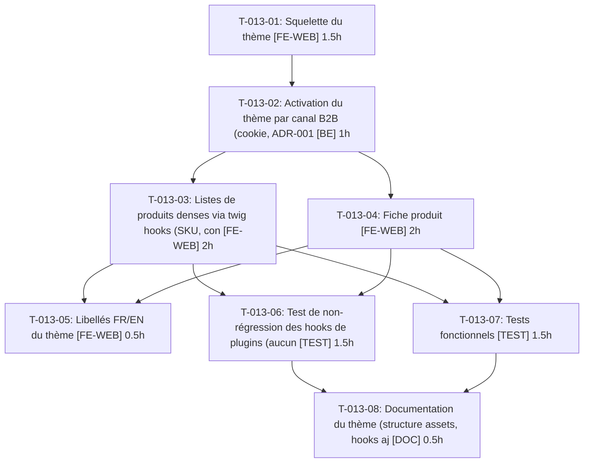

# Tâches — US-013 : Thème B2B du shop

## Informations US

- **Epic** : EPIC-03
- **Persona** : Nadia
- **Story Points** : 8
- **Sprint** : sprint-4-theme-b2b
- **Dépendances** : US-008

## Résumé

En tant que Nadia, je veux un shop à l'allure B2B dérivé du thème officiel, afin que la démo parle à un acheteur professionnel.

## Vue d'ensemble des tâches

| ID | Type | Tâche | Estimation | Dépend de | Statut |
|----|------|-------|------------|-----------|--------|
| T-013-01 | [FE-WEB] | Squelette du thème : entrée Encore `shop-b2b` + feuille de style propre | 1.5h | — | 🔲 |
| T-013-02 | [BE] | Activation du thème par canal B2B (cookie, ADR-0011), B2C inchangé | 1h | T-013-01 | 🔲 |
| T-013-03 | [FE-WEB] | Listes de produits denses via twig hooks (SKU, conditionnement, stock, prix HT, palier « dès ») | 2h | T-013-02 | 🔲 |
| T-013-04 | [FE-WEB] | Fiche produit : références et documents | 2h | T-013-02 | 🔲 |
| T-013-05 | [FE-WEB] | Libellés FR/EN du thème | 0.5h | T-013-03, T-013-04 | 🔲 |
| T-013-06 | [TEST] | Test de non-régression des hooks de plugins (aucun hookable remplacé) | 1.5h | T-013-03, T-013-04 | 🔲 |
| T-013-07 | [TEST] | Tests fonctionnels : catalogue connecté, anonyme, B2C, produit sans conditionnement, asset absent | 1.5h | T-013-03, T-013-04 | 🔲 |
| T-013-08 | [DOC] | Documentation du thème (structure assets, hooks ajoutés) | 0.5h | T-013-06, T-013-07 | 🔲 |

**Total estimé : 10.5h**

---

## Détail des tâches

### T-013-01 — Squelette du thème : entrée Encore `shop-b2b` + feuille de style propre

- **Type** : [FE-WEB]
- **Estimation** : 1.5h
- **Dépend de** : —

**Description** :
Créer l'entrée webpack dédiée dans `assets/shop/` (feuille propre, héritant du thème officiel) et la brancher dans `templates/shop/stylesheets.html.twig`.

**Critères de validation** :
- [ ] Build webpack vert
- [ ] Style chargé uniquement sur le canal B2B

---

### T-013-02 — Activation du thème par canal B2B (cookie, ADR-0011), B2C inchangé

- **Type** : [BE]
- **Estimation** : 1h
- **Dépend de** : T-013-01

**Description** :
Conditionner le chargement de l'entrée et des ajouts de hooks au canal B2B courant (`DemoChannelContext`).

**Critères de validation** :
- [ ] Canal B2C : rendu identique à avant
- [ ] Visiteur anonyme B2B : thème appliqué

---

### T-013-03 — Listes de produits denses via twig hooks (SKU, conditionnement, stock, prix HT, palier « dès »)

- **Type** : [FE-WEB]
- **Estimation** : 2h
- **Dépend de** : T-013-02

**Description** :
Ajouter des hookables dans les hooks de liste/carte produit sans remplacer ceux des plugins ; données issues des plugins existants (tier-pricing, packaging).

**Critères de validation** :
- [ ] Colonnes présentes
- [ ] Produit sans conditionnement : zone omise sans erreur

---

### T-013-04 — Fiche produit : références et documents

- **Type** : [FE-WEB]
- **Estimation** : 2h
- **Dépend de** : T-013-02

**Description** :
Hookables de la fiche produit : références (SKU, EAN, fabricant) et bloc documents (fiches techniques).

**Critères de validation** :
- [ ] Références et documents affichés
- [ ] Produit sans document : bloc omis

---

### T-013-05 — Libellés FR/EN du thème

- **Type** : [FE-WEB]
- **Estimation** : 0.5h
- **Dépend de** : T-013-03, T-013-04

**Description** :
Fichiers de traduction `messages` fr/en pour tous les libellés ajoutés.

**Critères de validation** :
- [ ] Aucun libellé en dur

---

### T-013-06 — Test de non-régression des hooks de plugins (aucun hookable remplacé)

- **Type** : [TEST]
- **Estimation** : 1.5h
- **Dépend de** : T-013-03, T-013-04

**Description** :
Comparer la liste des hookables enregistrés par les plugins avant/après thème (snapshot) ; échec si l'un a disparu ou est remplacé.

**Critères de validation** :
- [ ] Snapshot vert
- [ ] Échec prouvé si un hookable est supprimé

---

### T-013-07 — Tests fonctionnels : catalogue connecté, anonyme, B2C, produit sans conditionnement, asset absent

- **Type** : [TEST]
- **Estimation** : 1.5h
- **Dépend de** : T-013-03, T-013-04

**Description** :
Scénarios Gherkin US-013 en tests fonctionnels/fumée + test de fumée du build des assets.

**Critères de validation** :
- [ ] 6 scénarios couverts
- [ ] CI verte

---

### T-013-08 — Documentation du thème (structure assets, hooks ajoutés)

- **Type** : [DOC]
- **Estimation** : 0.5h
- **Dépend de** : T-013-06, T-013-07

**Description** :
Section dans la doc démo : où modifier le thème, règle « ajouter, ne jamais remplacer ».

**Critères de validation** :
- [ ] Doc relue

---

## Graphe de dépendances

## Résumé

| Type | Nb tâches | Heures |
|------|-----------|--------|
| [FE-WEB] | 4 | 6h |
| [BE] | 1 | 1h |
| [TEST] | 2 | 3h |
| [DOC] | 1 | 0.5h |
| **TOTAL** | **8** | **10.5h** |
