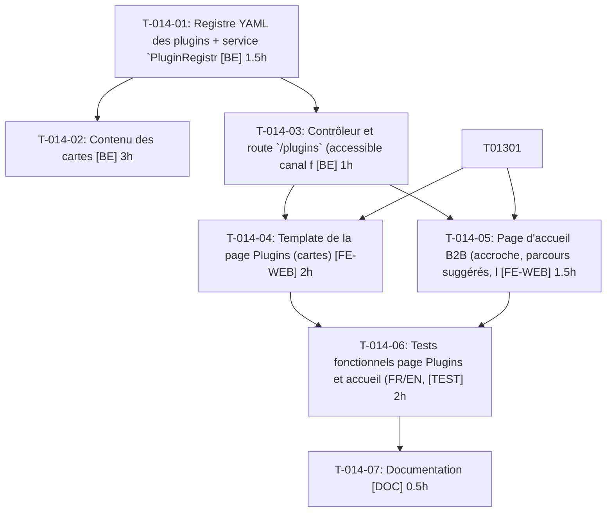

# Tâches — US-014 : Page d'accueil B2B et page Plugins

## Informations US

- **Epic** : EPIC-03
- **Persona** : Hugo
- **Story Points** : 5
- **Sprint** : sprint-4-theme-b2b
- **Dépendances** : US-013

## Résumé

En tant que Hugo, je veux une page d'accueil et une page qui présente chaque plugin avec son scénario, afin de savoir quoi essayer.

## Vue d'ensemble des tâches

| ID | Type | Tâche | Estimation | Dépend de | Statut |
|----|------|-------|------------|-----------|--------|
| T-014-01 | [BE] | Registre YAML des plugins + service `PluginRegistry` avec validation | 1.5h | — | 🔲 |
| T-014-02 | [BE] | Contenu des cartes : 21 plugins + nouveaux (descriptions, scénarios, comptes conseillés FR/EN) | 3h | T-014-01 | 🔲 |
| T-014-03 | [BE] | Contrôleur et route `/plugins` (accessible canal fermé) | 1h | T-014-01 | 🔲 |
| T-014-04 | [FE-WEB] | Template de la page Plugins (cartes) | 2h | T-014-03, T-013-01 | 🔲 |
| T-014-05 | [FE-WEB] | Page d'accueil B2B (accroche, parcours suggérés, lien Plugins) | 1.5h | T-014-03, T-013-01 | 🔲 |
| T-014-06 | [TEST] | Tests fonctionnels page Plugins et accueil (FR/EN, plugin sans Packagist, registre invalide) | 2h | T-014-04, T-014-05 | 🔲 |
| T-014-07 | [DOC] | Documentation : ajouter un plugin au registre | 0.5h | T-014-06 | 🔲 |

**Total estimé : 11.5h**

---

## Détail des tâches

### T-014-01 — Registre YAML des plugins + service `PluginRegistry` avec validation

- **Type** : [BE]
- **Estimation** : 1.5h
- **Dépend de** : —

**Description** :
`config/demo/plugins.yaml` (id, nom, description fr/en, scénario, compte conseillé par clé de compte, GitHub, Packagist nullable) ; validation au boot/test (champs requis).

**Critères de validation** :
- [ ] Entrée invalide → échec avec le nom du plugin

---

### T-014-02 — Contenu des cartes : 21 plugins + nouveaux (descriptions, scénarios, comptes conseillés FR/EN)

- **Type** : [BE]
- **Estimation** : 3h
- **Dépend de** : T-014-01

**Description** :
Rédiger le contenu, vérifier que les comptes conseillés existent dans la source unique (US-015).

**Critères de validation** :
- [ ] 21 plugins + nouveaux présents
- [ ] Liens GitHub/Packagist valides ou « Non publié »

---

### T-014-03 — Contrôleur et route `/plugins` (accessible canal fermé)

- **Type** : [BE]
- **Estimation** : 1h
- **Dépend de** : T-014-01

**Description** :
Contrôleur lecture seule, route publique, exemptée du canal fermé.

**Critères de validation** :
- [ ] 200 sur B2B, B2C et canal fermé

---

### T-014-04 — Template de la page Plugins (cartes)

- **Type** : [FE-WEB]
- **Estimation** : 2h
- **Dépend de** : T-014-03, T-013-01

**Description** :
Cartes : description, scénario, compte conseillé, liens ; gestion absence de Packagist.

**Critères de validation** :
- [ ] Carte complète
- [ ] Responsive

---

### T-014-05 — Page d'accueil B2B (accroche, parcours suggérés, lien Plugins)

- **Type** : [FE-WEB]
- **Estimation** : 1.5h
- **Dépend de** : T-014-03, T-013-01

**Description** :
Hookables sur la home du canal B2B ; au moins 3 parcours de démo.

**Critères de validation** :
- [ ] Home B2B affichée
- [ ] B2C inchangé

---

### T-014-06 — Tests fonctionnels page Plugins et accueil (FR/EN, plugin sans Packagist, registre invalide)

- **Type** : [TEST]
- **Estimation** : 2h
- **Dépend de** : T-014-04, T-014-05

**Description** :
Scénarios Gherkin US-014 ; test unitaire du registre.

**Critères de validation** :
- [ ] 5 scénarios couverts

---

### T-014-07 — Documentation : ajouter un plugin au registre

- **Type** : [DOC]
- **Estimation** : 0.5h
- **Dépend de** : T-014-06

**Description** :
Procédure d'ajout d'une entrée (partagée avec US-016/017).

**Critères de validation** :
- [ ] Doc relue

---

## Graphe de dépendances

## Résumé

| Type | Nb tâches | Heures |
|------|-----------|--------|
| [BE] | 3 | 5.5h |
| [FE-WEB] | 2 | 3.5h |
| [TEST] | 1 | 2h |
| [DOC] | 1 | 0.5h |
| **TOTAL** | **7** | **11.5h** |
