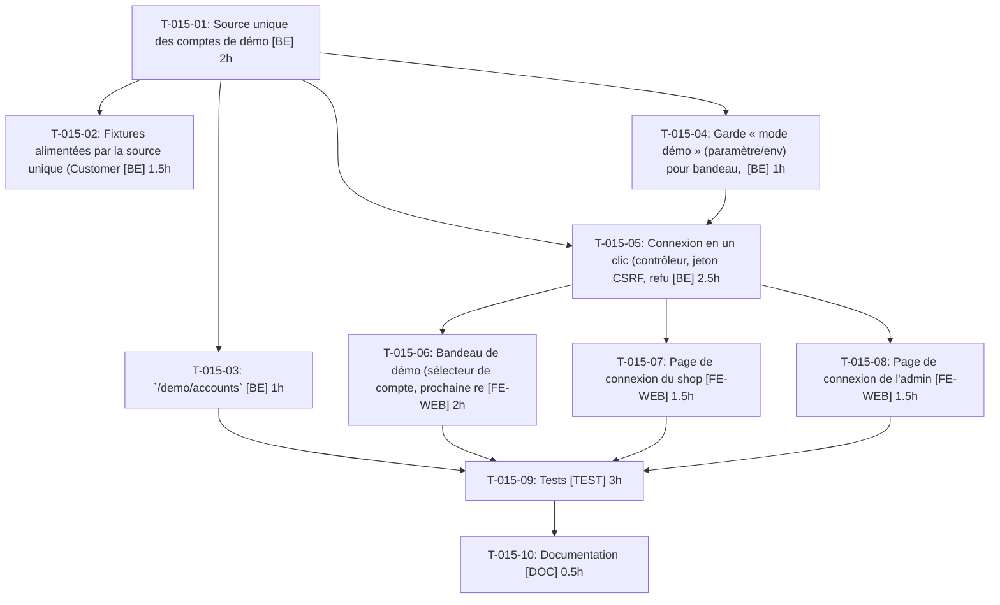

# Tâches — US-015 : Bandeau de démo et connexion en un clic

## Informations US

- **Epic** : EPIC-03
- **Persona** : Hugo
- **Story Points** : 5
- **Sprint** : sprint-4-theme-b2b
- **Dépendances** : US-009

## Résumé

En tant que Hugo, je veux me connecter en un clic sous chaque rôle, afin d'explorer sans chercher des identifiants. Compléments : comptes affichés sur les pages de connexion shop et admin, correction de /demo/accounts, source unique des comptes.

## Vue d'ensemble des tâches

| ID | Type | Tâche | Estimation | Dépend de | Statut |
|----|------|-------|------------|-----------|--------|
| T-015-01 | [BE] | Source unique des comptes de démo : `config/demo/accounts.yaml` + service `DemoAccountCatalog` | 2h | — | 🔲 |
| T-015-02 | [BE] | Fixtures alimentées par la source unique (CustomerDemoFixture, CompanyDemoFixture, demo_fixtures.yaml) | 1.5h | T-015-01 | 🔲 |
| T-015-03 | [BE] | `/demo/accounts` : consommer la source unique et corriger Marc (TechParts uniquement) | 1h | T-015-01 | 🔲 |
| T-015-04 | [BE] | Garde « mode démo » (paramètre/env) pour bandeau, login rapide et listes de comptes | 1h | T-015-01 | 🔲 |
| T-015-05 | [BE] | Connexion en un clic (contrôleur, jeton CSRF, refus du compte désactivé) | 2.5h | T-015-01, T-015-04 | 🔲 |
| T-015-06 | [FE-WEB] | Bandeau de démo (sélecteur de compte, prochaine remise à zéro, lien Mailpit, emplacement du bouton badges) | 2h | T-015-05 | 🔲 |
| T-015-07 | [FE-WEB] | Page de connexion du shop : comptes de démo visibles + connexion en un clic / formulaire pré-rempli | 1.5h | T-015-05 | 🔲 |
| T-015-08 | [FE-WEB] | Page de connexion de l'admin : comptes admin visibles + connexion en un clic / formulaire pré-rempli | 1.5h | T-015-05 | 🔲 |
| T-015-09 | [TEST] | Tests : login rapide, pages de login, /demo/accounts, source unique, compte désactivé, mode off | 3h | T-015-03, T-015-06, T-015-07, T-015-08 | 🔲 |
| T-015-10 | [DOC] | Documentation : comptes de démo (où les modifier) et mode démo | 0.5h | T-015-09 | 🔲 |

**Total estimé : 16.5h**

---

## Détail des tâches

### T-015-01 — Source unique des comptes de démo : `config/demo/accounts.yaml` + service `DemoAccountCatalog`

- **Type** : [BE]
- **Estimation** : 2h
- **Dépend de** : —

**Description** :
Entreprises, membres, rôles, mots de passe, comptes B2C et admin, indicateur « désactivé » ; accesseurs typés ; validation de structure.

**Critères de validation** :
- [ ] Un seul fichier de vérité
- [ ] Test de structure vert

---

### T-015-02 — Fixtures alimentées par la source unique (CustomerDemoFixture, CompanyDemoFixture, demo_fixtures.yaml)

- **Type** : [BE]
- **Estimation** : 1.5h
- **Dépend de** : T-015-01

**Description** :
Supprimer les e-mails/mots de passe en dur des fixtures ; comportement identique.

**Critères de validation** :
- [ ] `app:fixtures:load` vert
- [ ] Plus de recopie (grep)

---

### T-015-03 — `/demo/accounts` : consommer la source unique et corriger Marc (TechParts uniquement)

- **Type** : [BE]
- **Estimation** : 1h
- **Dépend de** : T-015-01

**Description** :
Remplacer le tableau en dur de `DemoAccountsController` ; retirer « aussi dans BuildCo SA » (un client = une entreprise, US-009).

**Critères de validation** :
- [ ] AccountsSmokeTest adapté et vert
- [ ] Mention fausse absente

---

### T-015-04 — Garde « mode démo » (paramètre/env) pour bandeau, login rapide et listes de comptes

- **Type** : [BE]
- **Estimation** : 1h
- **Dépend de** : T-015-01

**Description** :
Service `DemoMode` ; routes en 404 si désactivé ; jamais actif en prod.

**Critères de validation** :
- [ ] Mode off → 404 et aucun rendu

---

### T-015-05 — Connexion en un clic (contrôleur, jeton CSRF, refus du compte désactivé)

- **Type** : [BE]
- **Estimation** : 2.5h
- **Dépend de** : T-015-01, T-015-04

**Description** :
POST `/demo/login/{key}` shop et admin ; authentification programmatique ; message explicite pour Thomas (désactivé).

**Critères de validation** :
- [ ] Claire connectée
- [ ] Compte désactivé refusé avec message

---

### T-015-06 — Bandeau de démo (sélecteur de compte, prochaine remise à zéro, lien Mailpit, emplacement du bouton badges)

- **Type** : [FE-WEB]
- **Estimation** : 2h
- **Dépend de** : T-015-05

**Description** :
Hook shop ; prochaine remise à zéro depuis la planification de `app:demo:reset`.

**Critères de validation** :
- [ ] Bandeau visible en mode démo
- [ ] Mailpit et reset affichés

---

### T-015-07 — Page de connexion du shop : comptes de démo visibles + connexion en un clic / formulaire pré-rempli

- **Type** : [FE-WEB]
- **Estimation** : 1.5h
- **Dépend de** : T-015-05

**Description** :
Hook sur le template de login shop ; identifiants affichés (pas de porte dérobée).

**Critères de validation** :
- [ ] Liste complète
- [ ] Pré-remplissage fonctionnel

---

### T-015-08 — Page de connexion de l'admin : comptes admin visibles + connexion en un clic / formulaire pré-rempli

- **Type** : [FE-WEB]
- **Estimation** : 1.5h
- **Dépend de** : T-015-05

**Description** :
Hook/surcharge de template de login admin ; comptes admin depuis la source unique.

**Critères de validation** :
- [ ] Comptes admin affichés
- [ ] Connexion en un clic admin

---

### T-015-09 — Tests : login rapide, pages de login, /demo/accounts, source unique, compte désactivé, mode off

- **Type** : [TEST]
- **Estimation** : 3h
- **Dépend de** : T-015-03, T-015-06, T-015-07, T-015-08

**Description** :
Scénarios Gherkin US-015 ; test garde-fou : tout compte affiché existe dans la source unique et chaque fixture en provient.

**Critères de validation** :
- [ ] 7 scénarios couverts
- [ ] CI verte

---

### T-015-10 — Documentation : comptes de démo (où les modifier) et mode démo

- **Type** : [DOC]
- **Estimation** : 0.5h
- **Dépend de** : T-015-09

**Description** :
Mettre à jour README/doc démo ; mentionner la source unique.

**Critères de validation** :
- [ ] Doc relue

---

## Graphe de dépendances

## Résumé

| Type | Nb tâches | Heures |
|------|-----------|--------|
| [BE] | 5 | 8h |
| [FE-WEB] | 3 | 5h |
| [TEST] | 1 | 3h |
| [DOC] | 1 | 0.5h |
| **TOTAL** | **10** | **16.5h** |
