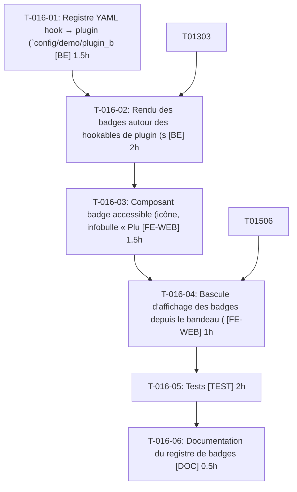

# Tâches — US-016 : Badges de plugin dans le shop

## Informations US

- **Epic** : EPIC-03
- **Persona** : Hugo
- **Story Points** : 5
- **Sprint** : sprint-4-theme-b2b
- **Dépendances** : US-013

## Résumé

En tant que Hugo, je veux voir quelle fonctionnalité vient de quel plugin, afin d'évaluer chaque plugin.

## Vue d'ensemble des tâches

| ID | Type | Tâche | Estimation | Dépend de | Statut |
|----|------|-------|------------|-----------|--------|
| T-016-01 | [BE] | Registre YAML hook → plugin (`config/demo/plugin_badges.yaml`) et validation | 1.5h | — | 🔲 |
| T-016-02 | [BE] | Rendu des badges autour des hookables de plugin (sans les remplacer) | 2h | T-016-01, T-013-03 | 🔲 |
| T-016-03 | [FE-WEB] | Composant badge accessible (icône, infobulle « Plugin tmonier/… », lien, focus clavier) | 1.5h | T-016-02 | 🔲 |
| T-016-04 | [FE-WEB] | Bascule d'affichage des badges depuis le bandeau (persistance) | 1h | T-016-03, T-015-06 | 🔲 |
| T-016-05 | [TEST] | Tests : badge, accessibilité clavier, désactivation, persistance, registre complet/invalide | 2h | T-016-04 | 🔲 |
| T-016-06 | [DOC] | Documentation du registre de badges | 0.5h | T-016-05 | 🔲 |

**Total estimé : 8.5h**

---

## Détail des tâches

### T-016-01 — Registre YAML hook → plugin (`config/demo/plugin_badges.yaml`) et validation

- **Type** : [BE]
- **Estimation** : 1.5h
- **Dépend de** : —

**Description** :
Associe un nom de hook/hookable à un plugin du registre US-014 ; validation (plugin inconnu → échec).

**Critères de validation** :
- [ ] Entrée inconnue → échec CI

---

### T-016-02 — Rendu des badges autour des hookables de plugin (sans les remplacer)

- **Type** : [BE]
- **Estimation** : 2h
- **Dépend de** : T-016-01, T-013-03

**Description** :
Mécanisme (décorateur de rendu/composant) ajoutant le badge ; hook absent du registre → rien.

**Critères de validation** :
- [ ] Hookables intacts
- [ ] Hook non listé sans erreur

---

### T-016-03 — Composant badge accessible (icône, infobulle « Plugin tmonier/… », lien, focus clavier)

- **Type** : [FE-WEB]
- **Estimation** : 1.5h
- **Dépend de** : T-016-02

**Description** :
Neutre, sans imiter Sylius Plus ; infobulle au focus et survol ; libellés FR/EN.

**Critères de validation** :
- [ ] Atteignable au clavier
- [ ] Contraste conforme

---

### T-016-04 — Bascule d'affichage des badges depuis le bandeau (persistance)

- **Type** : [FE-WEB]
- **Estimation** : 1h
- **Dépend de** : T-016-03, T-015-06

**Description** :
Contrôleur Stimulus ; préférence conservée entre pages.

**Critères de validation** :
- [ ] Masqués puis conservés au changement de page

---

### T-016-05 — Tests : badge, accessibilité clavier, désactivation, persistance, registre complet/invalide

- **Type** : [TEST]
- **Estimation** : 2h
- **Dépend de** : T-016-04

**Description** :
Scénarios Gherkin US-016 ; test que chaque entrée référence un plugin existant.

**Critères de validation** :
- [ ] 6 scénarios couverts

---

### T-016-06 — Documentation du registre de badges

- **Type** : [DOC]
- **Estimation** : 0.5h
- **Dépend de** : T-016-05

**Description** :
Comment déclarer un badge pour un nouveau plugin.

**Critères de validation** :
- [ ] Doc relue

---

## Graphe de dépendances

## Résumé

| Type | Nb tâches | Heures |
|------|-----------|--------|
| [BE] | 2 | 3.5h |
| [FE-WEB] | 2 | 2.5h |
| [TEST] | 1 | 2h |
| [DOC] | 1 | 0.5h |
| **TOTAL** | **6** | **8.5h** |
