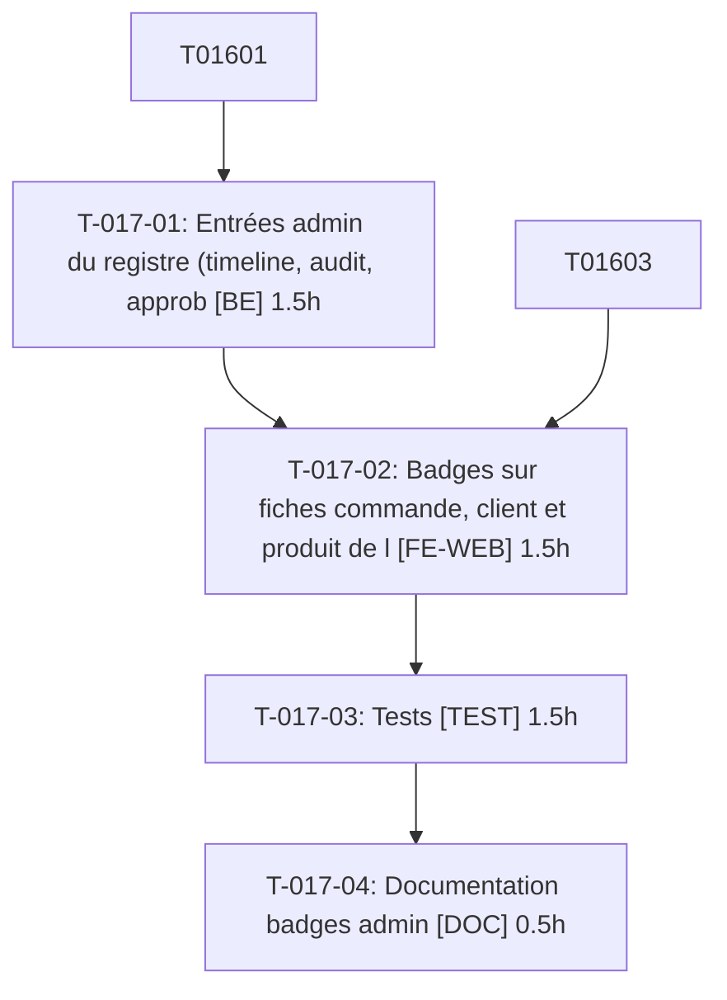

# Tâches — US-017 : Badges de plugin dans l'admin

## Informations US

- **Epic** : EPIC-03
- **Persona** : Hugo
- **Story Points** : 3
- **Sprint** : sprint-4-theme-b2b
- **Dépendances** : US-016

## Résumé

En tant que Hugo, je veux les mêmes badges dans l'admin, afin d'identifier les apports back-office.

## Vue d'ensemble des tâches

| ID | Type | Tâche | Estimation | Dépend de | Statut |
|----|------|-------|------------|-----------|--------|
| T-017-01 | [BE] | Entrées admin du registre (timeline, audit, approbation, Factur-X…) | 1.5h | T-016-01 | 🔲 |
| T-017-02 | [FE-WEB] | Badges sur fiches commande, client et produit de l'admin | 1.5h | T-017-01, T-016-03 | 🔲 |
| T-017-03 | [TEST] | Tests : fiches admin, clavier, cohérence shop/admin, bloc natif, plugin non activé | 1.5h | T-017-02 | 🔲 |
| T-017-04 | [DOC] | Documentation badges admin | 0.5h | T-017-03 | 🔲 |

**Total estimé : 5h**

---

## Détail des tâches

### T-017-01 — Entrées admin du registre (timeline, audit, approbation, Factur-X…)

- **Type** : [BE]
- **Estimation** : 1.5h
- **Dépend de** : T-016-01

**Description** :
Étendre le registre avec la surface `admin` ; réutiliser le service de rendu de US-016.

**Critères de validation** :
- [ ] Même source que le shop

---

### T-017-02 — Badges sur fiches commande, client et produit de l'admin

- **Type** : [FE-WEB]
- **Estimation** : 1.5h
- **Dépend de** : T-017-01, T-016-03

**Description** :
Hookables admin ; blocs natifs Sylius sans badge.

**Critères de validation** :
- [ ] Badges visibles sur les 3 fiches
- [ ] Bloc natif sans badge

---

### T-017-03 — Tests : fiches admin, clavier, cohérence shop/admin, bloc natif, plugin non activé

- **Type** : [TEST]
- **Estimation** : 1.5h
- **Dépend de** : T-017-02

**Description** :
Scénarios Gherkin US-017 via tests fonctionnels admin.

**Critères de validation** :
- [ ] 5 scénarios couverts

---

### T-017-04 — Documentation badges admin

- **Type** : [DOC]
- **Estimation** : 0.5h
- **Dépend de** : T-017-03

**Description** :
Compléter la doc du registre.

**Critères de validation** :
- [ ] Doc relue

---

## Graphe de dépendances

## Résumé

| Type | Nb tâches | Heures |
|------|-----------|--------|
| [BE] | 1 | 1.5h |
| [FE-WEB] | 1 | 1.5h |
| [TEST] | 1 | 1.5h |
| [DOC] | 1 | 0.5h |
| **TOTAL** | **4** | **5h** |
