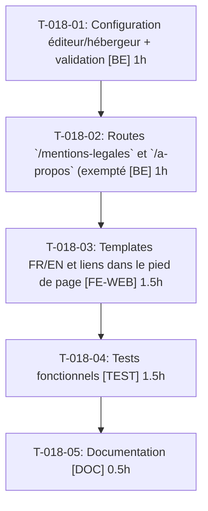

# Tâches — US-018 : Mentions légales et page À propos

## Informations US

- **Epic** : EPIC-03
- **Persona** : Nadia
- **Story Points** : 2
- **Sprint** : sprint-4-theme-b2b
- **Dépendances** : —

## Résumé

En tant que Nadia, je veux savoir qui édite la démo et comment mes données sont traitées, afin d'avoir confiance.

## Vue d'ensemble des tâches

| ID | Type | Tâche | Estimation | Dépend de | Statut |
|----|------|-------|------------|-----------|--------|
| T-018-01 | [BE] | Configuration éditeur/hébergeur + validation | 1h | — | 🔲 |
| T-018-02 | [BE] | Routes `/mentions-legales` et `/a-propos` (exemptées canal fermé) | 1h | T-018-01 | 🔲 |
| T-018-03 | [FE-WEB] | Templates FR/EN et liens dans le pied de page | 1.5h | T-018-02 | 🔲 |
| T-018-04 | [TEST] | Tests fonctionnels : pages, locales, canal fermé, config manquante, 404 | 1.5h | T-018-03 | 🔲 |
| T-018-05 | [DOC] | Documentation : renseigner les mentions légales | 0.5h | T-018-04 | 🔲 |

**Total estimé : 5.5h**

---

## Détail des tâches

### T-018-01 — Configuration éditeur/hébergeur + validation

- **Type** : [BE]
- **Estimation** : 1h
- **Dépend de** : —

**Description** :
Paramètres `demo.legal.*` (éditeur, hébergeur) ; marqueur « à compléter » si absent ; test de config.

**Critères de validation** :
- [ ] Config manquante → test rouge

---

### T-018-02 — Routes `/mentions-legales` et `/a-propos` (exemptées canal fermé)

- **Type** : [BE]
- **Estimation** : 1h
- **Dépend de** : T-018-01

**Description** :
Contrôleurs lecture seule ; 404 thémée pour URL inconnue.

**Critères de validation** :
- [ ] 200 anonyme sur tous canaux

---

### T-018-03 — Templates FR/EN et liens dans le pied de page

- **Type** : [FE-WEB]
- **Estimation** : 1.5h
- **Dépend de** : T-018-02

**Description** :
Contenu : éditeur, hébergeur, données fictives, remise à zéro, aucun e-mail réel.

**Critères de validation** :
- [ ] Liens au pied de page
- [ ] FR/EN corrects

---

### T-018-04 — Tests fonctionnels : pages, locales, canal fermé, config manquante, 404

- **Type** : [TEST]
- **Estimation** : 1.5h
- **Dépend de** : T-018-03

**Description** :
Scénarios Gherkin US-018.

**Critères de validation** :
- [ ] 5 scénarios couverts

---

### T-018-05 — Documentation : renseigner les mentions légales

- **Type** : [DOC]
- **Estimation** : 0.5h
- **Dépend de** : T-018-04

**Description** :
Variables à définir avant mise en ligne.

**Critères de validation** :
- [ ] Doc relue

---

## Graphe de dépendances

## Résumé

| Type | Nb tâches | Heures |
|------|-----------|--------|
| [BE] | 2 | 2h |
| [FE-WEB] | 1 | 1.5h |
| [TEST] | 1 | 1.5h |
| [DOC] | 1 | 0.5h |
| **TOTAL** | **5** | **5.5h** |
