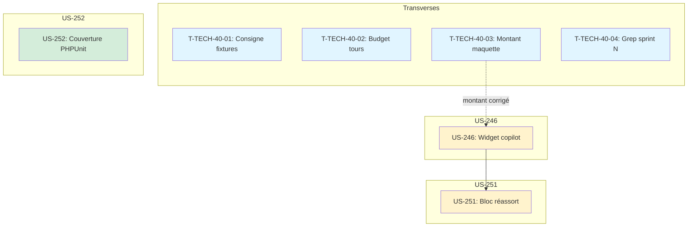

# Tâches : Sprint 040 (mise-en-forme-et-couverture)

> Sprint Planning Part 2 : décomposition faite au planning, le 2026-10-31 ; développement sur la branche `feature/sprint-40-mise-en-forme-et-couverture` (créée depuis main à 23962a6). Source de vérité du statut : `.bmad/sprint-status.yaml` (`sprint-40`).
>
> Liens : [objectif](../sprint-goal.md), [tableau](../task-board.md), [registre des décisions](../registre-decisions.md), [tâches transverses](./technical-tasks.md), [rétro du sprint 39](../../sprint-39-conception-graphique/sprint-retro.md).

## Vue d'ensemble

| US | Titre | Points | Tâches | Heures | Statut |
|----|-------|--------|--------|--------|--------|
| [US-246](./US-246-tasks.md) | Copilote d'achat : mise en forme du widget | 2 | 8 | 4 h | 🔲 prête |
| [US-251](./US-251-tasks.md) | Commerce prédictif : mise en forme du bloc de réassort | 3 | 9 | 5 h | 🔲 prête |
| [US-252](./US-252-tasks.md) | Couverture PHPUnit : pilote sur 3 plugins et la démo | 5 | 12 | 7 h | 🔲 prête |
| [Transverse](./technical-tasks.md) | Actions de la rétro du sprint 39 (sans points) | 0 | 4 | 1,25 h | 🔲 |
| **Total** | | **10** | **33** | **17,25 h** | |

**Total décomposé : 10 points, 33 tâches, 17,25 h** (toutes les heures pour Claude).

> **Périmètre décidé par Thibaut le 2026-10-31** (voir [../registre-decisions.md](../registre-decisions.md)) : mise en forme du widget du copilote (US-246), mise en forme du bloc de réassort (US-251), couverture PHPUnit pilote (US-252), plus les actions de la rétro du sprint 39 (T-TECH-40-01 à 04).

## Capacité

Méthode des sprints précédents : 2,1 h par point + 1,25 h de tâches transverses.

| Périmètre | Capacité | Charge de Claude | Marge |
|-----------|----------|------------------|-------|
| 10 points | 10 × 2,1 + 1,25 = **22,25 h** | 17,25 h | **+5 h** (+22 %) |

**Les 10 points tiennent** avec une marge confortable de 5 h (+22 %).

## Répartition par type

| Type | Tâches | Heures |
|------|--------|--------|
| [BE] | 2 | 1,5 h |
| [FE-WEB] | 5 | 4,25 h |
| [TEST] | 12 | 4,25 h |
| [DOC] | 5 | 2 h |
| [REV] | 3 | 1 h |
| [OPS] | 6 | 4 h |
| **Total** | **33** | **17,25 h** |

## Ordre d'exécution proposé

1. **Lot 0 (parallèle)** : wtech (T-TECH-40-01 à 04, tâches indépendantes)
2. **Lot 1 (séquentiel)** : w246 (US-246, mise en forme copilot — plugin puis démo)
3. **Lot 2 (séquentiel)** : w251 (US-251, mise en forme réassort — plugin puis démo)
4. **Lot 3 (parallèle avec lot 1/2)** : w252 (US-252, couverture PHPUnit — CI puis ProofCollector puis page)

**Parallélisme recommandé :**
- Lot 0 (wtech) d'abord pour corriger le montant de la maquette avant US-246
- Lots 1 et 2 séquentiels (US-246 puis US-251) car même pattern, mêmes fichiers thème
- Lot 3 (US-252) parallèle aux lots 1-2 (fichiers disjoints : CI workflows, ProofCollector, page Preuve)

**Budget de tours estimé (T-TECH-40-02) :**

| Worker | Story | Tours estimés | Stratégie |
|--------|-------|---------------|-----------|
| wtech | Transverses | ~30 | Un seul fork |
| w246 | US-246 (2 pts) | ~80 | Un seul fork |
| w251 | US-251 (3 pts) | ~90 | Un seul fork |
| w252 | US-252 (5 pts) | ~140 | Un seul fork, découper si > 150 |

## Workers proposés et parallélisme

| Worker | Story | Domaine de fichiers | Chevauchements |
|--------|-------|---------------------|----------------|
| wtech | T-TECH-40-01 à 04 | docs/, canevas Claude Design, translations/ | aucun |
| w246 | US-246 | plugin copilot (SCSS, templates), démo (templates/bundles/) | T-TECH-40-03 (maquette) doit finir avant |
| w251 | US-251 | plugin predictive (SCSS, templates), démo (templates/bundles/) | après w246 (même zone thème) |
| w252 | US-252 | CI workflows (4 repos), ProofCollector, page Preuve | indépendant de w246/w251 |

Contrainte : au plus 2 workers lancent des tests en même temps (8 Go RAM).

## Graphe des dépendances

## Notes

- T-TECH-40-03 (correction du montant de la maquette) doit être fait AVANT US-246 (le worker lit la maquette corrigée)
- US-246 et US-251 séquentielles (même pattern de mise en forme, templates proches)
- US-252 indépendante (CI, ProofCollector, page Preuve)
- Disque : vérifier l'espace avant de lancer des tests avec couverture (fichiers Clover XML)
- TDD : rouge prouvé pour US-246, US-251, US-252
- Tests en local avant push (règle 46)
- Un worker par dépôt (règle 49)
- Vérifier avant de créer (règle 50)
