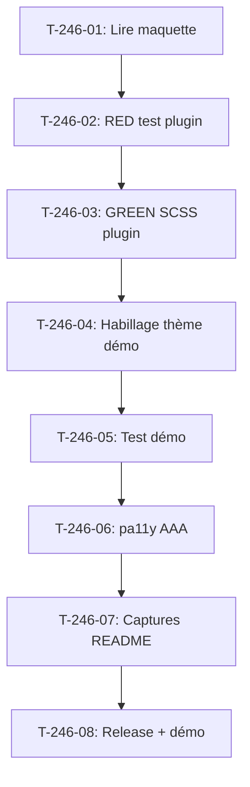

# Tâches - US-246 : Copilote d'achat — mise en forme du widget

## Informations US
- **Epic** : EPIC-16
- **Persona** : Claire (acheteuse), Thibaut (démonstrateur)
- **Story Points** : 2
- **Sprint** : sprint-40-mise-en-forme-et-couverture

## Résumé de la US
**En tant que** Claire
**Je veux** distinguer d'un coup d'œil mes questions des réponses du copilote
**Afin de** suivre l'échange sans relire chaque message

## Vue d'ensemble des tâches

| ID | Type | Tâche | Estimation | Dépend de | Statut |
|----|------|-------|------------|-----------|--------|
| T-246-01 | [DOC] | Lire la maquette Copilote/CopiloteMobile et la note de passation du S39 | 0,25 h | - | 🔲 |
| T-246-02 | [TEST] | RED : test fonctionnel widget — classes, aria-live, contrastes (plugin) | 0,5 h | T-246-01 | 🔲 |
| T-246-03 | [FE-WEB] | GREEN : feuille de style SCSS du widget dans le plugin copilote | 1 h | T-246-02 | 🔲 |
| T-246-04 | [FE-WEB] | Habillage thème Industrie & Négoce dans la démo (override template si besoin) | 0,5 h | T-246-03 | 🔲 |
| T-246-05 | [TEST] | Test démo : widget rendu avec les bonnes classes dans le dashboard B2B | 0,5 h | T-246-04 | 🔲 |
| T-246-06 | [TEST] | pa11y AAA sur la page dashboard avec le widget (360 px et 1280 px) | 0,25 h | T-246-05 | 🔲 |
| T-246-07 | [DOC] | Captures FR et EN du README du plugin copilote | 0,5 h | T-246-06 | 🔲 |
| T-246-08 | [REV] | Release du plugin sur GO de Thibaut, démo mise à jour, CI verte | 0,5 h | T-246-07 | 🔲 |

**Total estimé** : 4 h

---

## Détail des tâches

### T-246-01 : Lire la maquette et la note de passation
- **Type** : [DOC]
- **Estimation** : 0,25 h

Lire les pages Copilote et CopiloteMobile du canevas Claude Design `G2StRQigRKD6SqNRoyHpkW`. Relever les jetons (couleurs, typographies, espacements), les classes CSS à créer, la disposition question/réponse (droite/gauche), l'indicateur de chargement, le repli et l'état erreur. Relire les critères d'acceptation d'US-246.

### T-246-02 : RED — test fonctionnel widget dans le plugin
- **Type** : [TEST]
- **Estimation** : 0,5 h
- **Dépend de** : T-246-01

Écrire un test dans le plugin `sylius-b2b-sales-copilot-plugin` qui vérifie :
- la présence de la classe `copilot-message--user` (question) et `copilot-message--assistant` (réponse)
- la présence de l'attribut `aria-live="polite"` sur le conteneur de réponse
- la structure HTML attendue (input, bouton, zone de messages)

Le test doit échouer (rouge prouvé) avant l'implémentation.

### T-246-03 : GREEN — feuille de style SCSS dans le plugin
- **Type** : [FE-WEB]
- **Estimation** : 1 h
- **Dépend de** : T-246-02

Implémenter la feuille de style du widget dans le plugin copilote :
- Question alignée à droite, fond clair (variable Bootstrap)
- Réponse alignée à gauche, fond distinct
- Indicateur « Réponse en cours… » avec `aria-live="polite"`
- `overflow-wrap: anywhere` pour les messages longs (360 px sans scroll horizontal)
- Variables Bootstrap pour les couleurs (thème-agnostique)

### T-246-04 : Habillage thème dans la démo
- **Type** : [FE-WEB]
- **Estimation** : 0,5 h
- **Dépend de** : T-246-03

Override template dans `templates/bundles/` si nécessaire pour appliquer les jetons du thème Industrie & Négoce (fond crème `#faf8f5`, texte navy `#1a2332`, accent teal `#2d7d6f`, Fraunces/Inter).

### T-246-05 : Test démo — widget dans le dashboard B2B
- **Type** : [TEST]
- **Estimation** : 0,5 h
- **Dépend de** : T-246-04

Test fonctionnel dans la démo vérifiant que le widget copilote est rendu dans le dashboard B2B de Claire avec les classes et la structure attendues, en FR et EN (gabarit §4 de `docs/gabarits-tests.md`).

### T-246-06 : pa11y AAA
- **Type** : [TEST]
- **Estimation** : 0,25 h
- **Dépend de** : T-246-05

Audit pa11y AAA sur la page dashboard en 360 px et 1280 px. 0 erreur attendu.

### T-246-07 : Captures README plugin
- **Type** : [DOC]
- **Estimation** : 0,5 h
- **Dépend de** : T-246-06

Capturer le widget mis en forme (FR et EN) pour le README du plugin copilote dans `docs/screenshots/`.

### T-246-08 : Release plugin + mise à jour démo
- **Type** : [REV]
- **Estimation** : 0,5 h
- **Dépend de** : T-246-07

PR plugin, CI verte, release sur GO de Thibaut. Bump composer dans la démo. CI de la démo verte.

## Dépendances

