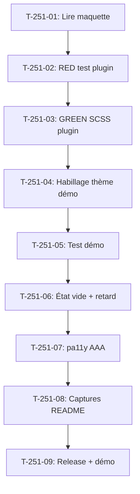

# Tâches - US-251 : Commerce prédictif — mise en forme du bloc de réassort

## Informations US
- **Epic** : EPIC-17
- **Persona** : Claire (acheteuse, Acme Industries)
- **Story Points** : 3
- **Sprint** : sprint-40-mise-en-forme-et-couverture

## Résumé de la US
**En tant que** Claire
**Je veux** lire mes alertes de réassort d'un coup d'œil sur mon tableau de bord
**Afin de** savoir quoi recommander et de préparer le panier en un clic

## Vue d'ensemble des tâches

| ID | Type | Tâche | Estimation | Dépend de | Statut |
|----|------|-------|------------|-----------|--------|
| T-251-01 | [DOC] | Lire la maquette Reassort/ReassortMobile et les fixtures de réassort | 0,25 h | - | 🔲 |
| T-251-02 | [TEST] | RED : test fonctionnel bloc — structure, textes, états (plugin) | 0,5 h | T-251-01 | 🔲 |
| T-251-03 | [FE-WEB] | GREEN : feuille de style SCSS du bloc dans le plugin prédictif | 1,5 h | T-251-02 | 🔲 |
| T-251-04 | [FE-WEB] | Habillage thème Industrie & Négoce dans la démo | 0,5 h | T-251-03 | 🔲 |
| T-251-05 | [TEST] | Test démo : bloc rendu dans le dashboard B2B avec alertes | 0,5 h | T-251-04 | 🔲 |
| T-251-06 | [TEST] | Vérifier état vide (client sans rythme) et alerte en retard (texte, pas couleur seule) | 0,5 h | T-251-05 | 🔲 |
| T-251-07 | [TEST] | pa11y AAA sur la page dashboard (360 px et 1280 px) | 0,25 h | T-251-06 | 🔲 |
| T-251-08 | [DOC] | Captures FR et EN du README du plugin prédictif | 0,5 h | T-251-07 | 🔲 |
| T-251-09 | [REV] | Release du plugin sur GO de Thibaut, démo mise à jour, CI verte | 0,5 h | T-251-08 | 🔲 |

**Total estimé** : 5 h

---

## Détail des tâches

### T-251-01 : Lire la maquette et les fixtures
- **Type** : [DOC]
- **Estimation** : 0,25 h

Lire les pages Reassort et ReassortMobile du canevas Claude Design `G2StRQigRKD6SqNRoyHpkW`. Relever les jetons (couleurs, typographies, espacements), la disposition des alertes (référence, date estimée, quantité, bouton « Préparer le panier »), les états (aucune alerte, alerte en retard). **Lire aussi les fixtures** (prix, quantités, noms de produits) pour vérifier la cohérence maquette/données (T-TECH-40-01).

### T-251-02 : RED — test fonctionnel bloc dans le plugin
- **Type** : [TEST]
- **Estimation** : 0,5 h
- **Dépend de** : T-251-01

Test dans le plugin `sylius-b2b-predictive-analytics-plugin` vérifiant la structure HTML du bloc de réassort : chaque alerte montre la référence, la date estimée, la quantité habituelle et le bouton d'action. Le test doit échouer avant l'implémentation.

### T-251-03 : GREEN — feuille de style SCSS dans le plugin
- **Type** : [FE-WEB]
- **Estimation** : 1,5 h
- **Dépend de** : T-251-02

Implémenter la feuille de style du bloc de réassort :
- Carte par alerte avec référence, date, quantité, action
- Alerte en retard : signalée par un texte « en retard de X jours » (pas seulement une couleur)
- État vide : message « Aucune alerte de réassort » avec illustration
- Variables Bootstrap pour les couleurs
- Responsive 360 px sans scroll horizontal

### T-251-04 : Habillage thème dans la démo
- **Type** : [FE-WEB]
- **Estimation** : 0,5 h
- **Dépend de** : T-251-03

Override template dans `templates/bundles/` pour le thème Industrie & Négoce (fond crème, texte navy, accent teal, Fraunces/Inter).

### T-251-05 : Test démo — bloc dans le dashboard
- **Type** : [TEST]
- **Estimation** : 0,5 h
- **Dépend de** : T-251-04

Test fonctionnel dans la démo vérifiant le rendu du bloc de réassort dans le dashboard B2B de Claire avec des alertes actives, en FR et EN.

### T-251-06 : État vide et alerte en retard
- **Type** : [TEST]
- **Estimation** : 0,5 h
- **Dépend de** : T-251-05

Tester l'état vide (client sans rythme d'achat) et l'alerte en retard (texte visible, pas couleur seule — accessibilité).

### T-251-07 : pa11y AAA
- **Type** : [TEST]
- **Estimation** : 0,25 h
- **Dépend de** : T-251-06

Audit pa11y AAA sur la page dashboard en 360 px et 1280 px. 0 erreur attendu.

### T-251-08 : Captures README plugin
- **Type** : [DOC]
- **Estimation** : 0,5 h
- **Dépend de** : T-251-07

Capturer le bloc mis en forme (FR et EN) pour le README du plugin prédictif dans `docs/screenshots/`.

### T-251-09 : Release plugin + mise à jour démo
- **Type** : [REV]
- **Estimation** : 0,5 h
- **Dépend de** : T-251-08

PR plugin, CI verte, release sur GO de Thibaut. Bump composer dans la démo. CI de la démo verte.

## Dépendances

