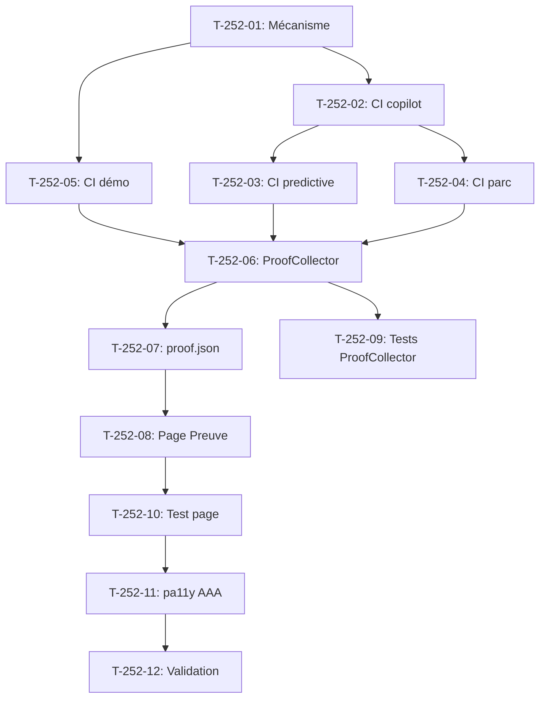

# Tâches - US-252 : Couverture PHPUnit — pilote sur 3 plugins et la démo

## Informations US
- **Epic** : EPIC-17
- **Persona** : Thibaut (démonstrateur)
- **Story Points** : 5
- **Sprint** : sprint-40-mise-en-forme-et-couverture

## Résumé de la US
**En tant que** Thibaut
**Je veux** voir le taux de couverture PHPUnit réel de chaque plugin pilote et de la démo sur la page Preuve
**Afin de** montrer que le code B2B est testé de façon mesurable

## Vue d'ensemble des tâches

| ID | Type | Tâche | Estimation | Dépend de | Statut |
|----|------|-------|------------|-----------|--------|
| T-252-01 | [DOC] | Valider le mécanisme : Xdebug/PCOV dans Docker, format Clover, check run GH | 0,5 h | - | 🔲 |
| T-252-02 | [OPS] | CI plugin pilote 1 (copilot) : step coverage + check run | 1 h | T-252-01 | 🔲 |
| T-252-03 | [OPS] | CI plugin pilote 2 (predictive-analytics) : step coverage + check run | 0,5 h | T-252-02 | 🔲 |
| T-252-04 | [OPS] | CI plugin pilote 3 (customer-asset-management) : step coverage + check run | 0,5 h | T-252-02 | 🔲 |
| T-252-05 | [OPS] | CI démo : step coverage + check run | 0,5 h | T-252-01 | 🔲 |
| T-252-06 | [BE] | ProofCollector : lire les check runs « coverage » via API GitHub | 1 h | T-252-05 | 🔲 |
| T-252-07 | [BE] | proof-refresh : ajouter la couverture dans proof.json | 0,5 h | T-252-06 | 🔲 |
| T-252-08 | [FE-WEB] | Page Preuve : afficher la couverture par plugin et démo | 1 h | T-252-07 | 🔲 |
| T-252-09 | [TEST] | Tests unitaires ProofCollector (coverage parsing) | 0,5 h | T-252-06 | 🔲 |
| T-252-10 | [TEST] | Test fonctionnel page Preuve (présence du bloc couverture) | 0,5 h | T-252-08 | 🔲 |
| T-252-11 | [TEST] | pa11y AAA sur la page Preuve (360 px et 1280 px) | 0,25 h | T-252-10 | 🔲 |
| T-252-12 | [REV] | CI verte, proof.json à jour, page Preuve validée | 0,25 h | T-252-11 | 🔲 |

**Total estimé** : 7 h

---

## Détail des tâches

### T-252-01 : Valider le mécanisme
- **Type** : [DOC]
- **Estimation** : 0,5 h

Vérifier que Xdebug ou PCOV est disponible dans l'image Docker CI. Choisir le driver (PCOV préféré pour la vitesse). Valider le format Clover XML pour le parsing. Documenter le mécanisme : `phpunit --coverage-clover`, extraction du taux, publication en check run GitHub Actions. La démo est déjà à 93,31 % de couverture de lignes.

### T-252-02 : CI plugin pilote 1 (copilot)
- **Type** : [OPS]
- **Estimation** : 1 h
- **Dépend de** : T-252-01

Ajouter une step dans le workflow CI du plugin copilot :
1. Exécuter PHPUnit avec `--coverage-clover=coverage.xml`
2. Parser le fichier Clover pour extraire le taux de lignes
3. Publier un check run « coverage » avec le taux dans le summary
4. Le check run est lisible par l'API publique GitHub (pas de token nécessaire)

Le check run ne bloque pas la CI (pas de seuil).

### T-252-03 : CI plugin pilote 2 (predictive-analytics)
- **Type** : [OPS]
- **Estimation** : 0,5 h
- **Dépend de** : T-252-02

Même pattern que T-252-02, appliqué au plugin predictive-analytics.

### T-252-04 : CI plugin pilote 3 (customer-asset-management)
- **Type** : [OPS]
- **Estimation** : 0,5 h
- **Dépend de** : T-252-02

Même pattern que T-252-02, appliqué au plugin customer-asset-management (parc).

### T-252-05 : CI démo
- **Type** : [OPS]
- **Estimation** : 0,5 h
- **Dépend de** : T-252-01

Même pattern que T-252-02, appliqué à la démo. La démo a déjà PHPUnit configuré ; ajouter la step coverage et le check run.

### T-252-06 : ProofCollector — lire les check runs
- **Type** : [BE]
- **Estimation** : 1 h
- **Dépend de** : T-252-05

Étendre le `ProofCollector` (ou créer un `CoverageCollector`) pour lire les check runs « coverage » des 3 plugins pilotes et de la démo via l'API GitHub (`GET /repos/{owner}/{repo}/commits/{ref}/check-runs`). Extraire le taux de couverture du summary. Pas de token nécessaire (repos publics).

### T-252-07 : proof-refresh — couverture dans proof.json
- **Type** : [BE]
- **Estimation** : 0,5 h
- **Dépend de** : T-252-06

Ajouter la section `coverage` dans `proof.json` :
```json
{
  "coverage": {
    "copilot": { "lines": 87.2, "run": "https://..." },
    "predictive-analytics": { "lines": 91.5, "run": "https://..." },
    "customer-asset-management": { "lines": 78.3, "run": "https://..." },
    "demo": { "lines": 93.31, "run": "https://..." }
  }
}
```

### T-252-08 : Page Preuve — afficher la couverture
- **Type** : [FE-WEB]
- **Estimation** : 1 h
- **Dépend de** : T-252-07

Ajouter un bloc « Couverture de code » sur la page Preuve :
- Un tableau ou des cartes avec le nom du plugin, le taux de lignes, un lien vers le run CI
- Pas de jauge ni badge fantaisie : les chiffres réels suffisent
- Responsive, thème Industrie & Négoce
- Texte factuel, pas de comparaison

### T-252-09 : Tests unitaires ProofCollector
- **Type** : [TEST]
- **Estimation** : 0,5 h
- **Dépend de** : T-252-06

Tests unitaires du parsing des check runs : format valide, format invalide, check run absent, taux 0 %, taux 100 %.

### T-252-10 : Test fonctionnel page Preuve
- **Type** : [TEST]
- **Estimation** : 0,5 h
- **Dépend de** : T-252-08

Test fonctionnel vérifiant la présence du bloc couverture sur la page Preuve avec les 4 entrées (3 plugins + démo).

### T-252-11 : pa11y AAA
- **Type** : [TEST]
- **Estimation** : 0,25 h
- **Dépend de** : T-252-10

Audit pa11y AAA sur la page Preuve en 360 px et 1280 px. 0 erreur attendu.

### T-252-12 : CI verte, validation
- **Type** : [REV]
- **Estimation** : 0,25 h
- **Dépend de** : T-252-11

CI verte sur les 4 dépôts (3 plugins + démo), proof.json à jour, page Preuve affiche les taux réels.

## Dépendances


