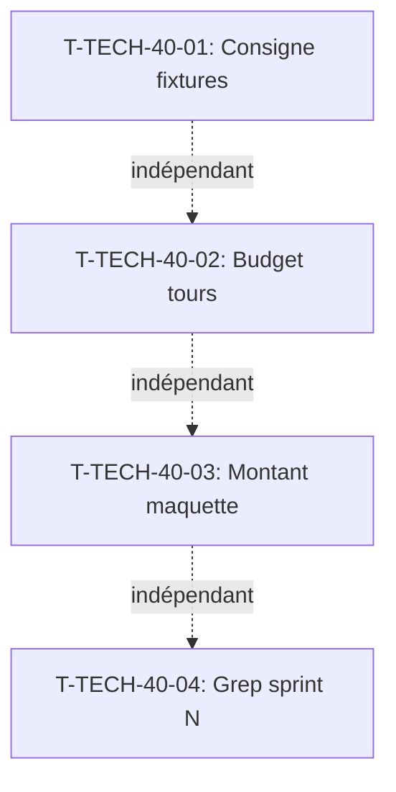

# Tâches transverses — Sprint 40

> Actions de la rétrospective du sprint 39 (T-TECH-40-01 à T-TECH-40-04).

## Vue d'ensemble

| ID | Type | Tâche | Estimation | Dépend de | Statut |
|----|------|-------|------------|-----------|--------|
| T-TECH-40-01 | [DOC] | Cohérence maquette/fixtures : consigne dans `docs/conception-graphique.md` | 0,5 h | - | 🔲 |
| T-TECH-40-02 | [DOC] | Estimer le budget de tours avant le lancement d'un fork | 0,25 h | - | 🔲 |
| T-TECH-40-03 | [FE-WEB] | Corriger le montant dans la maquette du copilote (1 017,35 € → 963,50 € HT) | 0,25 h | - | 🔲 |
| T-TECH-40-04 | [TEST] | Grep « sprint N » dans les traductions et templates publics | 0,25 h | - | 🔲 |

**Total estimé** : 1,25 h

---

## Détail

### T-TECH-40-01 : Cohérence maquette/fixtures
- **Type** : [DOC]
- **Estimation** : 0,5 h
- **Source** : Action 1 de la rétro du sprint 39

Ajouter dans `docs/conception-graphique.md` la consigne : « Avant de rédiger des chiffres dans une maquette (prix, quantités, totaux), le fork wdesign doit lire les fixtures du dépôt concerné pour vérifier la cohérence. » Ajouter aussi dans les instructions du fork wdesign.

**DoD** : Consigne écrite ; vérifiable par le prochain sprint de conception.

### T-TECH-40-02 : Budget de tours des forks
- **Type** : [DOC]
- **Estimation** : 0,25 h
- **Source** : Action 2 de la rétro du sprint 39

Avant de lancer un fork pour une story > 2 points, estimer le nombre de tours (fichiers à lire, tests à écrire, commits). Si > 150 tours estimés, découper en sous-forks ou prévoir un SendMessage de continuation. Ajouter cette consigne dans les instructions de l'orchestrateur.

**DoD** : Estimation citée dans le rapport de lancement de chaque fork au sprint 40 ; 0 fork atteignant 200 tours sans avoir terminé.

### T-TECH-40-03 : Corriger le montant dans la maquette du copilote
- **Type** : [FE-WEB]
- **Estimation** : 0,25 h
- **Source** : Action 3 de la rétro du sprint 39

Mettre à jour la maquette Copilote dans le canevas Claude Design `G2StRQigRKD6SqNRoyHpkW` : remplacer « 1 017,35 € » par « 963,50 € HT » (le total réel des fixtures du panier de Claire).

**DoD** : Maquette mise à jour ; montant cohérent avec les fixtures.

### T-TECH-40-04 : Grep « sprint N » dans les textes publics
- **Type** : [TEST]
- **Estimation** : 0,25 h
- **Source** : Action 4 de la rétro du sprint 39

Vérifier avec `grep -rn 'sprint [0-9]' translations/ templates/` qu'aucun texte visible par le public ne mentionne un numéro de sprint. Les numéros de sprint sont internes au projet.

**DoD** : 0 occurrence de « sprint N » dans les traductions et gabarits publics.

## Dépendances

Les 4 tâches sont indépendantes et peuvent être faites en parallèle.
