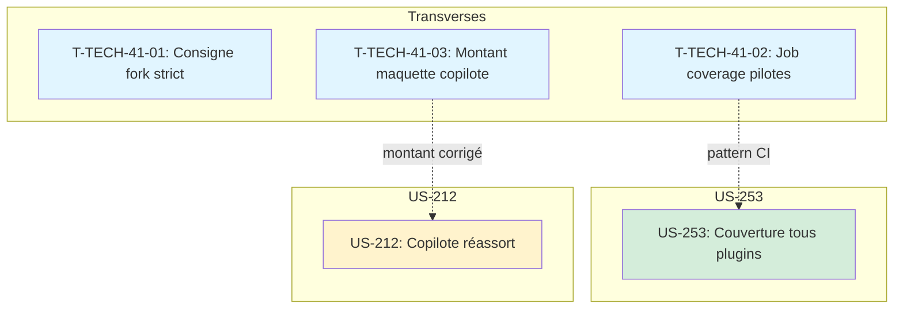

# Tâches : Sprint 041 (couverture-et-copilote)

> Sprint Planning Part 2 : décomposition faite au planning, le 2026-10-31 ; développement sur la branche `feature/sprint-41-couverture-et-copilote` (créée depuis main). Source de vérité du statut : `.bmad/sprint-status.yaml` (`sprint-41`).
>
> Liens : [objectif](../sprint-goal.md), [tableau](../task-board.md), [registre des décisions](../registre-decisions.md), [tâches transverses](./technical-tasks.md), [rétro du sprint 40](../../sprint-40-mise-en-forme-et-couverture/sprint-retro.md).

## Vue d'ensemble

| US | Titre | Points | Tâches | Heures | Statut |
|----|-------|--------|--------|--------|--------|
| [US-253](./US-253-tasks.md) | Preuve technique : couverture tous plugins | 5 | 14 | 8 h | 🔲 prête |
| [US-212](./US-212-tasks.md) | Copilote : réassort "comme le mois dernier" | 8 | 16 | 12 h | 🔲 prête |
| [Transverse](./technical-tasks.md) | Actions techniques T-TECH-41 (sans points) | 0 | 3 | 1 h | 🔲 |
| **Total** | | **13** | **33** | **21 h** | |

**Total décomposé : 13 points, 33 tâches, 21 h** (toutes les heures pour Claude).

> **Périmètre décidé par Thibaut le 2026-10-31** (voir [../registre-decisions.md](../registre-decisions.md)) : couverture de code pour tous les plugins (US-253), copilote de réassort automatique (US-212), plus les actions techniques T-TECH-41-01 à 03.

## Capacité

Méthode des sprints précédents : 2,1 h par point + 1 h de tâches transverses.

| Périmètre | Capacité | Charge de Claude | Marge |
|-----------|----------|------------------|-------|
| 13 points | 13 × 2,1 + 1 = **28,3 h** | 21 h | **+7,3 h** (+26 %) |

**Les 13 points tiennent** avec une marge confortable de 7,3 h (+26 %).

## Répartition par type

| Type | Tâches | Heures |
|------|--------|--------|
| [BE] | 5 | 5 h |
| [FE-WEB] | 1 | 0,5 h |
| [TEST] | 14 | 7,5 h |
| [DOC] | 5 | 2,5 h |
| [REV] | 2 | 1 h |
| [OPS] | 6 | 4,5 h |
| **Total** | **33** | **21 h** |

## Ordre d'exécution proposé

1. **Lot 0 (parallèle)** : wtech (T-TECH-41-01 à 03, tâches indépendantes)
2. **Lot 1 (séquentiel)** : w253 (US-253, couverture tous plugins — CI workflows par lots + proof-refresh)
3. **Lot 2 (parallèle avec lot 1)** : w212 (US-212, copilote réassort — plugin puis démo)

**Parallélisme recommandé :**
- Lot 0 (wtech) d'abord pour corriger le montant de la maquette (T-TECH-41-03, dépendance d'US-212)
- Lot 1 (US-253) et Lot 2 (US-212) parallèles (fichiers disjoints : CI workflows vs plugin copilote)

**Budget de tours estimé :**

| Worker | Story | Tours estimés | Stratégie |
|--------|-------|---------------|-----------|
| wtech | Transverses | ~40 | Un seul fork |
| w253 | US-253 (5 pts) | ~120 | Un seul fork, découper par lots de repos |
| w212 | US-212 (8 pts) | ~180 | Un seul fork, découper si > 150 |

## Workers proposés et parallélisme

| Worker | Story | Domaine de fichiers | Chevauchements |
|--------|-------|---------------------|----------------|
| wtech | T-TECH-41-01 à 03 | docs/, canevas Claude Design | aucun |
| w253 | US-253 | CI workflows (27 repos plugins), ProofCollector, page Preuve | indépendant de w212 |
| w212 | US-212 | plugin copilot (services, templates), démo (cassette, fixtures, tests) | T-TECH-41-03 (maquette) doit finir avant |

Contrainte : au plus 2 workers lancent des tests en même temps (8 Go RAM).

## Graphe des dépendances

## Notes

- T-TECH-41-02 (job coverage pilotes) déjà intégré dans US-253 (pattern CI)
- T-TECH-41-03 (correction du montant de la maquette) doit être fait AVANT US-212 (le worker lit la maquette corrigée)
- US-253 et US-212 parallèles (fichiers disjoints)
- Disque : vérifier l'espace avant de lancer des tests avec couverture (fichiers Clover XML)
- TDD : rouge prouvé pour US-253 et US-212
- Tests en local avant push (règle 46)
- Un worker par dépôt (règle 49)
- Vérifier avant de créer (règle 50)
