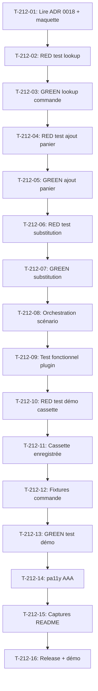

# Tâches - US-212 : Copilote d'achat — réassort "comme le mois dernier" avec substitution

## Informations US
- **Epic** : EPIC-16
- **Persona** : Claire (acheteuse)
- **Story Points** : 8
- **Sprint** : sprint-41-couverture-et-copilote

## Résumé de la US
**En tant que** Claire
**Je veux** demander au copilote de me réapprovisionner "comme le mois dernier"
**Afin de** reproduire rapidement une commande passée sans ressaisir les références et quantités

## Vue d'ensemble des tâches

| ID | Type | Tâche | Estimation | Dépend de | Statut |
|----|------|-------|------------|-----------|--------|
| T-212-01 | [DOC] | Lire ADR 0018 et la maquette Copilote (montant corrigé) | 0,25 h | - | 🔲 |
| T-212-02 | [TEST] | RED : test unitaire — lookup dernière commande | 0,5 h | T-212-01 | 🔲 |
| T-212-03 | [BE] | GREEN : service lookup dernière commande (OrderRepository) | 1 h | T-212-02 | 🔲 |
| T-212-04 | [TEST] | RED : test unitaire — ajout des items au panier | 0,5 h | T-212-03 | 🔲 |
| T-212-05 | [BE] | GREEN : service ajout des items au panier (CartManager) | 1 h | T-212-04 | 🔲 |
| T-212-06 | [TEST] | RED : test unitaire — substitution référence inactive | 0,5 h | T-212-05 | 🔲 |
| T-212-07 | [BE] | GREEN : service substitution référence inactive | 1,5 h | T-212-06 | 🔲 |
| T-212-08 | [BE] | Orchestration scénario réassort dans CopilotService | 1 h | T-212-07 | 🔲 |
| T-212-09 | [TEST] | Test fonctionnel plugin — scénario réassort complet | 1 h | T-212-08 | 🔲 |
| T-212-10 | [TEST] | RED : test démo — cassette "réassort mois dernier" | 0,5 h | T-212-09 | 🔲 |
| T-212-11 | [OPS] | Cassette enregistrée démo (réassort "comme le mois dernier") | 1 h | T-212-10 | 🔲 |
| T-212-12 | [OPS] | Fixtures démo : commande du mois dernier pour Claire | 0,5 h | T-212-11 | 🔲 |
| T-212-13 | [TEST] | GREEN : test démo avec cassette enregistrée | 0,5 h | T-212-12 | 🔲 |
| T-212-14 | [TEST] | pa11y AAA sur la page dashboard avec le copilote | 0,25 h | T-212-13 | 🔲 |
| T-212-15 | [DOC] | Captures FR/EN du scénario réassort dans le README plugin | 0,5 h | T-212-14 | 🔲 |
| T-212-16 | [REV] | Release plugin + mise à jour démo + CI verte | 0,5 h | T-212-15 | 🔲 |

**Total estimé** : 12 h

---

## Détail des tâches

### T-212-01 : Lire ADR 0018 et la maquette Copilote
- **Type** : [DOC]
- **Estimation** : 0,25 h

Lire l'ADR 0018 (décision S39 : replay with scenario buttons, per-action confirmation) et la page Copilote du canevas Claude Design `G2StRQigRKD6SqNRoyHpkW` (montant corrigé par T-TECH-41-03). Comprendre le flow du scénario de réassort.

### T-212-02 : RED — test unitaire lookup dernière commande
- **Type** : [TEST]
- **Estimation** : 0,5 h
- **Dépend de** : T-212-01

Écrire un test dans le plugin `sylius-b2b-sales-copilot-plugin` qui vérifie que `OrderRepository` peut :
- Récupérer la dernière commande d'un utilisateur
- Retourner les items (produit, variant, quantité)
- Retourner null si aucune commande

Le test doit échouer (rouge prouvé) avant l'implémentation.

### T-212-03 : GREEN — service lookup dernière commande
- **Type** : [BE]
- **Estimation** : 1 h
- **Dépend de** : T-212-02

Implémenter dans `OrderRepository` ou `OrderLookupService` la méthode `findLastOrderByCustomer(CustomerInterface $customer): ?OrderInterface`.

### T-212-04 : RED — test unitaire ajout des items au panier
- **Type** : [TEST]
- **Estimation** : 0,5 h
- **Dépend de** : T-212-03

Écrire un test qui vérifie que `CartManager` peut :
- Ajouter une liste d'items (produit, variant, quantité) au panier
- Gérer les stocks insuffisants
- Retourner un résumé (items ajoutés, items en erreur)

Le test doit échouer (rouge prouvé) avant l'implémentation.

### T-212-05 : GREEN — service ajout des items au panier
- **Type** : [BE]
- **Estimation** : 1 h
- **Dépend de** : T-212-04

Implémenter dans `CartManager` ou `ReorderService` la méthode `addItemsToCart(OrderInterface $cart, array $items): array`.

### T-212-06 : RED — test unitaire substitution référence inactive
- **Type** : [TEST]
- **Estimation** : 0,5 h
- **Dépend de** : T-212-05

Écrire un test qui vérifie que `ProductSubstitutionService` peut :
- Détecter qu'une référence est inactive
- Trouver une référence de substitution (même catégorie, même fournisseur si possible)
- Proposer la substitution à l'utilisateur
- Retourner null si aucune substitution

Le test doit échouer (rouge prouvé) avant l'implémentation.

### T-212-07 : GREEN — service substitution référence inactive
- **Type** : [BE]
- **Estimation** : 1,5 h
- **Dépend de** : T-212-06

Implémenter `ProductSubstitutionService` avec :
- Méthode `findSubstitution(ProductVariantInterface $inactiveVariant): ?ProductVariantInterface`
- Logique de recherche : même catégorie principale, même fournisseur si attribut présent
- Retour null si aucune substitution trouvée

### T-212-08 : Orchestration scénario réassort
- **Type** : [BE]
- **Estimation** : 1 h
- **Dépend de** : T-212-07

Implémenter dans `CopilotService` ou `ReorderScenarioHandler` le scénario complet :
1. L'utilisateur dit "recommande comme le mois dernier"
2. Lookup de la dernière commande
3. Pour chaque item : vérifier si actif, sinon chercher substitution
4. Ajouter au panier avec confirmation par action (ADR 0018)
5. Retourner un résumé (items ajoutés, items substitués, items ignorés)

### T-212-09 : Test fonctionnel plugin — scénario complet
- **Type** : [TEST]
- **Estimation** : 1 h
- **Dépend de** : T-212-08

Test fonctionnel dans le plugin vérifiant le scénario complet :
- Utilisateur avec une commande du mois dernier
- Demande "comme le mois dernier"
- Items ajoutés au panier
- Substitution si référence inactive
- Résumé correct retourné

### T-212-10 : RED — test démo cassette réassort
- **Type** : [TEST]
- **Estimation** : 0,5 h
- **Dépend de** : T-212-09

Écrire un test dans la démo qui vérifie que le scénario réassort fonctionne avec une cassette enregistrée. Le test doit échouer (rouge prouvé) avant l'enregistrement de la cassette.

### T-212-11 : Cassette enregistrée démo
- **Type** : [OPS]
- **Estimation** : 1 h
- **Dépend de** : T-212-10

Enregistrer une cassette VCR pour le scénario "réassort mois dernier" dans la démo :
- Requête : "recommande comme le mois dernier"
- Réponse : résumé des items ajoutés, substitutions
- Fichier cassette dans `tests/fixtures/vcr/`

### T-212-12 : Fixtures démo — commande mois dernier
- **Type** : [OPS]
- **Estimation** : 0,5 h
- **Dépend de** : T-212-11

Ajouter dans les fixtures de la démo une commande du mois dernier pour Claire avec :
- 5-7 items variés
- Au moins 1 item avec référence qui sera marquée inactive (pour tester la substitution)
- Date : 30 jours avant la date de seed

### T-212-13 : GREEN — test démo avec cassette
- **Type** : [TEST]
- **Estimation** : 0,5 h
- **Dépend de** : T-212-12

Vérifier que le test démo passe avec la cassette enregistrée et les fixtures.

### T-212-14 : pa11y AAA sur le dashboard avec copilote
- **Type** : [TEST]
- **Estimation** : 0,25 h
- **Dépend de** : T-212-13

Audit pa11y AAA sur la page dashboard avec le copilote (réassort) en 360 px et 1280 px. 0 erreur attendu.

### T-212-15 : Captures FR/EN du scénario réassort
- **Type** : [DOC]
- **Estimation** : 0,5 h
- **Dépend de** : T-212-14

Capturer le scénario réassort (FR et EN) pour le README du plugin copilote dans `docs/screenshots/`.

### T-212-16 : Release plugin + mise à jour démo
- **Type** : [REV]
- **Estimation** : 0,5 h
- **Dépend de** : T-212-15

PR plugin, CI verte, release sur GO de Thibaut. Bump composer dans la démo. CI de la démo verte.

## Dépendances

