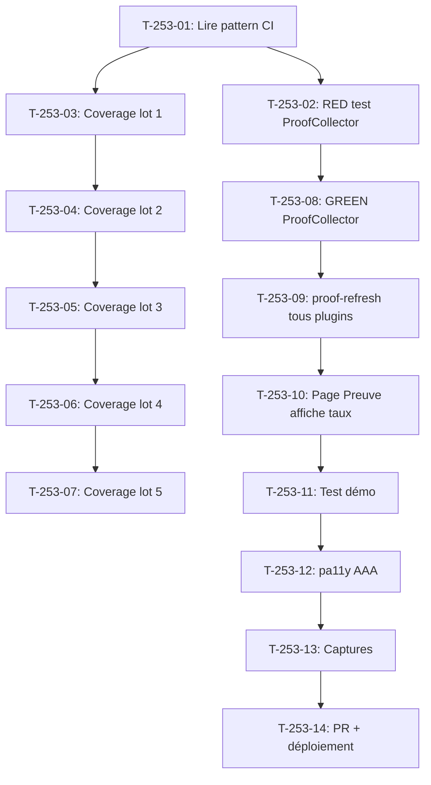

# Tâches - US-253 : Preuve technique — couverture de code publiée pour tous les plugins

## Informations US
- **Epic** : EPIC-17
- **Persona** : Thibaut (démonstrateur), recruteurs
- **Story Points** : 5
- **Sprint** : sprint-41-couverture-et-copilote

## Résumé de la US
**En tant que** Thibaut
**Je veux** afficher la couverture de code PHPUnit de tous mes plugins sur la page Preuve technique
**Afin de** prouver que chaque plugin est testé et maintenu selon des standards de qualité

## Vue d'ensemble des tâches

| ID | Type | Tâche | Estimation | Dépend de | Statut |
|----|------|-------|------------|-----------|--------|
| T-253-01 | [DOC] | Lire le pattern CI coverage du pilote (démo) | 0,25 h | - | 🔲 |
| T-253-02 | [TEST] | RED : test unitaire ProofCollector — lecture check run coverage | 0,5 h | T-253-01 | 🔲 |
| T-253-03 | [OPS] | Job coverage CI dans les plugins lot 1 (5 repos) | 1 h | T-253-01 | 🔲 |
| T-253-04 | [OPS] | Job coverage CI dans les plugins lot 2 (5 repos) | 1 h | T-253-03 | 🔲 |
| T-253-05 | [OPS] | Job coverage CI dans les plugins lot 3 (5 repos) | 1 h | T-253-04 | 🔲 |
| T-253-06 | [OPS] | Job coverage CI dans les plugins lot 4 (6 repos) | 1 h | T-253-05 | 🔲 |
| T-253-07 | [OPS] | Job coverage CI dans les plugins lot 5 (6 repos) | 1 h | T-253-06 | 🔲 |
| T-253-08 | [BE] | GREEN : ProofCollector lit les check runs coverage | 1 h | T-253-02 | 🔲 |
| T-253-09 | [BE] | Commande bin/proof-refresh exécutée pour tous les plugins | 0,5 h | T-253-08 | 🔲 |
| T-253-10 | [FE-WEB] | Page Preuve affiche les taux de couverture par plugin | 0,5 h | T-253-09 | 🔲 |
| T-253-11 | [TEST] | Test démo : page Preuve affiche les taux de couverture | 0,5 h | T-253-10 | 🔲 |
| T-253-12 | [TEST] | pa11y AAA sur la page Preuve avec les taux | 0,25 h | T-253-11 | 🔲 |
| T-253-13 | [DOC] | Capture FR/EN de la page Preuve avec les taux de couverture | 0,25 h | T-253-12 | 🔲 |
| T-253-14 | [REV] | PR démo, CI verte, déploiement Railway | 0,5 h | T-253-13 | 🔲 |

**Total estimé** : 8 h

---

## Détail des tâches

### T-253-01 : Lire le pattern CI coverage du pilote
- **Type** : [DOC]
- **Estimation** : 0,25 h

Lire le fichier `.github/workflows/ci.yaml` de la démo et des 3 plugins pilotes (copilot, passport, parc) pour comprendre le pattern du job coverage :
- PHPUnit avec extension PCOV
- Génération du fichier Clover XML
- Publication du check run « coverage » avec env vars COV_RATE/COV_COVERED/COV_TOTAL
- Utilisation de `process.env` dans le script GitHub Actions

### T-253-02 : RED — test unitaire ProofCollector
- **Type** : [TEST]
- **Estimation** : 0,5 h
- **Dépend de** : T-253-01

Écrire un test dans la démo qui vérifie que `ProofCollector` peut :
- Lire le check run « coverage » d'un plugin via l'API REST publique GitHub
- Extraire les valeurs COV_RATE, COV_COVERED, COV_TOTAL
- Écrire ces valeurs dans `proof.json`

Le test doit échouer (rouge prouvé) avant l'implémentation.

### T-253-03 : Job coverage CI dans les plugins lot 1
- **Type** : [OPS]
- **Estimation** : 1 h
- **Dépend de** : T-253-01

Ajouter le job coverage dans les workflows CI de 5 plugins :
1. `sylius-b2b-access-mode-plugin`
2. `sylius-b2b-bulk-order-plugin`
3. `sylius-b2b-company-accounts-plugin`
4. `sylius-b2b-container-fill-plugin`
5. `sylius-b2b-customer-asset-management-plugin`

Pattern : copier le step « Publish coverage check run » du ci.yaml de la démo.

### T-253-04 : Job coverage CI dans les plugins lot 2
- **Type** : [OPS]
- **Estimation** : 1 h
- **Dépend de** : T-253-03

Ajouter le job coverage dans les workflows CI de 5 plugins :
6. `sylius-b2b-invoice-plugin`
7. `sylius-b2b-managed-registration-plugin`
8. `sylius-b2b-purchase-order-plugin`
9. `sylius-b2b-purchase-passports-plugin`
10. `sylius-b2b-quick-order-plugin`

### T-253-05 : Job coverage CI dans les plugins lot 3
- **Type** : [OPS]
- **Estimation** : 1 h
- **Dépend de** : T-253-04

Ajouter le job coverage dans les workflows CI de 5 plugins :
11. `sylius-b2b-sales-copilot-plugin`
12. `sylius-b2b-shared-shopping-lists-plugin`
13. `sylius-b2b-value-insights-plugin`
14. `sylius-bundles-combined-feeds-plugin`
15. `sylius-categorised-product-feeds-plugin`

### T-253-06 : Job coverage CI dans les plugins lot 4
- **Type** : [OPS]
- **Estimation** : 1 h
- **Dépend de** : T-253-05

Ajouter le job coverage dans les workflows CI de 6 plugins :
16. `sylius-company-equipment-park-plugin`
17. `sylius-contact-form-plugin`
18. `sylius-custom-attribute-value-plugin`
19. `sylius-deferred-resource-loads-plugin`
20. `sylius-employee-badge-plugin`
21. `sylius-human-date-filter-plugin`

### T-253-07 : Job coverage CI dans les plugins lot 5
- **Type** : [OPS]
- **Estimation** : 1 h
- **Dépend de** : T-253-06

Ajouter le job coverage dans les workflows CI de 6 plugins :
22. `sylius-predictive-commerce-plugin`
23. `sylius-product-csv-import-plugin`
24. `sylius-product-packs-plugin`
25. `sylius-punchout-cxml-plugin`
26. `sylius-relatable-entities-plugin`
27. `sylius-routing-context-plugin`

### T-253-08 : GREEN — ProofCollector lit les check runs
- **Type** : [BE]
- **Estimation** : 1 h
- **Dépend de** : T-253-02

Implémenter dans `ProofCollector` la lecture des check runs « coverage » via l'API REST publique GitHub :
- Pour chaque plugin, récupérer le dernier check run « coverage » de la branche `main`
- Extraire COV_RATE, COV_COVERED, COV_TOTAL
- Écrire ces valeurs dans `proof.json` sous la clé `coverage` de chaque plugin

### T-253-09 : Exécuter bin/proof-refresh pour tous les plugins
- **Type** : [BE]
- **Estimation** : 0,5 h
- **Dépend de** : T-253-08

Exécuter `bin/proof-refresh` dans la démo pour récupérer les taux de couverture de tous les plugins et les écrire dans `proof.json`.

### T-253-10 : Page Preuve affiche les taux de couverture
- **Type** : [FE-WEB]
- **Estimation** : 0,5 h
- **Dépend de** : T-253-09

Modifier la page Preuve technique pour afficher les taux de couverture de chaque plugin :
- Tableau avec colonnes : Plugin, Couverture (%), Lignes couvertes, Lignes totales
- Badge de couleur selon le taux (< 50% rouge, 50-80% orange, > 80% vert)
- Tri par taux décroissant
- Lien vers le dépôt GitHub de chaque plugin

### T-253-11 : Test démo — page Preuve affiche les taux
- **Type** : [TEST]
- **Estimation** : 0,5 h
- **Dépend de** : T-253-10

Test fonctionnel dans la démo vérifiant que la page Preuve affiche les taux de couverture de tous les plugins en FR et EN (gabarit §4 de `docs/gabarits-tests.md`).

### T-253-12 : pa11y AAA sur la page Preuve
- **Type** : [TEST]
- **Estimation** : 0,25 h
- **Dépend de** : T-253-11

Audit pa11y AAA sur la page Preuve avec les taux de couverture en 360 px et 1280 px. 0 erreur attendu.

### T-253-13 : Captures FR/EN de la page Preuve
- **Type** : [DOC]
- **Estimation** : 0,25 h
- **Dépend de** : T-253-12

Capturer la page Preuve avec les taux de couverture (FR et EN) pour `docs/screenshots/`.

### T-253-14 : PR démo, CI verte, déploiement
- **Type** : [REV]
- **Estimation** : 0,5 h
- **Dépend de** : T-253-13

PR démo, CI verte, déploiement Railway. Vérifier que la page Preuve affiche bien les taux de couverture en production.

## Dépendances

